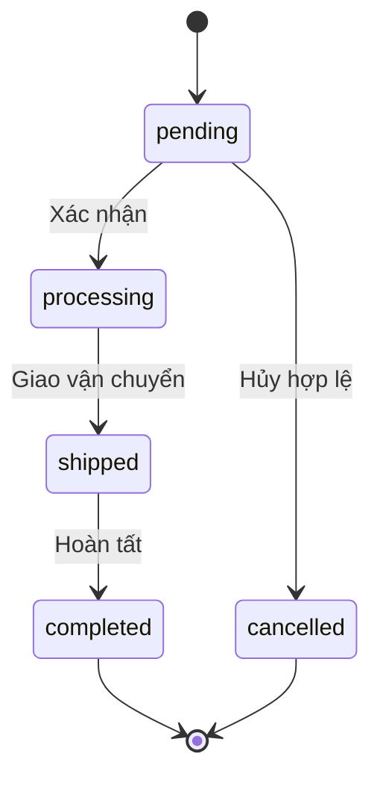

# SRS — ĐẶC TẢ YÊU CẦU PHẦN MỀM

## WEBSITE BÁN HÀNG VINMARK

| Thông tin | Nội dung |
| --- | --- |
| Trường | Trường Đại học Công nghệ Thông tin — ĐHQG TP. Hồ Chí Minh |
| Môn học / Lớp | IS207 — Phát triển ứng dụng Web / IS207.Q12 |
| Học kỳ / Năm học | Học kỳ 1 / 2025–2026 |
| Giảng viên hướng dẫn | ThS. Mai Xuân Hùng — hungmx@uit.edu.vn |
| Nhóm thực hiện | Trần Minh Triết (23521653), Phạm Đức Trung (23521685), Phan Đức Trí (23521646), Đỗ Xuân Tú (23521698) |
| Phiên bản | 1.0 — Bản dự thảo để nhóm rà soát |
| Ngày biên soạn | 17/11/2026 |
| Tài liệu đầu vào | [BRD](BRD.md), source code và thông tin đồ án do nhóm cung cấp |

### Lịch sử tài liệu

| Phiên bản | Nội dung |
| --- | --- |
| 1.0 | Đặc tả hành vi mục tiêu, đối chiếu mã nguồn và xác định các điểm cần hoàn thiện trước nghiệm thu. |

## Mục lục

1. [Giới thiệu và quy ước](#1-giới-thiệu-và-quy-ước)
2. [Mô tả tổng thể](#2-mô-tả-tổng-thể)
3. [Tác nhân và phân quyền](#3-tác-nhân-và-phân-quyền)
4. [Yêu cầu chức năng](#4-yêu-cầu-chức-năng)
5. [Đặc tả các luồng chính](#5-đặc-tả-các-luồng-chính)
6. [Dữ liệu và quy tắc toàn vẹn](#6-dữ-liệu-và-quy-tắc-toàn-vẹn)
7. [Giao diện và tích hợp](#7-giao-diện-và-tích-hợp)
8. [Yêu cầu phi chức năng](#8-yêu-cầu-phi-chức-năng)
9. [Tiêu chí kiểm thử và nghiệm thu](#9-tiêu-chí-kiểm-thử-và-nghiệm-thu)
10. [Ma trận truy vết](#10-ma-trận-truy-vết)
11. [Chênh lệch giữa yêu cầu và source code](#11-chênh-lệch-giữa-yêu-cầu-và-source-code)
12. [Tài liệu tham chiếu và quản lý thay đổi](#12-tài-liệu-tham-chiếu-và-quản-lý-thay-đổi)

## 1. Giới thiệu và quy ước

### 1.1. Mục đích

SRS mô tả các hành vi phần mềm Vinmark cần đáp ứng, dữ liệu đầu vào/đầu ra, điều kiện nghiệp vụ, phân quyền và tiêu chí kiểm thử. Đối tượng sử dụng tài liệu gồm nhóm phát triển, người kiểm thử, người vận hành và giảng viên đánh giá đồ án.

Tài liệu được xây dựng từ việc đọc source code, không phải chứng nhận tất cả chức năng đang chạy đúng. Các yêu cầu mô tả **hành vi cần đạt**; cột hiện trạng và phần 11 mô tả mức độ thể hiện trong mã nguồn. Phiên biên soạn này không thực hiện kiểm thử tích hợp thanh toán/email/AI hoặc đo tải hệ thống.

### 1.2. Thuật ngữ và mức ưu tiên

| Thuật ngữ | Ý nghĩa |
| --- | --- |
| BR | Yêu cầu nghiệp vụ trong BRD. |
| FR | Yêu cầu chức năng có mã định danh để truy vết và kiểm thử. |
| NFR | Yêu cầu phi chức năng. |
| UC / AT | Luồng sử dụng / Kịch bản kiểm thử chấp nhận. |
| GAP | Khác biệt quan sát được giữa mã nguồn và yêu cầu mục tiêu. |
| COD / `cash` | Thanh toán tiền mặt khi nhận hàng. Tạo đơn không đồng nghĩa đã thu tiền. |
| IPN / Callback | Thông báo kết quả thanh toán từ dịch vụ ngoài về hệ thống. |
| Idempotency | Xử lý yêu cầu lặp mà không tạo thêm tác động nghiệp vụ ngoài lần hợp lệ đầu tiên. |
| P0 / P1 | Cốt lõi / Mở rộng hoặc cần tích hợp; mức ưu tiên đề xuất theo BRD. |
| Có mã | Có nhánh triển khai chính; chưa hàm ý đã kiểm thử hoặc đáp ứng mọi tiêu chí. |
| Một phần | Có mã nhưng thiếu kiểm soát/hành vi cần thiết đã quan sát được. |
| Đề xuất | Chưa thấy luồng đầy đủ trong mã nguồn; cần triển khai nếu đưa vào phạm vi nghiệm thu. |

Các yêu cầu ghi **đề xuất** và các chính sách BRD-TBD cần nhóm thống nhất trước khi đóng phiên bản yêu cầu. Mã FR không thay đổi khi sửa nội dung; thay đổi phải được ghi vào lịch sử phiên bản.

## 2. Mô tả tổng thể

### 2.1. Kiến trúc và môi trường

Vinmark là ứng dụng web theo mô hình MVC: route và middleware tiếp nhận yêu cầu; controller xử lý nghiệp vụ; Eloquent tương tác cơ sở dữ liệu; Blade dựng giao diện; jQuery/AJAX cập nhật một số thành phần mà không tải lại toàn trang.

- Backend: PHP theo ràng buộc `^8.2`, Laravel `^12.0` trong `composer.json`; phiên bản cụ thể phải tương thích `composer.lock`.
- Cơ sở dữ liệu: MySQL; dashboard hiện dùng các hàm SQL như `MONTH`, `DATE_FORMAT`.
- Giao diện: Blade, Bootstrap, jQuery và tài nguyên tĩnh trong `public/assets`.
- Có cấu hình Vite; các layout chính hiện tải CSS/JS trực tiếp từ thư mục tài nguyên công khai.
- Phiên đăng nhập: hai guard `web` và `admin`, cùng sử dụng bảng người dùng.
- Ảnh tải lên: Laravel public storage, phục vụ qua `public/storage`.
- Dịch vụ ngoài: email, PayPal, MoMo, Gemini. Không yêu cầu dịch vụ ngoài để xem danh sách sản phẩm hoặc sử dụng giỏ hàng.

### 2.2. Giới hạn phạm vi

Hệ thống phục vụ một cửa hàng, giao diện tiếng Việt, giá cơ sở bằng VNĐ. Không có quy trình nhà bán hàng độc lập, hãng vận chuyển tự động, nhập kho nhiều kho, khuyến mại hay hoàn tiền tự động trong phạm vi source hiện tại. Chi tiết phạm vi và quyết định chưa chốt nằm ở BRD phần 4 và phần 11.

## 3. Tác nhân và phân quyền

| Chức năng | Khách vãng lai | Khách hàng | Nhân viên | Quản trị viên |
| --- | :---: | :---: | :---: | :---: |
| Xem nội dung, tìm/lọc/xem sản phẩm | Có | Có | Công khai | Công khai |
| Giỏ hàng tạm, gửi liên hệ, chatbot | Có | Có | Công khai | Công khai |
| Đăng ký, kích hoạt, khôi phục mật khẩu | Có | Theo luồng tài khoản | Không có luồng khôi phục riêng cho quản trị | Không có luồng khôi phục riêng cho quản trị |
| Hồ sơ, địa chỉ, yêu thích, đặt/tra cứu đơn | Không | Dữ liệu của mình | Không qua guard khách hàng | Không qua guard khách hàng |
| Gửi đánh giá | Không | Khi đủ điều kiện mua hàng | Không | Không |
| Đăng nhập quản trị, dashboard, hồ sơ quản trị | Không | Không | Có | Có |
| Quản lý sản phẩm — `manage_products` | Không | Không | Có | Có |
| Quản lý liên hệ — `manage_contacts` | Không | Không | Có | Có |
| Quản lý danh mục — `manage_categories` | Không | Không | Không | Có |
| Quản lý đơn — `manage_orders` | Không | Không | Không | Có |
| Quản lý người dùng — `manage_users` | Không | Không | Không | Có |
| Trang thông báo quản trị | Không | Không | Có, cần chốt phạm vi dữ liệu | Có, cần chốt phạm vi dữ liệu |

Ma trận quyền nghiệp vụ lấy từ seed hiện tại. Dashboard/hồ sơ/thông báo nằm trong nhóm route đăng nhập quản trị, không có permission riêng. Không có màn hình cấu hình vai trò/quyền tùy ý; việc nâng khách hàng thành nhân viên là chức năng riêng. Các thao tác công khai được mô tả theo khả năng truy cập route, không có nghĩa tài khoản quản trị sử dụng được các luồng mua hàng yêu cầu guard `web`.

## 4. Yêu cầu chức năng

Tiêu chí ở mỗi FR là điều kiện kiểm thử cần đạt. Nơi có khác biệt triển khai, tham chiếu GAP để không hiểu tiêu chí mục tiêu là hiện trạng đã hoàn tất.

### 4.1. Tài khoản và địa chỉ — BR-01

| Mã / Ưu tiên | Yêu cầu và tiêu chí chấp nhận | Hiện trạng / Căn cứ |
| --- | --- | --- |
| FR-01 / P0 | Cho phép đăng ký bằng họ tên, email, mật khẩu. Tên/email tối đa 255 ký tự; email đúng định dạng và duy nhất; mật khẩu tối thiểu 6 ký tự. Dữ liệu hợp lệ tạo đúng một khách hàng `pending`, lưu mật khẩu băm và gửi hướng dẫn kích hoạt; dữ liệu sai không tạo tài khoản. | Có mã: `Clients/AuthController::register`. Xử lý lỗi gửi mail cần kiểm thử riêng. |
| FR-02 / P0 | Đường dẫn kích hoạt có token hợp lệ chuyển tài khoản sang `active` và vô hiệu hóa token đã dùng. Token không tồn tại/đã dùng bị từ chối. Thời hạn token kích hoạt cần chốt ở BRD-TBD-06, không mặc định áp dụng thời hạn reset mật khẩu cho kích hoạt. | Có mã: `activateAccount`; chưa có trường hết hạn token kích hoạt. |
| FR-03 / P0 | Khách hàng đăng nhập bằng email/mật khẩu đúng và trạng thái `active`; vai trò khác bị từ chối ở khu vực khách. Đăng nhập thành công tái tạo session; đăng xuất hủy session và token CSRF của phiên. | Có mã: `AuthController::login/logout`. |
| FR-04 / P0 | Cho phép yêu cầu email đặt lại mật khẩu và đổi bằng token đúng, còn hạn. Mật khẩu mới tối thiểu 6 ký tự, xác nhận khớp; token dùng rồi/hết hạn không đặt lại được. Theo cấu hình hiện tại: hạn 60 phút, khoảng cách gửi lại 60 giây; cần kiểm thử với mail thử nghiệm. | Có mã: `ForgotPasswordController`, `ResetPasswordController`, `config/auth.php`. |
| FR-05 / P0 | Khách xem/cập nhật họ tên, số điện thoại, địa chỉ hồ sơ, ảnh đại diện của mình; đổi mật khẩu khi biết mật khẩu hiện tại và xác nhận khớp. Ảnh hợp lệ tối đa 2 MB. Sai mật khẩu hiện tại không cập nhật mật khẩu. | Có mã: `Clients/AccountController`. Địa chỉ hồ sơ khác danh sách địa chỉ giao hàng FR-06. |
| FR-06 / P0 | Khách thêm, xóa địa chỉ của mình và đặt một địa chỉ mặc định. Tên người nhận 3–100 ký tự; điện thoại 10 chữ số; địa chỉ 5–255 ký tự; thành phố 2–100 ký tự. Không thao tác địa chỉ người khác. Địa chỉ đã gắn đơn phải được bảo toàn hoặc chặn xóa; tối đa một mặc định mỗi người. | Một phần: `AccountController`; GAP-02, GAP-09. Chưa có luồng sửa đầy đủ nội dung địa chỉ, chỉ đổi địa chỉ mặc định. |

### 4.2. Tra cứu sản phẩm — BR-02

| Mã / Ưu tiên | Yêu cầu và tiêu chí chấp nhận | Hiện trạng / Căn cứ |
| --- | --- | --- |
| FR-07 / P0 | Hiển thị trang chủ và danh sách sản phẩm với ảnh, tên, giá, đơn vị và danh mục. Danh sách `/products` chỉ gồm sản phẩm có trạng thái cho phép bán, phân trang 9 sản phẩm/trang. Không có dữ liệu thì hiển thị trạng thái rỗng. | Có mã: `HomeController`, `Clients/ProductController::index`; cần thống nhất tình trạng bán giữa các màn hình ở GAP-12. |
| FR-08 / P0 | Tìm theo tên/mô tả bằng từ khóa không rỗng, phân trang 12 kết quả/trang; lọc theo danh mục, khoảng giá và sắp xếp giá tăng/giảm hoặc mới nhất, phân trang 9 kết quả/trang. Tham số lọc phải giữ khi chuyển trang và thống nhất chính sách hiển thị hàng ngừng bán. | Một phần: `SearchController`, `ProductController::filter`; GAP-12. |
| FR-09 / P0 | Chi tiết theo slug hiển thị thông tin, ảnh, tồn kho, đánh giá trung bình và tối đa 6 sản phẩm cùng danh mục khác sản phẩm hiện tại. Slug không tồn tại trả lỗi không tìm thấy. Nút mua phải phản ánh khả năng mua thực tế. | Có mã: `ProductController::detail`; đường dẫn ảnh và trạng thái cần kiểm tra theo GAP-10, GAP-12. |

### 4.3. Giỏ hàng và yêu thích — BR-03

| Mã / Ưu tiên | Yêu cầu và tiêu chí chấp nhận | Hiện trạng / Căn cứ |
| --- | --- | --- |
| FR-10 / P0 | Thêm, sửa số lượng, xóa hàng và xem giỏ/mini-cart cho khách vãng lai và khách đăng nhập. Số lượng là số nguyên từ 1 đến tồn kho; thêm lại cộng số lượng; dữ liệu vượt tồn bị từ chối trước khi ghi. Khách dùng session, người đăng nhập dùng dữ liệu theo tài khoản. | Một phần: `CartController`; cập nhật hiện ghi trước kiểm tra tồn, GAP-03. |
| FR-11 / P0 | Khi đăng nhập khách hàng thành công, hợp nhất giỏ session vào giỏ tài khoản theo sản phẩm. Chỉ xóa giỏ tạm sau khi hợp nhất thành công; phát hiện tổng lượng vượt tồn và thông báo để khách điều chỉnh; đăng nhập quản trị không được làm chuyển giỏ khách sang tài khoản quản trị. | Một phần: `MergeCartAfterLogin`; thiếu kiểm tra tồn/guard, GAP-03. |
| FR-12 / P0 | Khách đã đăng nhập thêm/xem/xóa sản phẩm yêu thích của mình. Kiểm tra sản phẩm tồn tại; thêm lại không tạo nhiều bản ghi cùng cặp khách–sản phẩm. | Một phần: `WishListController`; thiếu kiểm tra hợp lệ/trùng, GAP-13. |

### 4.4. Đặt hàng và thanh toán — BR-04, BR-05

| Mã / Ưu tiên | Yêu cầu và tiêu chí chấp nhận | Hiện trạng / Căn cứ |
| --- | --- | --- |
| FR-13 / P0 | Chỉ khách đã đăng nhập, có giỏ hợp lệ và địa chỉ giao hàng thuộc mình được chốt đơn. Trang checkout hiện yêu cầu địa chỉ mặc định. Máy chủ tính tổng từ giá hiện hành và số lượng; đề xuất phí giao hàng 25.000 VNĐ/đơn theo BRD-TBD-01. Tổng hiển thị, tổng đơn và tiền thanh toán phải khớp. | Một phần: `CheckoutController::index/getAddress`; kiểm tra ở thao tác đặt và công thức tiền chưa đầy đủ, GAP-01, GAP-02. |
| FR-14 / P0 | Đặt COD tạo đơn `pending`, các dòng hàng có giá tại thời điểm đặt và thanh toán `cash/pending`. Kiểm tra lại tồn kho, trừ kho và xóa giỏ trong cùng giao dịch; lỗi bất kỳ phải rollback toàn bộ. Yêu cầu lặp không tạo thêm đơn ngoài ý muốn. | Một phần: `placeOrder`; đã có transaction và kiểm tra tồn, chưa có cơ chế chống lặp/khóa đồng thời, GAP-01, GAP-03. |
| FR-15 / P1 | PayPal chỉ được ghi nhận `completed` khi máy chủ xác minh giao dịch hợp lệ, người nhận, số tiền và mã tham chiếu đúng đơn. Số tiền và tỷ giá phải theo chính sách thống nhất, không tin số tiền trình duyệt. Lặp mã giao dịch không tạo đơn hoặc trừ kho thêm; lỗi xác minh không được ghi thanh toán thành công. | Một phần: `placeOrderPaypal` và JS checkout; hiện tin dữ liệu request, GAP-05. |
| FR-16 / P1 | MoMo tạo yêu cầu thanh toán với số tiền máy chủ tính; thông báo kết quả phải được kiểm tra chữ ký, mã tham chiếu, số tiền và chống xử lý lặp. Chỉ sau xác nhận hợp lệ mới chốt kết quả; tạo đơn/dòng hàng/thanh toán/trừ tồn phải nhất quán. Trang return hiển thị trạng thái, không tự coi tham số `resultCode` là bằng chứng thanh toán. | Một phần: `placeOrderMoMo/momoReturn/momoNotify`; GAP-06. |

### 4.5. Đơn hàng và đánh giá — BR-06, BR-07

| Mã / Ưu tiên | Yêu cầu và tiêu chí chấp nhận | Hiện trạng / Căn cứ |
| --- | --- | --- |
| FR-17 / P0 | Khách xem lịch sử mới nhất trước và chi tiết đơn của mình, gồm dòng hàng, tiền, địa chỉ, phương thức/trạng thái thanh toán và trạng thái đơn. Thay ID sang đơn người khác không trả dữ liệu; ID không tồn tại được báo phù hợp. | Một phần: `AccountController::index`, `Clients/OrderController::showOrder`; thiếu lọc sở hữu ở chi tiết, GAP-02. |
| FR-18 / P0 | Khách hủy đơn của mình khi còn `pending`; trạng thái chuẩn mục tiêu là `cancelled`. Hoàn kho một lần và ghi lịch sử; hủy lại, hủy đơn người khác hoặc đơn không đủ điều kiện phải bị từ chối mà không đổi dữ liệu. Đơn đã trả online không được tự ghi là đã hoàn tiền. | Một phần: `Clients/OrderController::cancelOrder`; GAP-04, GAP-07. |
| FR-19 / P1 | Chỉ khách đã mua sản phẩm trong đơn `completed` và chưa đánh giá mới được gửi đánh giá. Điểm nguyên 1–5, bình luận tùy chọn tối đa 1.000 ký tự; phải kiểm tra điều kiện tại máy chủ, không chỉ ẩn form. | Một phần: `ReviewController`, `ProductController::detail`, view chi tiết; GAP-08. |

### 4.6. Liên hệ và chatbot — BR-08

| Mã / Ưu tiên | Yêu cầu và tiêu chí chấp nhận | Hiện trạng / Căn cứ |
| --- | --- | --- |
| FR-20 / P0 | Khách gửi liên hệ với tên, email, điện thoại và nội dung không rỗng. Tên/email tối đa 255 ký tự, email hợp lệ, điện thoại 10–15 chữ số. Người có `manage_contacts` xem mới nhất trước và gửi phản hồi đến email thuộc liên hệ; gửi lỗi giữ trạng thái chưa trả lời. | Một phần: hai `ContactController`; cần kiểm tra nội dung, thống nhất trường trạng thái và người nhận, GAP-11. |
| FR-21 / P1 | Khách và người đăng nhập gửi tin nhắn tối đa 2.000 ký tự, xem lịch sử của mình. Bot trả lời tiếng Việt, dùng danh sách tên/giá/đơn vị sản phẩm còn tồn; gửi tối đa 10 bản ghi gần nhất làm ngữ cảnh theo code hiện tại. Thiếu key/lỗi dịch vụ phải thông báo phù hợp. Đăng nhập khách hợp nhất lịch sử khách vãng lai theo token, không trộn lịch sử người khác. | Có mã: `ChatController`, `MergeGuestChatAfterLogin`; cần kiểm thử guard, cookie, cô lập dữ liệu và dịch vụ ngoài; GAP-15. |

### 4.7. Khu vực quản trị — BR-09, BR-10, BR-11, BR-12

| Mã / Ưu tiên | Yêu cầu và tiêu chí chấp nhận | Hiện trạng / Căn cứ |
| --- | --- | --- |
| FR-22 / P0 | Chỉ admin/staff hoạt động được đăng nhập bằng guard quản trị. Sai mật khẩu, sai vai trò hoặc bị khóa đều bị từ chối. Tái tạo session sau đăng nhập và hủy sau đăng xuất. | Một phần: `AdminAuthController`; chưa kiểm tra trạng thái hoạt động, GAP-14. |
| FR-23 / P0 | Kiểm tra permission tại máy chủ cho năm nhóm nghiệp vụ theo phần 3. Truy cập khi chưa đăng nhập được chuyển tới đăng nhập; đã đăng nhập nhưng thiếu quyền trả 403. Không cho thao tác trái quyền bằng cách gọi thẳng endpoint. | Có mã: `CheckPermission`, `RedirectIfNotAuthenticated`, `routes/admin.php`; cần kiểm thử ma trận. |
| FR-24 / P0 | Người có `manage_categories` xem/thêm/sửa/xóa danh mục. Tên/slug duy nhất; ảnh tối đa 2 MB, định dạng hợp lệ. Dữ liệu trùng phải báo lỗi rõ; không xóa dây chuyền lịch sử mua hàng. | Một phần: `Admin/CategoryController`, migration; GAP-09. |
| FR-25 / P0 | Người có `manage_products` quản lý tên, danh mục, mô tả, giá, tồn, đơn vị, trạng thái và nhiều ảnh. Giá không âm, tồn nguyên không âm; danh mục tồn tại; slug duy nhất; ảnh hợp lệ tối đa 2 MB/ảnh. Xóa/ngừng bán không phá lịch sử đơn đã phát sinh. | Một phần: `Admin/ProductController`; thêm/sửa chưa thống nhất validation, ảnh và trạng thái; GAP-09, GAP-10, GAP-12. |
| FR-26 / P0 | Người có `manage_orders` xem danh sách/chi tiết, xác nhận `pending → processing` và hủy đơn đủ điều kiện. Phải kiểm tra trạng thái nguồn; hủy/nhấn xác nhận lặp không gây tác động lặp; hủy hoàn kho trong cùng giao dịch. | Một phần: `Admin/OrderController`; GAP-04, GAP-07. |
| FR-27 / P1 | Bổ sung cập nhật `processing → shipped → completed` cho người có `manage_orders`, ghi lịch sử mỗi chuyển trạng thái gồm trạng thái mới, thời điểm, ghi chú và người thực hiện. Không bỏ qua bước hoặc sửa đơn đã kết thúc. Bổ sung thao tác xác nhận đã thu COD có bằng chứng, chỉ khi đó đổi thanh toán `pending → completed`; không suy ra đã thu chỉ từ trạng thái giao hàng. | Đề xuất cho chuyển giao/hoàn tất và xác nhận thu COD; có bảng lịch sử nhưng chưa thấy luồng ghi đầy đủ, GAP-07. |
| FR-28 / P1 | Người có `manage_orders` chủ động gửi email thông tin đơn tới email khách của đơn. Đơn/khách/địa chỉ không hợp lệ hoặc gửi lỗi phải báo thất bại. Không tự đánh dấu đơn đã thu tiền vì đã gửi email. | Có mã: `Admin/OrderController::sendInvoice`, template `admin/emails/invoice`; không có tự gửi khi đặt đơn. |
| FR-29 / P0 | Người có `manage_users` xem danh sách phân trang 9 người/trang, cập nhật trạng thái hợp lệ và nâng khách hàng thành staff. Đề xuất không tự hạ/khóa quản trị viên cuối cùng hoặc nâng một admin thành staff; server kiểm tra tài khoản đích và quy tắc chuyển vai trò. | Một phần: `UsersController`; GAP-14. Chưa có chức năng cấp quyền tùy ý. |
| FR-30 / P0 | Dashboard hiển thị chỉ số khách hàng, sản phẩm, đơn và doanh thu theo định nghĩa phần 6.4. Các biểu đồ phải khớp dữ liệu đối chứng, tháng không phát sinh là 0; kỳ báo cáo phải xác định rõ. | Một phần: `DashboardController`; hiện chưa giới hạn năm doanh thu, GAP-16. |
| FR-31 / P0 | Admin/staff xem/sửa hồ sơ của mình, đổi email không trùng, đổi mật khẩu khi xác nhận đúng mật khẩu cũ, cập nhật ảnh đại diện hợp lệ tối đa 2 MB. Không cập nhật hồ sơ người khác qua tham số request. | Một phần: `Admin/AccountController`; thiếu validation avatar, GAP-10. |
| FR-32 / P1 | Hiển thị thông báo chưa đọc và đánh dấu đã đọc theo phạm vi người nhận đã thống nhất. Đề xuất phát sinh thông báo khi có đơn/liên hệ mới; thao tác đọc không làm mất thông báo của người khác nếu là hộp thư cá nhân. | Một phần: `NotificationController`, `DefaultAdminData`; chưa thấy nơi tạo thông báo, truy vấn chưa lọc người nhận, GAP-17. |

## 5. Đặc tả các luồng chính

Đặc tả chi tiết theo bốn sơ đồ use case và hai ERD của nhóm được lưu tại [Đặc tả Use Case](USE_CASE.md), gồm luồng chính, luồng thay thế/ngoại lệ, quy tắc nghiệp vụ và bảng đối chiếu với các mã UC/FR dưới đây.

### UC-01 — Đăng ký, kích hoạt và đăng nhập

- **Tác nhân:** khách vãng lai. **Liên quan:** FR-01–FR-04.
- **Tiền điều kiện:** email chưa được đăng ký; dịch vụ email đã cấu hình cho kiểm thử gửi thực.
- **Luồng chính:** nhập dữ liệu → kiểm tra hợp lệ → tạo khách `pending` với mật khẩu băm → gửi đường dẫn kích hoạt → khách mở link hợp lệ → đổi sang `active`, xóa token → khách đăng nhập → tái tạo session và hợp nhất dữ liệu khách theo FR-11/FR-21.
- **Ngoại lệ:** email trùng hoặc mật khẩu ngắn thì không tạo; token sai/đã dùng không kích hoạt; tài khoản chờ/bị khóa không đăng nhập; lỗi email phải có thông báo và cách xử lý tài khoản đã tạo, tránh thông báo thành công giả.
- **Hậu điều kiện:** tài khoản hoạt động có phiên khách hàng; không lưu mật khẩu thô; không kích hoạt lại bằng token cũ.

### UC-02 — Đặt hàng COD

- **Tác nhân:** khách hàng. **Liên quan:** FR-06, FR-10–FR-11, FR-13–FR-14.
- **Tiền điều kiện:** khách đăng nhập; giỏ không rỗng; có địa chỉ mặc định và địa chỉ chọn thuộc khách; sản phẩm còn tồn.
- **Luồng chính:** mở checkout → hiển thị hàng và tổng dự tính → chọn địa chỉ/COD → máy chủ kiểm tra lại quyền sở hữu, giá và lượng → khóa dữ liệu tồn cần thiết → tính tổng chuẩn → tạo đơn, dòng hàng, thanh toán chờ, trừ kho → xóa giỏ → commit → hiển thị kết quả và cho tra cứu.
- **Ngoại lệ:** địa chỉ không thuộc khách, hàng không còn bán, thiếu tồn, giỏ rỗng hoặc yêu cầu không hợp lệ thì không tạo đơn; lỗi giữa chừng rollback. Hai khách tranh mua lượng cuối phải chỉ có số đơn trong giới hạn tồn kho được chấp nhận.
- **Hậu điều kiện:** một đơn hợp lệ với các bản ghi liên quan; tồn không âm; tổng tiền đúng công thức; gửi lại cùng yêu cầu không tạo đơn trùng.

### UC-03 — Thanh toán trực tuyến

- **Tác nhân:** khách hàng, PayPal hoặc MoMo. **Liên quan:** FR-13, FR-15–FR-16.
- **Tiền điều kiện:** cấu hình thử nghiệm hợp lệ; có mã tham chiếu ổn định gắn với yêu cầu mua và tổng do server tính.
- **Luồng mục tiêu:** tạo yêu cầu thanh toán → khách thao tác tại dịch vụ → máy chủ nhận/xác minh kết quả → so khớp số tiền, giao dịch và đơn → xử lý duy nhất một lần → ghi thanh toán, dòng đơn và tồn nhất quán → trả trạng thái cho giao diện.
- **Ngoại lệ:** chữ ký sai, sai số tiền, khác mã tham chiếu, thanh toán bị hủy/thất bại hoặc timeout thì không ghi thành công. Callback đã xử lý trả kết quả ổn định nhưng không trừ kho thêm. Nếu thanh toán đã được dịch vụ xác nhận nhưng không thể chốt đơn, phải lưu dấu vết để xử lý đối soát; không làm mất giao dịch.
- **Hậu điều kiện:** giao dịch xác minh được ánh xạ đúng đơn; giỏ không bị xóa khi chưa chốt thành công. Không đánh dấu hoàn tiền tự động khi hủy đơn đã trả tiền.
- **Hiện trạng:** là luồng mục tiêu; chi tiết những phần còn thiếu tại GAP-05, GAP-06.

### UC-04 — Hủy đơn

- **Tác nhân:** khách sở hữu đơn hoặc người có `manage_orders`. **Liên quan:** FR-18, FR-26–FR-27.
- **Tiền điều kiện:** xác thực đúng; trạng thái đủ điều kiện. Chính sách đề xuất cho tự hủy của khách là `pending`; quyền hủy ngoài trạng thái này cần chốt riêng trước khi mở.
- **Luồng mục tiêu:** lấy và khóa đơn → kiểm tra quyền/trạng thái → đổi `cancelled` → hoàn kho từng dòng một lần → ghi lịch sử → commit → thông báo.
- **Ngoại lệ:** hủy lại, đơn không tồn tại, không thuộc khách hoặc không đủ điều kiện thì không tăng kho; lỗi bất kỳ rollback. Đơn đã thanh toán được ghi nhận cần xử lý hoàn tiền riêng.
- **Hậu điều kiện:** trạng thái nhất quán giữa hai giao diện, tồn chỉ tăng đúng số lượng đã trừ, không có tác động lặp khi gửi đồng thời.

### UC-05 — Quản lý hàng hóa

- **Tác nhân:** admin với danh mục; admin/staff với sản phẩm. **Liên quan:** FR-23–FR-25.
- **Tiền điều kiện:** có permission phù hợp; danh mục tham chiếu tồn tại.
- **Luồng chính:** mở danh sách/form → nhập hoặc sửa dữ liệu → server kiểm tra giá, tồn, slug và ảnh → lưu bản ghi/ảnh → hiển thị kết quả.
- **Ngoại lệ:** giá âm, tồn âm, slug trùng, ảnh sai định dạng/quá dung lượng không được lưu dở dang. Xóa danh mục/sản phẩm có giao dịch bị chặn hoặc chuyển ngừng bán theo chính sách bảo toàn lịch sử.
- **Hậu điều kiện:** hàng hóa hiển thị đúng ảnh/giá/trạng thái, dữ liệu đơn cũ không bị thay đổi vì chỉnh giá hoặc xóa hàng hóa.

### UC-06 — Đánh giá sau mua

- **Tác nhân:** khách hàng. **Liên quan:** FR-19.
- **Tiền điều kiện:** có đơn hoàn tất chứa sản phẩm; chưa có đánh giá của khách cho sản phẩm đó.
- **Luồng mục tiêu:** mở chi tiết → nhập điểm và bình luận → máy chủ kiểm tra điều kiện mua, chống trùng và dữ liệu → lưu → tính lại điểm trung bình.
- **Ngoại lệ:** gọi POST trực tiếp khi chưa mua, mua chưa hoàn tất hoặc đã đánh giá thì bị từ chối; không chỉ dựa vào việc ẩn form trên giao diện.
- **Hậu điều kiện:** đúng một đánh giá hợp lệ gắn đúng khách và sản phẩm.

### UC-07 — Gửi và phản hồi liên hệ

- **Tác nhân:** khách; admin/staff có `manage_contacts`. **Liên quan:** FR-20.
- **Luồng chính:** khách gửi nội dung hợp lệ → lưu liên hệ chưa trả lời → người có quyền mở danh sách → soạn phản hồi → server lấy email từ bản ghi liên hệ → gửi → cập nhật đã trả lời.
- **Ngoại lệ:** nội dung thiếu hoặc email sai không lưu; dịch vụ gửi lỗi thì không đánh dấu đã trả lời; thay email request không được gửi lệch người nhận.
- **Hậu điều kiện:** trạng thái phản ánh đúng kết quả gửi; nội dung liên hệ vẫn tra cứu được.

### UC-08 — Hỏi chatbot

- **Tác nhân:** khách vãng lai hoặc khách hàng. **Liên quan:** FR-21.
- **Luồng chính:** gửi tin hợp lệ → nhận diện bằng tài khoản hoặc cookie khách → lưu tin → lấy ngữ cảnh gần nhất và danh sách sản phẩm còn tồn → gọi AI → lưu/trả phản hồi.
- **Ngoại lệ:** không có key, lỗi mạng, timeout hoặc phản hồi không hợp lệ thì trả thông báo dễ hiểu; không làm thất bại luồng giỏ/đặt hàng. Thay token/ID không được đọc lịch sử không thuộc phiên/tài khoản.
- **Hậu điều kiện:** lịch sử tách theo người dùng/khách; khi đăng nhập khách, lịch sử được hợp nhất đúng chủ thể. Bot không được tự thực hiện đặt/hủy đơn hoặc công nhận thanh toán.

## 6. Dữ liệu và quy tắc toàn vẹn

### 6.1. Từ điển dữ liệu chính theo migrations

`id` mặc định là khóa chính tự tăng, trừ bảng nối và bảng token ghi riêng. Các trường thời gian chuẩn gồm `created_at`, `updated_at` nếu migration có khai báo.

| Bảng | Thuộc tính nghiệp vụ chính | Liên kết / Ràng buộc hiện có |
| --- | --- | --- |
| `roles` | `name` | Tên duy nhất; seed `admin`, `staff`, `customer`. |
| `permissions` | `name` | Tên duy nhất; năm quyền quản trị nghiệp vụ. |
| `roles_permissions` | `role_id`, `permission_id` | Bảng nối nhiều–nhiều; chưa có unique cho cặp khóa. |
| `users` | `name`, `email`, `password`, `status`, `phone_number`, `avatar`, `address`, `activation_token`, `google_id` | Email duy nhất; FK `role_id`; trạng thái `pending/active/banned/deleted`. Có `google_id` không đồng nghĩa đã có OAuth. |
| `categories` | `name`, `slug`, `description`, `image` | Tên và slug duy nhất. |
| `products` | `name`, `slug`, `description`, `price`, `stock`, `status`, `unit` | Slug duy nhất; giá `decimal(10,2)`; FK `category_id`. |
| `product_images` | `product_id`, `image` | Một sản phẩm có nhiều ảnh. |
| `shipping_addresses` | `full_name`, `phone`, `address`, `city`, `default` | FK `user_id`; chưa có ràng buộc DB bảo đảm một địa chỉ mặc định. |
| `cart_items` | `user_id`, `product_id`, `quantity` | FK người dùng/sản phẩm; giỏ vãng lai dùng session ngoài bảng này. |
| `orders` | `user_id`, `shipping_address_id`, `total_price`, `status` | Tổng `decimal(10,2)`; trạng thái đơn là chuỗi, mặc định `pending`. |
| `order_items` | `order_id`, `product_id`, `quantity`, `price` | Giá tại thời điểm đặt, `decimal(10,2)`; FK đơn và sản phẩm. |
| `payments` | `order_id`, `payment_method`, `transaction_id`, `amount`, `paid_at`, `status` | Phương thức `paypal/cash/momo`; trạng thái `pending/completed/failed`. Model coi một đơn có một payment nhưng DB chưa unique `order_id`. |
| `orders_status_history` | `order_id`, `status`, `changed_at`, `notes` | Enum `pending/processing/shipped/completed/cancelled`; chưa có trường người thực hiện. |
| `wishlists` | `user_id`, `product_id` | Chưa có unique cặp khách–sản phẩm. |
| `reviews` | `user_id`, `product_id`, `rating`, `comment` | `rating` là số nhỏ không dấu; giới hạn 1–5 do ứng dụng kiểm tra; chưa có unique cặp khách–sản phẩm. |
| `contacts` | `full_name`, `email`, `phone_number`, `message`, `is_replyed` | `message` không nullable; cần dùng nhất quán tên trường `is_replyed`. |
| `notifications` | `user_id`, `type`, `message`, `link`, `is_read` | FK người dùng; cờ đã đọc. Chính sách người nhận chưa thống nhất. |
| `chat_messages` | `user_id`, `guest_token`, `sender`, `message` | `user_id` nullable; `guest_token` có index; sender `user/bot`. |
| `password_reset_tokens` | `email`, `token`, `created_at` | Email là khóa chính, không có `id` hay `updated_at`. |

### 6.2. Quy tắc dữ liệu mục tiêu

- Chủ sở hữu tài nguyên phải được kiểm tra ở mọi thao tác đọc/ghi, không chỉ ở danh sách.
- Một khách có tối đa một dòng giỏ, một yêu thích và một đánh giá cho cùng sản phẩm theo chính sách đề xuất; kiểm tra trùng phải chịu được yêu cầu đồng thời.
- Tiền dùng kiểu số thập phân, không dùng số thực nhị phân để quyết toán. Giá, lượng và tổng phải nằm trong giới hạn kiểu dữ liệu; vượt giới hạn bị từ chối có thông báo.
- Mọi thay đổi đơn–dòng hàng–thanh toán–tồn kho phải có tính nguyên tử. Với mua đồng thời cần khóa hoặc cập nhật tồn có điều kiện, không chỉ kiểm tra rồi giảm ở hai câu lệnh rời.
- Mã tham chiếu thanh toán/giao dịch phải xác định được đơn và chống xử lý lặp. Không lưu khóa dịch vụ hoặc thông tin thẻ trong tài liệu, log hay dữ liệu công khai.
- Không để thao tác xóa danh mục/sản phẩm/địa chỉ/người dùng làm mất lịch sử giao dịch. Đề xuất ngừng bán, hạn chế xóa hoặc lưu bản chụp dữ liệu người nhận/sản phẩm lúc đặt. Source hiện tại chủ yếu lưu FK địa chỉ và sản phẩm, chưa bảo toàn đầy đủ bản chụp.
- Trạng thái tài khoản `deleted` hiện là giá trị nghiệp vụ, không phải cơ chế `SoftDeletes` đã được chứng minh.
- Quyền truy cập dữ liệu chat/liên hệ, thời hạn giữ và quy trình xóa cần nhóm xác nhận theo BRD-TBD-06.

### 6.3. Trạng thái và tổng tiền mục tiêu

Luồng đơn đề xuất:



Source hiện có luồng tạo `pending`, xác nhận `processing`, hủy bằng hai cách viết `canceled/cancelled`. Chưa có endpoint đầy đủ cho `shipped/completed`, chưa ghi lịch sử trong các thao tác trên. Sơ đồ là mục tiêu, không phải sơ đồ chứng nhận hiện trạng. Hủy sau xác nhận cần được chốt riêng trước khi bổ sung cạnh chuyển trạng thái.

Trạng thái thanh toán độc lập: `pending`, `completed`, `failed`. Đề xuất COD giữ `pending` đến khi xác nhận thu tiền; chưa thấy endpoint xác nhận thu COD trong source. Đơn hủy không tự biến thanh toán đã hoàn tất thành đã hoàn tiền; chưa có trạng thái/quy trình hoàn tiền tự động.

Công thức đề xuất chờ chốt BRD-TBD-01:

```text
Tiền hàng = tổng(số lượng × đơn giá máy chủ tại thời điểm đặt)
Phí giao hàng = 25.000 VNĐ/đơn hợp lệ
Tổng thanh toán = Tiền hàng + Phí giao hàng
```

Giỏ rỗng không tạo đơn. Ví dụ kiểm thử: 2 sản phẩm giá 30.000đ và 1 sản phẩm giá 40.000đ có tiền hàng 100.000đ, tổng thanh toán 125.000đ. Đây là dữ liệu kiểm thử, không phải danh mục/giá bán thực tế. Luồng COD hiện lưu 100.000đ trong ví dụ này nên chưa đạt yêu cầu mục tiêu.

Tỷ giá và quy tắc làm tròn cho PayPal cần BRD-TBD-02. Không dùng giá trị ngoại tệ do trình duyệt gửi làm căn cứ duy nhất để ghi nhận tổng tiền.

### 6.4. Định nghĩa chỉ số dashboard

| Chỉ số | Cách hiểu / Mục tiêu |
| --- | --- |
| Khách hàng | Số tài khoản vai trò khách hàng; code hiện chọn `role_id = 3`, không chỉ lọc tài khoản đang hoạt động. |
| Sản phẩm | Tổng số bản ghi sản phẩm trong dữ liệu quản trị hiện tại. |
| Tổng đơn | Tất cả đơn; số đơn hoàn tất được thống kê riêng theo `status = completed`. |
| Doanh thu đơn hoàn tất | Tổng `total_price` của đơn `completed` trong kỳ; theo công thức mục tiêu có cả phí giao hàng. Đây không đồng nghĩa doanh thu kế toán hay tổng tiền đã thu. |
| Doanh thu theo tháng | Đề xuất lọc năm được chọn, nhóm tháng 1–12; tháng không có phát sinh là 0. Hiện code nhóm tháng nhưng không lọc năm. |
| Phân bố sản phẩm theo danh mục | Số sản phẩm mỗi danh mục; code gom nhóm có tỷ trọng dưới 5% vào “Khác”. |
| Sản phẩm có lượng bán cao | Đề xuất cộng số lượng dòng hàng thuộc đơn hoàn tất. Truy vấn hiện tại chưa lọc trạng thái đơn nên cần thống nhất trước nghiệm thu. |

## 7. Giao diện và tích hợp

### 7.1. Nhóm màn hình và endpoint đại diện

| Nhóm | Đường dẫn / Thao tác | Thành phần cần có |
| --- | --- | --- |
| Nội dung công khai | `/`, `/about`, `/service`, `/team`, `/faq` | Header/menu, nội dung cửa hàng, footer và liên kết tới sản phẩm/liên hệ. |
| Sản phẩm | `GET /products`, `/products/filter`, `/search`, `/product/{slug}` | Danh sách, lọc/sắp xếp, phân trang, ảnh, chi tiết và trạng thái rỗng. |
| Tài khoản khách | `/register`, `/activate/{token}`, `/login`, `/forgot-password`, `/reset-password/{token}` | Form, thông báo lỗi trường dữ liệu và kết quả thao tác. |
| Hồ sơ và địa chỉ | `/account`, các thao tác `/account/*` | Thông tin cá nhân, mật khẩu, địa chỉ mặc định và lịch sử đơn. |
| Giỏ và yêu thích | `/cart`, `/mini-cart`, `/wishlist` và các thao tác thêm/sửa/xóa | Số lượng, thành tiền, tổng và thông báo vượt tồn. |
| Đặt hàng | `/checkout`, `/checkout/paypal`, `/checkout/momo` | Địa chỉ, danh sách hàng, phí giao hàng, tổng và phương thức trả tiền. |
| Đơn khách hàng | `/order/{id}`, `POST /order/{id}/cancel` | Chi tiết đơn và hành động hủy theo trạng thái/quyền sở hữu. |
| Đánh giá/liên hệ/chat | `POST /review`, `/contact`, `/chat/messages`, `/chat/send` | Điểm/bình luận, nội dung liên hệ, khung chat và báo lỗi dịch vụ. |
| Quản trị | `/admin/login`, `/admin/dashboard`, `/admin/profile` | Đăng nhập, chỉ số và hồ sơ quản trị. |
| Quản lý dữ liệu | `/admin/products`, `/admin/categories`, `/admin/users`, `/admin/orders`, `/admin/contacts`, `/admin/notifications` | Bảng dữ liệu, form/thao tác theo quyền, trạng thái và thông báo kết quả. |

Danh sách route đầy đủ là [routes/web.php](../routes/web.php) và [routes/admin.php](../routes/admin.php). Route là giao diện nội bộ của web Blade/AJAX, không phải cam kết API công khai có phiên bản.

### 7.2. Quy ước phản hồi

- Thao tác form có thể trả redirect kèm thông báo; AJAX trả JSON với kết quả, dữ liệu cần cập nhật và lỗi hợp lệ.
- Mục tiêu dùng HTTP 422 cho lỗi dữ liệu AJAX, 403 khi thiếu quyền, 404 khi tài nguyên không tồn tại hoặc không được phép tiết lộ; không trả stack trace cho người dùng.
- Source hiện dùng lẫn `status`, `success`, `message`, `errors` và có trường hợp trả HTTP 200 dù thất bại. Khi chuẩn hóa phải cập nhật đồng bộ client; đây là yêu cầu cải thiện, không mô tả schema đã thống nhất.
- Mọi thao tác thay đổi dữ liệu cần phương thức phù hợp và cơ chế chống CSRF cho yêu cầu từ trình duyệt. Callback ngoài dùng cơ chế xác minh dịch vụ riêng, không phụ thuộc phiên khách hàng.

### 7.3. Dịch vụ ngoài

| Tích hợp | Dữ liệu / Yêu cầu | Phụ thuộc và giới hạn hiện tại |
| --- | --- | --- |
| Email | Kích hoạt, reset mật khẩu, phản hồi liên hệ, email thông tin đơn. | Cấu hình `MAIL_*`; driver log không gửi đến hộp thư. Gửi thông tin đơn hiện do quản trị chủ động. |
| PayPal | Giao diện SDK và máy chủ đối chiếu giao dịch với đơn/số tiền. | Giao diện đọc `PAYPAL_CLIENT_ID`; endpoint hiện nhận ID và số tiền từ trình duyệt, chưa xác minh server. |
| MoMo | Tạo URL thanh toán, return/IPN, xác minh chữ ký và chống lặp. | Source dùng endpoint thử nghiệm và tham số cấu hình nằm trong controller. IPN hiện chỉ ghi log, nằm trong nhóm auth và chưa có ngoại lệ CSRF riêng. |
| Gemini | Gửi nội dung chat, ngữ cảnh gần nhất và tên/giá/đơn vị sản phẩm còn tồn để sinh trả lời tiếng Việt. | Cần `GOOGLE_GEMINI_API_KEY`; source gọi model `gemini-flash-latest`. Tên model là cấu hình hiện có, không bảo đảm dịch vụ ngoài luôn hỗ trợ. |
| Public storage | Lưu ảnh sản phẩm, danh mục, avatar; URL phải trỏ tới cùng đường dẫn đã lưu. | Cần link storage; code hiện chưa thống nhất đường dẫn ảnh. |

Source đang có `/check-models` phục vụ chẩn đoán Gemini; đây không phải chức năng nghiệp vụ công khai. Trước triển khai thực tế cần giới hạn/bỏ route chẩn đoán và bật xác minh chứng chỉ khi gọi HTTPS ngoài.

## 8. Yêu cầu phi chức năng

Các ngưỡng định lượng dưới đây là **đề xuất kiểm thử**, chưa phải kết quả đo hoặc SLA đã cam kết. Cấu hình máy đo, phiên bản trình duyệt, kích thước dữ liệu và công cụ đo phải ghi trong báo cáo nghiệm thu.

| Mã | Yêu cầu | Tiêu chí đánh giá |
| --- | --- | --- |
| NFR-01 | Xác thực và phân quyền | 100% trường hợp thử truy cập chéo tài khoản và trái permission trong AT-02/AT-06 bị từ chối; phiên phải thay đổi sau đăng nhập và mất hiệu lực sau đăng xuất. |
| NFR-02 | Bảo vệ dữ liệu nhạy cảm | Mật khẩu băm; bí mật đặt ngoài mã nguồn công khai; log không ghi mật khẩu, token hoặc khóa thanh toán. Khi triển khai bật HTTPS, xác minh chứng chỉ dịch vụ ngoài và tắt debug công khai. |
| NFR-03 | Toàn vẹn giao dịch | Mô phỏng lỗi giữa thao tác và hai yêu cầu mua/hủy đồng thời: không có đơn dở, tồn âm, thanh toán hoặc hoàn kho lặp. |
| NFR-04 | Hiệu năng tra cứu | Đề xuất dữ liệu 1.000 sản phẩm, 10.000 đơn, 50 người dùng đồng thời: 95% request trang chủ/danh sách/tìm kiếm phản hồi phía server trong 3 giây. Không tính độ trễ dịch vụ ngoài; chưa đo tải. |
| NFR-05 | Chịu lỗi dịch vụ ngoài | Đề xuất giới hạn mỗi lần gọi dịch vụ ngoài tối đa 30 giây; lỗi/timeout có thông báo phù hợp, không báo đã trả tiền khi chưa xác minh. Trang sản phẩm/giỏ không phụ thuộc việc AI hay email đang sẵn sàng. |
| NFR-06 | Khả dụng trên màn hình phổ biến | Kiểm tra luồng mua trên viewport 375px, 768px, 1440px; không mất nút chính hoặc tràn form. Bảng quản trị được cuộn ngang khi cần. Kiểm tra Chrome, Firefox và Safari theo phiên bản ghi trong biên bản. |
| NFR-07 | Dễ sử dụng và tiếp cận | Form có nhãn, lỗi gắn trường; nút có tên rõ; ảnh nội dung có mô tả; thao tác chính dùng được bằng bàn phím và có chỉ báo focus; thông báo không chỉ dựa vào màu sắc. |
| NFR-08 | Khả năng cài đặt và bảo trì | Cài theo lock file trên môi trường sạch, migrate/seed DB thử, tạo storage link và chạy được theo tài liệu. Phân biệt cấu hình local với cấu hình triển khai; không cần thay bí mật trong controller. |
| NFR-09 | Sao lưu và khôi phục | Đề xuất sao lưu DB và ảnh ít nhất hằng ngày khi vận hành; thử phục hồi một bản sao vào môi trường riêng và đối chiếu đơn/ảnh. Thời hạn giữ, RPO/RTO cần nhóm chốt; chưa có tự động hóa được chứng minh. |
| NFR-10 | Quan sát và kiểm thử | Có dấu vết lỗi bằng mã tham chiếu, không lộ bí mật; có kiểm thử cho thanh toán, sở hữu đơn, tồn kho và phân quyền. Không coi hai test ví dụ hiện tại là bao phủ nghiệp vụ. |

## 9. Tiêu chí kiểm thử và nghiệm thu

### 9.1. Dữ liệu và môi trường

- Dùng DB kiểm thử riêng; có khách A/B, staff, admin và tài khoản chờ/bị khóa.
- Có ít nhất hai danh mục; sản phẩm còn hàng, hết hàng, giá khác nhau và ảnh hợp lệ.
- Tạo đơn thử ở các trạng thái bằng fixture kiểm thử; việc có fixture `completed` không chứng minh đã có luồng cập nhật hoàn tất trên giao diện.
- Có địa chỉ riêng cho A/B, giỏ trống/không trống và trường hợp lượng cuối còn một sản phẩm.
- Email dùng hộp thư thử hoặc mail fake tùy mục tiêu; kiểm tra tích hợp gửi thực riêng. PayPal/MoMo dùng môi trường thử nghiệm, không dùng giao dịch tiền thật để thay thế test.
- Mọi phép thử lỗi, đồng thời, xóa và rollback phải chạy trên dữ liệu thử; không làm thay đổi dữ liệu vận hành.

### 9.2. Kịch bản chấp nhận

| Mã | Kịch bản | Kết quả cần đạt | FR / NFR |
| --- | --- | --- | --- |
| AT-01 | Đăng ký hợp lệ/trùng email; kích hoạt đúng/sai/dùng lại; reset đúng/hết hạn. | Tài khoản/trạng thái đúng, token không dùng lại, mật khẩu mới băm, gửi email đúng luồng. | FR-01–FR-04 |
| AT-02 | Đăng nhập khách/admin/staff; thử tài khoản bị khóa, vai trò sai, phiên sau logout. | Từ chối đúng trường hợp, session được tái tạo/hủy; không dùng phiên đã logout. | FR-03, FR-22, NFR-01 |
| AT-03 | Sửa hồ sơ, đổi mật khẩu sai/đúng, ảnh quá 2 MB, địa chỉ của khách khác. | Không đổi khi lỗi, bảo vệ sở hữu, mặc định không trùng, địa chỉ gắn đơn không làm mất đơn. | FR-05–FR-06, FR-31 |
| AT-04 | Tìm/lọc/sắp xếp/phân trang; không kết quả; slug sai; ảnh sản phẩm. | Kết quả và thứ tự đúng, giữ điều kiện lọc, thông báo rỗng/404, ảnh tải được. | FR-07–FR-09 |
| AT-05 | Giỏ khách và tài khoản; thêm lại; cập nhật vượt tồn; hợp nhất; yêu thích trùng. | Không ghi lượng sai, không mất hàng hợp lệ, không có cặp yêu thích trùng. | FR-10–FR-12 |
| AT-06 | Khách A gọi ID đơn/địa chỉ của B; staff gọi endpoint đơn/danh mục/người dùng. | Không tiết lộ/sửa dữ liệu của B; staff nhận 403 với nhóm quyền không có. | FR-06, FR-13, FR-17, FR-23, NFR-01 |
| AT-07 | Đặt COD theo ví dụ tổng 125.000đ; giỏ rỗng; thiếu tồn; lỗi sau tạo dòng hàng. | Đúng tổng, chỉ lưu khi hợp lệ, rollback đủ các bảng và tồn/giỏ khi lỗi. | FR-13–FR-14, NFR-03 |
| AT-08 | Hai khách mua lượng cuối; gửi lặp thao tác đặt. | Không vượt tồn, không tạo đơn trùng từ cùng yêu cầu; phản hồi lỗi phù hợp. | FR-14, NFR-03 |
| AT-09 | PayPal hợp lệ, giả dữ liệu thành công, sửa số tiền, timeout, mã giao dịch lặp. | Chỉ giao dịch server xác minh mới hoàn tất; không thêm đơn/trừ kho lặp. | FR-15, NFR-02–NFR-03 |
| AT-10 | MoMo chữ ký đúng/sai, callback ngoài session, return giả, IPN lặp/đảo thứ tự. | Xác minh đầy đủ, không tin riêng return; trạng thái/đơn/tồn nhất quán một lần. | FR-16, NFR-02–NFR-03 |
| AT-11 | Xem/hủy đơn của mình; hủy lặp và đồng thời; xác nhận sau hủy. | Từ chối chuyển sai trạng thái; hoàn kho một lần; không tự xác nhận hoàn tiền. | FR-17–FR-18, FR-26, NFR-03 |
| AT-12 | Đánh giá chưa mua, chưa hoàn tất, đã đánh giá, điểm ngoài 1–5, gọi POST trực tiếp. | Server chỉ nhận đúng điều kiện, không tạo đánh giá trùng. | FR-19 |
| AT-13 | Gửi liên hệ thiếu nội dung, phản hồi đúng/sửa email nhận, lỗi gửi mail. | Dữ liệu hợp lệ mới lưu; gửi đúng người; cờ trả lời chỉ đổi sau thành công. | FR-20 |
| AT-14 | Chat không có key, lỗi dịch vụ, lịch sử A/B, hợp nhất khách sau đăng nhập. | Báo lỗi dễ hiểu, không lẫn lịch sử, không ảnh hưởng đặt hàng. | FR-21, NFR-05 |
| AT-15 | Sản phẩm/danh mục: trùng slug, giá/tồn âm, ảnh lỗi, xóa dữ liệu có giao dịch. | Báo lỗi rõ, không lưu dở; không mất lịch sử đơn; cập nhật ảnh đúng URL. | FR-24–FR-25 |
| AT-16 | Cập nhật vai trò/trạng thái tài khoản đích, tự khóa/hạ admin cuối cùng. | Chỉ chuyển hợp lệ theo chính sách đã chốt; không mất tài khoản quản trị cuối cùng. | FR-29 |
| AT-17 | Chuyển đơn qua các bước, ghi lịch sử, thu COD và gửi email thông tin đơn. | Đúng vai trò/trạng thái, lịch sử đủ; chỉ đổi thanh toán sau bằng chứng thu; email lỗi báo thất bại. | FR-26–FR-28 |
| AT-18 | Đơn nhiều năm, hủy/chưa hoàn tất; dashboard theo kỳ; sản phẩm bán nhiều. | Số liệu đúng định nghĩa, không gộp nhầm năm hoặc tính đơn hủy vào doanh thu. | FR-30 |
| AT-19 | Tạo thông báo mới, đánh dấu đọc, thử ID thông báo người khác. | Sự kiện được tạo và giới hạn theo chính sách người nhận đã chốt. | FR-32 |
| AT-20 | Kiểm tra viewport/trình duyệt, tải đề xuất, timeout và khôi phục backup. | Có bằng chứng đáp ứng từng ngưỡng NFR; ghi rõ những phần chưa đo/chưa đạt. | NFR-04–NFR-10 |

### 9.3. Điều kiện kết thúc nghiệm thu

Các yêu cầu P0 phải có kết quả kiểm thử đạt và không còn lỗi làm sai quyền, tiền hoặc tồn kho trong phạm vi nghiệm thu. P1 được ghi đạt/chưa đạt theo từng tích hợp và luồng, không suy ra từ việc nút đã xuất hiện. Báo cáo cần ghi phiên bản source, cấu hình môi trường, ngày thử, dữ liệu và bằng chứng; tài liệu này chưa chứa kết quả chạy bộ AT.

## 10. Ma trận truy vết

| BRD | SRS | Use case / Kiểm thử chính |
| --- | --- | --- |
| BR-01 | FR-01–FR-06 | UC-01, AT-01–AT-03, AT-06 |
| BR-02 | FR-07–FR-09 | AT-04 |
| BR-03 | FR-10–FR-12 | UC-02, AT-05 |
| BR-04 | FR-13–FR-14 | UC-02, AT-06–AT-08 |
| BR-05 | FR-15–FR-16 | UC-03, AT-09–AT-10 |
| BR-06 | FR-17–FR-18 | UC-04, AT-06, AT-11 |
| BR-07 | FR-19 | UC-06, AT-12 |
| BR-08 | FR-20–FR-21 | UC-07–UC-08, AT-13–AT-14 |
| BR-09 | FR-22–FR-23, FR-29, FR-31 | AT-02–AT-03, AT-06, AT-16 |
| BR-10 | FR-24–FR-25 | UC-05, AT-15 |
| BR-11 | FR-26–FR-28 | UC-04, AT-11, AT-17 |
| BR-12 | FR-30, FR-32 | AT-18–AT-19 |

## 11. Chênh lệch giữa yêu cầu và source code

Bảng này chỉ ghi những điểm quan sát từ mã nguồn, không thay thế báo cáo kiểm thử. Việc biên soạn tài liệu **không tự sửa code** hay coi các yêu cầu đề xuất là đã triển khai.

| Mã | Quan sát và căn cứ | Ảnh hưởng / Yêu cầu liên quan |
| --- | --- | --- |
| GAP-01 | View giỏ/checkout cộng 25.000đ; `placeOrder` lưu tổng tiền hàng không phí; PayPal dùng `amount × 25000 + 25000`; MoMo nhận amount từ request. | Chưa thống nhất tổng tiền và nguồn dữ liệu tin cậy; FR-13–FR-16. |
| GAP-02 | `showOrder` tìm theo ID không lọc `user_id`; đặt hàng kiểm tra địa chỉ tồn tại nhưng không kiểm tra thuộc khách. `getAddress` có lọc sở hữu nhưng không thay thế kiểm tra ở lúc ghi đơn. | Truy cập chéo đơn hoặc dùng địa chỉ người khác; FR-06, FR-13, FR-17. |
| GAP-03 | `updateCart` lưu số lượng trước khi kiểm tra tồn; listener hợp nhất cộng trực tiếp, không kiểm tra tồn hoặc guard. Nhánh đặt cash/PayPal có transaction nhưng chưa khóa tồn/chống yêu cầu lặp. | Giỏ sai lượng, tranh mua vượt tồn hoặc tạo đơn trùng; FR-10–FR-11, FR-14–FR-15. |
| GAP-04 | Khách hủy ghi `canceled`, quản trị ghi `cancelled`; luồng admin hủy không kiểm tra trạng thái trước hoàn kho, không có transaction. Xác nhận đặt `processing` mà không kiểm tra trạng thái nguồn. | Hủy lại có thể hoàn kho thêm, đơn kết thúc có thể bị sửa trạng thái; FR-18, FR-26. |
| GAP-05 | `placeOrderPaypal` nhận số tiền và các ID từ trình duyệt rồi ghi payment `completed`; chưa thấy xác minh giao dịch server hoặc chống mã giao dịch lặp. | Chưa đủ điều kiện công nhận thanh toán online; FR-15. |
| GAP-06 | `momoReturn` tin `resultCode`, tạo đơn ngoài transaction, không trừ tồn; notify chỉ log. Cấu hình nằm trong controller; notify ở nhóm auth và chưa có xử lý CSRF riêng cho IPN. | Luồng chưa đáp ứng xác minh, đồng bộ tồn, chống lặp và callback ngoài; FR-16. |
| GAP-07 | Có bảng lịch sử nhưng chưa thấy thao tác ghi lịch sử; model `OrderStatusHistory` chưa chỉ rõ tên bảng `orders_status_history` khác quy ước suy ra. Chưa có endpoint chuyển shipped/completed hoặc xác nhận thu COD. | Cần hoàn thiện vòng đời, thu tiền và đối chiếu lịch sử; FR-18, FR-26–FR-27. |
| GAP-08 | View chi tiết kiểm tra đã mua/đã đánh giá, nhưng `createReview` chỉ validate sản phẩm, điểm và bình luận; chưa kiểm tra đơn hoàn tất hoặc đánh giá trùng ở server. | Có thể bỏ qua điều kiện qua POST trực tiếp; FR-19. |
| GAP-09 | FK trong nhiều bảng dùng `onDelete('cascade')`, kể cả từ địa chỉ đến đơn và từ sản phẩm đến dòng đơn. Controller danh mục/sản phẩm/địa chỉ xóa trực tiếp. | Xóa dữ liệu nguồn có thể làm mất lịch sử giao dịch; FR-06, FR-24–FR-25. |
| GAP-10 | Ảnh tạo mới, ảnh cập nhật và một số view dùng các tiền tố đường dẫn khác nhau; avatar admin không có validation file đầy đủ. | Cần kiểm thử tải/hiển thị và chuẩn hóa lưu trữ; FR-05, FR-09, FR-25, FR-31. |
| GAP-11 | Migration/view và phản hồi dùng `is_replyed`, controller gửi ghi `is_replied`, model khai báo `isReply`. Nội dung gửi liên hệ chưa được validate; email người nhận phản hồi lấy từ request. | Có thể sai trạng thái hoặc gửi lệch người nhận; FR-20. |
| GAP-12 | Cập nhật sản phẩm nhận `out_stock`, factory có `out_of_stock`; tìm kiếm chưa lọc `in_stock` như danh sách. Thêm sản phẩm chưa validate giá không âm, tồn nguyên không âm đầy đủ; sửa slug có thể trùng. | Chính sách bán hàng/validation chưa nhất quán; FR-07–FR-09, FR-25. |
| GAP-13 | Thêm yêu thích chưa validate sản phẩm/chống trùng; DB chưa unique cặp yêu thích, đánh giá, giỏ. Model payment là hasOne nhưng DB chưa unique order hoặc transaction ID. | Cần cơ chế dữ liệu và nghiệp vụ chống trùng phù hợp; FR-10, FR-12, FR-15–FR-16, FR-19. |
| GAP-14 | Admin login kiểm tra role nhưng chưa kiểm tra status. Nâng role ghi staff trực tiếp theo ID, chưa giới hạn khách hàng; cập nhật trạng thái chưa validate tập giá trị/quy tắc bảo vệ admin cuối cùng. | Chưa đủ bảo vệ tài khoản vận hành; FR-22, FR-29. |
| GAP-15 | Chat và `/check-models` gọi HTTPS với `verify=false`; route chẩn đoán đang công khai. Listener chat cần kiểm thử không hợp nhất nhầm khi login guard quản trị. | Hoàn thiện cấu hình tích hợp và cô lập phiên trước triển khai; FR-21, NFR-02. |
| GAP-16 | Dashboard nhóm tháng không lọc năm, dù comment nói năm hiện tại; top sản phẩm cộng dòng đơn chưa lọc hoàn tất. | Báo cáo có thể gộp năm hoặc tính đơn chưa bán xong; FR-30. |
| GAP-17 | Có xem/đánh dấu thông báo nhưng chưa thấy nơi tạo; truy vấn không lọc user_id dù bảng có người nhận. | Chưa thể khẳng định thông báo tự động/cá nhân hoạt động; FR-32, BRD-TBD-07. |
| GAP-18 | Test hiện tại chủ yếu là test ví dụ; migration rollback reviews có lỗi tên `Scheama`. Một số tên class/file cần kiểm tra trên filesystem phân biệt hoa thường, ví dụ WishList/Wishlist. | Chưa có bằng chứng bao phủ nghiệp vụ và cài/rollback đa môi trường; NFR-08, NFR-10. |

Các GAP ảnh hưởng tiền, tồn kho và quyền sở hữu cần ưu tiên trước công bố chạy thực tế. Thứ tự hoàn thiện đề xuất: GAP-01–GAP-06 và GAP-14 → bảo toàn dữ liệu/đánh giá/validation → lịch sử/báo cáo/thông báo → đo và kiểm thử NFR.

## 12. Tài liệu tham chiếu và quản lý thay đổi

### 12.1. Nguồn đối chiếu

- [BRD](BRD.md): mục tiêu, phạm vi, quy tắc và quyết định cần chốt.
- [routes/web.php](../routes/web.php), [routes/admin.php](../routes/admin.php): endpoint và nhóm middleware.
- [Controllers/Clients](../app/Http/Controllers/Clients), [Controllers/Admin](../app/Http/Controllers/Admin): hành vi xử lý nêu trong FR và GAP.
- [Listeners](../app/Listeners): hợp nhất giỏ và lịch sử chat khi đăng nhập.
- [config/auth.php](../config/auth.php), [CheckPermission](../app/Http/Middleware/CheckPermission.php), [RedirectIfNotAuthenticated](../app/Http/Middleware/RedirectIfNotAuthenticated.php): guard, cấu hình reset và kiểm tra quyền.
- [RolePermissionTableSeeder](../database/seeders/RolePermissionTableSeeder.php), [PermissionsTableSeeder](../database/seeders/PermissionsTableSeeder.php): ma trận quyền mặc định.
- [database/migrations](../database/migrations), [app/Models](../app/Models): trường dữ liệu, quan hệ và ràng buộc.
- [resources/views](../resources/views), [public/assets/clients/js/custom.js](../public/assets/clients/js/custom.js): form, hiển thị và tương tác phía khách.
- [composer.json](../composer.json), [package.json](../package.json): công nghệ và ràng buộc thư viện.
- [tests](../tests): hiện trạng kiểm thử; chưa phải bằng chứng nghiệm thu các FR.

### 12.2. Quản lý thay đổi và xác nhận

Khi nhóm chốt BRD-TBD-01–BRD-TBD-08, cập nhật các FR, công thức, trạng thái, AT và GAP liên quan trong cùng phiên bản tài liệu. Sau khi sửa code, chỉ chuyển GAP sang đã xử lý khi có bằng chứng kiểm thử; không xóa dấu vết quyết định cũ khỏi lịch sử thay đổi.

Phiên bản 1.0 là bản dự thảo dựa trên source code tại thời điểm biên soạn. Chưa có xác nhận phê duyệt của giảng viên, nhóm hoặc đơn vị vận hành được ghi nhận trong tài liệu này.
