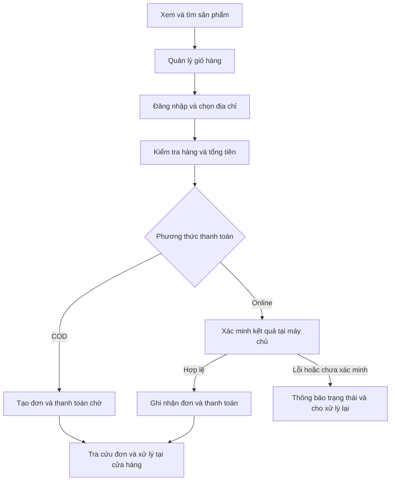

# BRD — TÀI LIỆU YÊU CẦU NGHIỆP VỤ

## WEBSITE BÁN HÀNG VINMARK

| Thông tin | Nội dung |
| --- | --- |
| Trường | Trường Đại học Công nghệ Thông tin — ĐHQG TP. Hồ Chí Minh |
| Môn học | IS207 — Phát triển ứng dụng Web |
| Lớp | IS207.Q12 |
| Học kỳ / Năm học | Học kỳ 1 / 2025–2026 |
| Giảng viên hướng dẫn | ThS. Mai Xuân Hùng — hungmx@uit.edu.vn |
| Phiên bản tài liệu | 1.0 — Bản dự thảo để nhóm rà soát |
| Ngày biên soạn | 17/11/2026 |
| Cơ sở xây dựng | Source code Vinmark và thông tin đồ án do nhóm cung cấp |
| Tài liệu liên quan | [SRS](SRS.md), [README](../../README.md), [Hướng dẫn sử dụng](../../HUONG_DAN_SU_DUNG.md) |

### Nhóm thực hiện

| MSSV | Họ và tên |
| --- | --- |
| 23521653 | Trần Minh Triết |
| 23521685 | Phạm Đức Trung |
| 23521646 | Phan Đức Trí |
| 23521698 | Đỗ Xuân Tú |

### Lịch sử tài liệu

| Phiên bản | Nội dung |
| --- | --- |
| 1.0 | Xây dựng yêu cầu nghiệp vụ từ phạm vi chức năng và các hạn chế quan sát được trong source code. |

## Mục lục

1. [Mục đích và cơ sở lập tài liệu](#1-mục-đích-và-cơ-sở-lập-tài-liệu)
2. [Bối cảnh và mục tiêu nghiệp vụ](#2-bối-cảnh-và-mục-tiêu-nghiệp-vụ)
3. [Các bên liên quan](#3-các-bên-liên-quan)
4. [Phạm vi sản phẩm](#4-phạm-vi-sản-phẩm)
5. [Yêu cầu nghiệp vụ](#5-yêu-cầu-nghiệp-vụ)
6. [Quy trình nghiệp vụ](#6-quy-trình-nghiệp-vụ)
7. [Quy tắc nghiệp vụ](#7-quy-tắc-nghiệp-vụ)
8. [User Story tiêu biểu](#8-user-story-tiêu-biểu)
9. [Tiêu chí thành công và nghiệm thu](#9-tiêu-chí-thành-công-và-nghiệm-thu)
10. [Giả định, phụ thuộc và rủi ro](#10-giả-định-phụ-thuộc-và-rủi-ro)
11. [Các nội dung cần thống nhất](#11-các-nội-dung-cần-thống-nhất)
12. [Căn cứ đối chiếu source code](#12-căn-cứ-đối-chiếu-source-code)

## 1. Mục đích và cơ sở lập tài liệu

BRD mô tả lý do xây dựng Vinmark, đối tượng sử dụng, phạm vi, mục tiêu và các quy tắc kinh doanh. Tài liệu là cơ sở để nhóm thống nhất yêu cầu trước khi thiết kế, triển khai và nghiệm thu. Chi tiết hành vi phần mềm và tiêu chí kiểm thử nằm trong SRS.

Đây là tài liệu được xây dựng ngược từ source code hiện có, không phải biên bản khảo sát doanh nghiệp. Các vấn đề nghiệp vụ dưới đây được suy luận từ chức năng của sản phẩm; chưa có dữ liệu phỏng vấn, lưu lượng sử dụng hoặc doanh thu thực tế. Các chính sách bổ sung được ghi rõ là **đề xuất**, chưa được xem là quyết định đã phê duyệt.

Có mã nguồn cho một chức năng không đồng nghĩa chức năng đó đã được kiểm thử đầy đủ. Những khác biệt giữa yêu cầu và cách triển khai được ghi tại phần 11 của SRS.

## 2. Bối cảnh và mục tiêu nghiệp vụ

### 2.1. Bối cảnh

Vinmark phục vụ mô hình một cửa hàng bán hàng trực tuyến, với nội dung hiện tại tập trung vào thực phẩm và hàng tiêu dùng. Khách hàng cần một nơi tra cứu sản phẩm, chọn hàng và theo dõi đơn. Cửa hàng cần quản lý tập trung danh mục, giá bán, tồn kho, đơn hàng và các yêu cầu liên hệ.

Các nhu cầu mà sản phẩm hướng đến:

- Cung cấp thông tin sản phẩm thống nhất để khách hàng chủ động lựa chọn.
- Giảm các bước ghi nhận đơn hàng thủ công và sai lệch số lượng, giá tiền.
- Phân chia quyền thao tác giữa người quản trị và nhân viên.
- Lưu lại thông tin mua hàng và yêu cầu hỗ trợ để thuận tiện tra cứu.
- Hỗ trợ xem tổng quan hoạt động bán hàng từ dữ liệu đơn hàng.

### 2.2. Mục tiêu và cách đánh giá đề xuất

| Mã | Mục tiêu | Cách đánh giá khi nghiệm thu |
| --- | --- | --- |
| OBJ-01 | Khách hàng thực hiện được quy trình chọn hàng và đặt hàng trên website. | Hoàn thành kịch bản từ tìm sản phẩm đến tạo đơn COD, có mã đơn và chi tiết hàng hóa đúng. |
| OBJ-02 | Thông tin đơn hàng, thanh toán và tồn kho nhất quán. | Kiểm tra tổng tiền, xử lý thiếu hàng, rollback, gửi yêu cầu lặp và hủy đơn. Không có tồn kho âm hoặc hoàn kho lặp. |
| OBJ-03 | Cửa hàng quản lý dữ liệu tập trung và đúng quyền. | Kiểm thử ma trận vai trò; yêu cầu ngoài quyền phải bị từ chối ở máy chủ. |
| OBJ-04 | Khách hàng tra cứu được giao dịch và được hỗ trợ. | Kiểm tra lịch sử đơn của chính mình, gửi liên hệ, phản hồi và lịch sử chatbot. |
| OBJ-05 | Có báo cáo tổng quan phục vụ vận hành. | Số liệu dashboard khớp bộ dữ liệu kiểm thử về đơn hoàn tất và các chỉ số được định nghĩa trong SRS. |

Không đặt chỉ tiêu tăng doanh thu hoặc tỷ lệ chuyển đổi vì chưa có số liệu nền. Các tiêu chí trên là mục tiêu nghiệm thu đề xuất, không phải kết quả đã đo.

## 3. Các bên liên quan

| Bên liên quan / Tác nhân | Nhu cầu, trách nhiệm |
| --- | --- |
| Khách vãng lai | Xem nội dung cửa hàng, tìm sản phẩm, sử dụng giỏ hàng tạm, gửi liên hệ và hỏi chatbot. |
| Khách hàng có tài khoản | Quản lý hồ sơ, địa chỉ, giỏ hàng, yêu thích, đặt hàng, tra cứu/hủy đơn đủ điều kiện và đánh giá sản phẩm. |
| Nhân viên (`staff`) | Theo phân quyền khởi tạo: quản lý sản phẩm, phản hồi liên hệ; sử dụng dashboard, hồ sơ và trang thông báo trong khu vực quản trị. |
| Quản trị viên (`admin`) | Quản lý sản phẩm, danh mục, đơn hàng, người dùng, liên hệ và theo dõi thống kê. |
| Đơn vị vận hành cửa hàng | Thống nhất chính sách giá, phí giao hàng, xử lý đơn, hủy/hoàn tiền và bảo quản dữ liệu. Vai trò nghiệp vụ này không phải một loại tài khoản riêng trong code. |
| Nhóm phát triển | Phân tích, xây dựng, kiểm thử, triển khai và bảo trì sản phẩm; cập nhật tài liệu khi phạm vi thay đổi. |
| Giảng viên hướng dẫn | Hướng dẫn và đánh giá đồ án theo yêu cầu môn học. |
| Dịch vụ ngoài | Dịch vụ email, PayPal, MoMo và Gemini; hoạt động phụ thuộc cấu hình và khả năng kết nối. |

## 4. Phạm vi sản phẩm

### 4.1. Trong phạm vi

- Website tiếng Việt gồm khu vực khách hàng và khu vực quản trị.
- Đăng ký, kích hoạt qua email, đăng nhập/đăng xuất và khôi phục mật khẩu.
- Quản lý hồ sơ cá nhân, mật khẩu, ảnh đại diện và nhiều địa chỉ giao hàng.
- Danh mục, danh sách sản phẩm, tìm kiếm, lọc, sắp xếp và chi tiết sản phẩm.
- Giỏ hàng cho khách vãng lai và khách đăng nhập; hợp nhất giỏ sau khi đăng nhập.
- Yêu thích sản phẩm, đánh giá và bình luận.
- Đặt hàng, ghi nhận thanh toán COD; các luồng tích hợp PayPal và MoMo cần hoàn thiện và kiểm thử riêng.
- Theo dõi đơn, hủy đơn đủ điều kiện; khu vực quản trị xác nhận/hủy đơn và gửi email thông tin đơn.
- Quản lý sản phẩm, ảnh, danh mục, người dùng và liên hệ.
- Dashboard, trang thông báo và chatbot tư vấn dựa trên dữ liệu sản phẩm.

Trong SRS, các yêu cầu về chuyển trạng thái giao hàng/hoàn tất, lưu lịch sử xử lý, xác minh thanh toán và bảo toàn lịch sử mua hàng là yêu cầu mục tiêu. Source code hiện tại mới đáp ứng một phần.

### 4.2. Ngoài phạm vi phiên bản đồ án hiện tại

- Sàn nhiều nhà bán hàng, tài khoản người bán và đối soát hoa hồng.
- Ứng dụng di động độc lập.
- Tích hợp hãng vận chuyển, theo dõi vị trí giao hàng theo thời gian thực.
- Quản lý nhà cung cấp, nhập kho, nhiều kho, lô hàng và hạn sử dụng.
- Mã giảm giá, tích điểm, khuyến mại và chương trình thành viên.
- Quy trình đổi trả/hoàn tiền tự động và phát hành hóa đơn điện tử theo nghiệp vụ kế toán.
- Đăng nhập Google: có trường dữ liệu liên quan nhưng chưa thấy luồng chức năng tương ứng.

## 5. Yêu cầu nghiệp vụ

**P0:** yêu cầu cốt lõi cho phiên bản nghiệm thu đề xuất. **P1:** chức năng mở rộng hoặc cần dịch vụ ngoài; nghiệm thu riêng sau khi cấu hình và hoàn thiện. Việc chia mức ưu tiên này là đề xuất, không khẳng định chức năng P0 đã đạt.

| Mã | Yêu cầu nghiệp vụ | Ưu tiên | Mục tiêu | Yêu cầu SRS liên quan |
| --- | --- | --- | --- | --- |
| BR-01 | Khách hàng có định danh, đăng nhập và tự quản lý thông tin mua hàng. | P0 | OBJ-01, OBJ-04 | FR-01–FR-06 |
| BR-02 | Khách hàng tra cứu đúng thông tin hàng hóa và tìm được sản phẩm phù hợp. | P0 | OBJ-01 | FR-07–FR-09 |
| BR-03 | Khách hàng quản lý danh sách hàng muốn mua và sản phẩm yêu thích. | P0 | OBJ-01 | FR-10–FR-12 |
| BR-04 | Cửa hàng tiếp nhận đơn hợp lệ, tính đúng tiền và cập nhật tồn kho. | P0 | OBJ-01, OBJ-02 | FR-13–FR-14 |
| BR-05 | Khách hàng có thêm phương thức thanh toán trực tuyến được xác minh. | P1 | OBJ-01, OBJ-02 | FR-15–FR-16 |
| BR-06 | Khách hàng tra cứu đơn của mình và hủy đơn theo chính sách. | P0 | OBJ-02, OBJ-04 | FR-17–FR-18 |
| BR-07 | Khách hàng gửi đánh giá sau khi mua để hỗ trợ người mua khác. | P1 | OBJ-04 | FR-19 |
| BR-08 | Cửa hàng tiếp nhận và phản hồi yêu cầu hỗ trợ; chatbot bổ trợ tư vấn. | P0: liên hệ; P1: chatbot | OBJ-04 | FR-20–FR-21 |
| BR-09 | Người vận hành chỉ được thực hiện các thao tác được phân quyền. | P0 | OBJ-03 | FR-22–FR-23, FR-29, FR-31 |
| BR-10 | Cửa hàng quản lý tập trung danh mục, sản phẩm và số lượng tồn. | P0 | OBJ-02, OBJ-03 | FR-24–FR-25 |
| BR-11 | Cửa hàng xử lý vòng đời đơn và gửi thông tin đơn cho khách. | P0: xác nhận/hủy; P1: hoàn thiện vòng đời, email | OBJ-02, OBJ-04 | FR-26–FR-28 |
| BR-12 | Người vận hành theo dõi số liệu tổng quan và thông báo công việc. | P0: dashboard; P1: thông báo tự động | OBJ-03, OBJ-05 | FR-30, FR-32 |

## 6. Quy trình nghiệp vụ

### 6.1. Mua hàng và tiếp nhận đơn

1. Khách xem danh sách, tìm kiếm hoặc lọc sản phẩm.
2. Khách chọn số lượng và thêm vào giỏ; giỏ của khách vãng lai được lưu trong phiên truy cập.
3. Khi đặt hàng, khách đăng nhập bằng tài khoản khách hàng đã kích hoạt. Giỏ tạm được hợp nhất với giỏ tài khoản và cần kiểm tra lại tồn kho.
4. Khách chọn địa chỉ giao hàng thuộc tài khoản. Luồng hiện tại yêu cầu có địa chỉ mặc định để vào trang thanh toán.
5. Hệ thống tính tiền hàng, phí giao hàng và tổng thanh toán theo chính sách đã thống nhất.
6. Với COD, hệ thống tạo đơn, dòng hàng, bản ghi thanh toán chờ và trừ tồn kho trong cùng giao dịch dữ liệu.
7. Với thanh toán online, việc công nhận thanh toán phải dựa trên kết quả được máy chủ xác minh; không dựa riêng vào thông tin gửi từ trình duyệt.
8. Đơn hợp lệ xuất hiện trong lịch sử mua hàng của khách và danh sách quản trị.

Đây là quy trình mục tiêu. Nhánh online trong code chưa đáp ứng đầy đủ yêu cầu xác minh và chống ghi nhận lặp.

### 6.2. Xử lý đơn tại cửa hàng

1. Quản trị viên có quyền quản lý đơn mở danh sách và xem chi tiết.
2. Xác nhận đơn đang chờ để chuyển sang đang xử lý.
3. Quy trình mục tiêu tiếp tục sang đã giao cho vận chuyển và hoàn tất; hiện chưa thấy endpoint cập nhật hai bước này.
4. Nếu hủy đơn, hệ thống kiểm tra điều kiện, ghi trạng thái và hoàn kho đúng một lần. Đơn đã thanh toán online cần chuyển sang xử lý hoàn tiền theo chính sách riêng.
5. Người có quyền có thể chủ động gửi email thông tin đơn cho khách. Code hiện chưa tự động gửi email này ngay khi khách đặt hàng.

### 6.3. Hỗ trợ khách hàng

1. Khách gửi thông tin liên hệ và nội dung cần hỗ trợ.
2. Người có quyền quản lý liên hệ xem các yêu cầu và soạn phản hồi.
3. Hệ thống gửi email; chỉ đánh dấu đã phản hồi sau khi thao tác gửi thành công.
4. Chatbot hỗ trợ hỏi đáp bằng tiếng Việt, có tham chiếu tên/giá/đơn vị sản phẩm còn tồn. Chatbot không thay thế quyết định xử lý đơn hoặc xác nhận thanh toán.

## 7. Quy tắc nghiệp vụ

| Mã | Quy tắc | Căn cứ / Tình trạng |
| --- | --- | --- |
| RULE-01 | Email tài khoản là duy nhất; khách đăng ký được gán vai trò khách hàng và trạng thái chờ kích hoạt. | Có trong đăng ký và cấu trúc dữ liệu. |
| RULE-02 | Khách chỉ đăng nhập khu vực khách hàng khi có vai trò khách hàng và trạng thái hoạt động. Tài khoản quản trị/nhân viên bị khóa cũng phải bị từ chối. | Vế khách hàng có trong code; kiểm tra trạng thái ở đăng nhập quản trị cần bổ sung. |
| RULE-03 | Khách chỉ xem/thay đổi dữ liệu cá nhân, địa chỉ, giỏ hàng và đơn hàng thuộc mình. | Yêu cầu bắt buộc; một số endpoint chưa kiểm tra đầy đủ. |
| RULE-04 | Số lượng mua là số nguyên dương, không vượt tồn kho tại thời điểm chốt đơn; tồn kho không được âm. | Có kiểm tra một phần; cần đồng bộ giỏ, hợp nhất giỏ và khóa dữ liệu khi đặt đồng thời. |
| RULE-05 | Giá và tổng tiền phải do hệ thống xác định; giá tại thời điểm đặt được lưu ở dòng đơn hàng. | Có lưu giá dòng hàng; tổng tiền giữa các nhánh thanh toán chưa thống nhất. |
| RULE-06 | Phí giao hàng đề xuất là 25.000 VNĐ/đơn theo giao diện hiện tại; áp dụng nhất quán cho mọi phương thức. | Cần nhóm xác nhận. Luồng COD hiện chưa cộng phí vào tổng lưu. |
| RULE-07 | Đơn mới ở trạng thái chờ xử lý; trạng thái xử lý đơn và trạng thái thanh toán phải được quản lý riêng. | Có hai trường trạng thái riêng trong dữ liệu. |
| RULE-08 | Khách được yêu cầu hủy đơn của mình khi đơn còn chờ xử lý. Mọi hủy đơn phải kiểm soát trạng thái và hoàn kho đúng một lần. | Khách có điều kiện chờ; luồng quản trị chưa bảo vệ đầy đủ. |
| RULE-09 | Chỉ công nhận thanh toán online sau khi kiểm tra giao dịch, số tiền và mã tham chiếu; gửi lặp không tạo đơn/hoàn kho lặp. | Yêu cầu mục tiêu; tích hợp hiện tại chưa đáp ứng đầy đủ. |
| RULE-10 | Đề xuất chỉ cho khách đã có đơn hoàn tất chứa sản phẩm đánh giá; mỗi khách tối đa một đánh giá/sản phẩm, điểm 1–5. | Giao diện có điều kiện; máy chủ mới kiểm tra điểm, sản phẩm và nội dung. |
| RULE-11 | Nhân viên khởi tạo chỉ quản lý sản phẩm và liên hệ; quản trị viên có đủ năm quyền nghiệp vụ. | Có trong seed phân quyền. Chưa có màn hình chỉnh ma trận quyền. |
| RULE-12 | Đề xuất ngừng bán/ẩn sản phẩm hoặc chặn xóa khi đã có giao dịch, để không mất lịch sử đơn. Địa chỉ đã gắn đơn cần được bảo toàn. | Khác triển khai hiện tại đang sử dụng nhiều khóa ngoại xóa dây chuyền. |
| RULE-13 | Email thông tin đơn do người có quyền chủ động gửi; không coi đây là hóa đơn điện tử theo nghiệp vụ kế toán. | Có thao tác gửi từ quản trị. |
| RULE-14 | Thời hạn giữ dữ liệu, sao lưu và xử lý hoàn tiền cần được chủ thể vận hành xác nhận trước khi sử dụng thực tế. | Chưa có chính sách trong source code. |

## 8. User Story tiêu biểu

Các User Story dưới đây được biên soạn cho tài liệu này; tiêu chí chi tiết liên kết sang các FR trong SRS.

| Mã | User Story | Tiêu chí chấp nhận chính | SRS |
| --- | --- | --- | --- |
| US-01 | Là khách mới, tôi muốn đăng ký và kích hoạt tài khoản để có thể mua hàng. | Email không trùng; có đường dẫn kích hoạt; tài khoản chờ không đăng nhập được. | FR-01–FR-03 |
| US-02 | Là khách mua hàng, tôi muốn lọc theo danh mục và giá để tìm sản phẩm phù hợp. | Kết quả đúng điều kiện; có phân trang và thông báo khi không có sản phẩm. | FR-07–FR-09 |
| US-03 | Là khách vãng lai, tôi muốn giữ các sản phẩm đã chọn sau khi đăng nhập để không chọn lại. | Hợp nhất giỏ không mất hàng hợp lệ; phát hiện số lượng vượt tồn. | FR-10–FR-11 |
| US-04 | Là khách hàng, tôi muốn đặt đơn với địa chỉ của mình và biết tổng tiền trước khi xác nhận. | Địa chỉ đúng chủ sở hữu; tổng hiển thị bằng tổng lưu; tạo đơn và tồn kho nhất quán. | FR-06, FR-13–FR-14 |
| US-05 | Là khách hàng, tôi muốn thanh toán online để thuận tiện khi mua hàng. | Giao dịch được xác minh; sai số tiền bị từ chối; callback lặp không tạo đơn thứ hai. | FR-15–FR-16 |
| US-06 | Là khách hàng, tôi muốn xem và hủy đơn còn chờ của mình để điều chỉnh nhu cầu. | Không truy cập đơn người khác; đơn đủ điều kiện được hủy và hoàn kho một lần. | FR-17–FR-18 |
| US-07 | Là khách đã nhận hàng, tôi muốn đánh giá sản phẩm để chia sẻ trải nghiệm. | Kiểm tra đơn hoàn tất và đánh giá trùng ở máy chủ. | FR-19 |
| US-08 | Là nhân viên, tôi muốn cập nhật sản phẩm và trả lời liên hệ để vận hành cửa hàng. | Thực hiện được hai nhóm quyền; không gọi được endpoint quản lý người dùng/đơn/danh mục. | FR-20, FR-23, FR-25 |
| US-09 | Là quản trị viên, tôi muốn xác nhận đơn và theo dõi xử lý để tránh bỏ sót đơn mua. | Chuyển trạng thái hợp lệ, có lịch sử; gửi thông tin đơn tới email khách. | FR-26–FR-28 |
| US-10 | Là quản trị viên, tôi muốn xem thống kê để nắm tình hình bán hàng. | Số liệu khớp dữ liệu kiểm thử và phân biệt tiền đơn hoàn tất với tiền đã thanh toán. | FR-30 |
| US-11 | Là khách hàng quên mật khẩu, tôi muốn nhận đường dẫn đặt lại qua email để lấy lại quyền truy cập tài khoản. | Token đúng email và còn hạn; mật khẩu xác nhận khớp; token đã dùng không dùng lại; không tự mở khóa tài khoản. | FR-04 |

Xem bộ 24 User Story và tiêu chí chấp nhận, bao gồm đặc tả chi tiết US-11, tại [User Story — Vinmark](USER_STORY.md).

## 9. Tiêu chí thành công và nghiệm thu

1. Các yêu cầu P0 có kịch bản kiểm thử đạt và có bằng chứng kết quả; các yêu cầu chưa đạt được ghi nhận công khai, không mặc nhiên coi là hoàn tất.
2. Luồng mua hàng COD đi hết từ giỏ đến lịch sử đơn, hiển thị đúng giá, số lượng, phí giao hàng và địa chỉ.
3. Yêu cầu đặt/hủy đơn lặp hoặc đồng thời không làm tồn kho âm, trừ kho lặp hoặc hoàn kho lặp.
4. Không có trường hợp người dùng đọc hoặc sửa tài nguyên của người khác trái quyền trong bộ kiểm thử nghiệm thu.
5. Nhân viên và quản trị viên thao tác đúng ma trận phân quyền; yêu cầu trực tiếp tới endpoint ngoài quyền bị từ chối.
6. Dashboard khớp dữ liệu đối chứng; đơn hủy không được tính vào doanh thu đơn hoàn tất.
7. Các tích hợp P1 chỉ được công bố đạt khi có cấu hình thử nghiệm hợp lệ và kịch bản thành công, thất bại, timeout, gọi lặp đều được kiểm tra.
8. Các trường hợp chưa thống nhất tại phần 11 được nhóm chốt trước khi coi tài liệu là bản chính thức.

## 10. Giả định, phụ thuộc và rủi ro

| Mã | Nội dung | Ảnh hưởng / Hướng xử lý đề xuất |
| --- | --- | --- |
| AS-01 | Vinmark là một cửa hàng; giá cơ sở thể hiện bằng VNĐ. | Không thiết kế phân chia doanh thu cho nhiều nhà bán. |
| AS-02 | Người vận hành cung cấp nội dung sản phẩm, giá và tồn kho đúng. | Kiểm tra dữ liệu nhập trước khi mở bán. |
| DEP-01 | Email cần cấu hình dịch vụ gửi; chế độ log chỉ phục vụ phát triển. | Không coi ghi log là đã giao email tới người dùng. |
| DEP-02 | PayPal, MoMo cần cấu hình, thông tin thử nghiệm và kết nối; callback cần truy cập từ dịch vụ ngoài. | Localhost đơn thuần không đủ để nghiệm thu IPN công khai. |
| DEP-03 | Gemini cần API key và kết nối Internet. | Chatbot cần thông báo phù hợp khi thiếu cấu hình/lỗi dịch vụ; mua hàng vẫn sử dụng được. |
| RISK-01 | Phí vận chuyển, tỷ giá và cách tính tổng chưa thống nhất. | Chốt chính sách, tính lại phía máy chủ và đối chiếu mọi phương thức. |
| RISK-02 | Hủy đơn/chuyển trạng thái và cập nhật tồn có thể lặp hoặc không đồng bộ. | Hoàn thiện giao dịch dữ liệu, kiểm soát trạng thái và kiểm thử đồng thời. |
| RISK-03 | Xóa danh mục/sản phẩm/địa chỉ có thể ảnh hưởng dữ liệu đơn qua cascade. | Thống nhất lưu lịch sử và hạn chế xóa dữ liệu đã phát sinh giao dịch. |
| RISK-04 | Quyền sở hữu tài nguyên và xác minh thanh toán chưa đầy đủ. | Ưu tiên hoàn thiện trước khi đưa vào sử dụng thực tế. |

## 11. Các nội dung cần thống nhất

| Mã | Câu hỏi / Quyết định cần có | Đề xuất ban đầu |
| --- | --- | --- |
| TBD-01 | Phí giao hàng có cố định 25.000 VNĐ không? Có thuế/phụ phí nào khác? | Dùng 25.000 VNĐ/đơn theo giao diện, chưa thêm thuế/phụ phí mới. |
| TBD-02 | PayPal quy đổi ngoại tệ và làm tròn theo chính sách nào? | Chưa chốt; không coi hằng số 25.000 VNĐ/USD trong code là tỷ giá kinh doanh được phê duyệt. |
| TBD-03 | Khi nào được hủy đơn; xử lý đơn đã thanh toán ra sao? | Khách tự hủy khi chờ; đơn đã trả tiền cần xử lý hoàn tiền riêng, không tự đánh dấu đã hoàn. |
| TBD-04 | Ai cập nhật đã giao/hoàn tất và bằng chứng hoàn tất là gì? | Đề xuất người có quyền quản lý đơn; bổ sung màn hình và lịch sử. |
| TBD-05 | Một khách được đánh giá mỗi sản phẩm bao nhiêu lần? | Một lần sau khi có đơn hoàn tất, theo điều kiện đang thể hiện trên giao diện. |
| TBD-06 | Thời hạn lưu lịch sử đơn/chat, chu kỳ sao lưu và thời hạn token kích hoạt? | Nhóm thống nhất; không tự áp dụng thời hạn pháp lý hoặc SLA chưa được cung cấp. |
| TBD-07 | Thông báo nghiệp vụ gửi riêng từng người hay dùng hộp thư chung? | Chưa chốt; dữ liệu có `user_id` nhưng truy vấn hiện dùng danh sách chung. |
| TBD-08 | Có nghiệm thu đủ PayPal, MoMo, Gemini và SMTP trong kỳ nộp không? | Tách tiêu chí nghiệm thu từng tích hợp và ghi trạng thái thực tế. |

Các quyết định cần được nhóm ghi nhận vào phiên bản tiếp theo; thông tin giảng viên trong tài liệu không hàm ý giảng viên đã phê duyệt.

## 12. Căn cứ đối chiếu source code

- Phạm vi endpoint: [routes/web.php](../../routes/web.php), [routes/admin.php](../../routes/admin.php).
- Khách hàng: [Controllers/Clients](../../app/Http/Controllers/Clients).
- Vận hành: [Controllers/Admin](../../app/Http/Controllers/Admin).
- Phân quyền: [PermissionsTableSeeder](../../database/seeders/PermissionsTableSeeder.php), [RolePermissionTableSeeder](../../database/seeders/RolePermissionTableSeeder.php), [CheckPermission](../../app/Http/Middleware/CheckPermission.php).
- Cấu trúc dữ liệu: [database/migrations](../../database/migrations), [app/Models](../../app/Models).
- Giao diện nghiệp vụ: [resources/views/clients/pages](../../resources/views/clients/pages), [resources/views/admin/pages](../../resources/views/admin/pages).
- Chi tiết yêu cầu và chênh lệch triển khai: [SRS](SRS.md).
