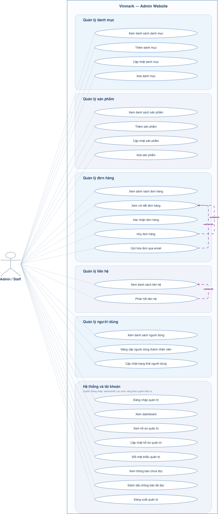
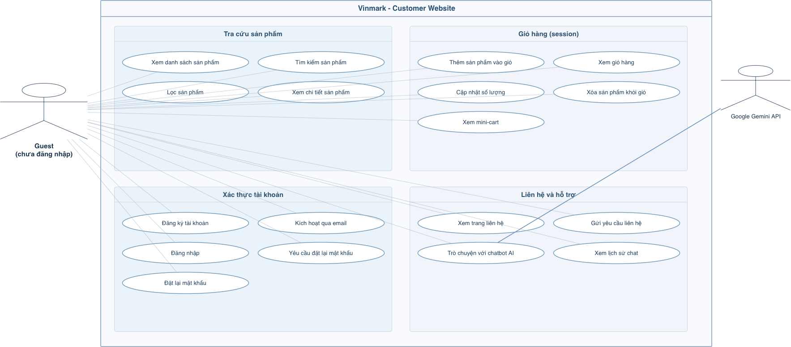
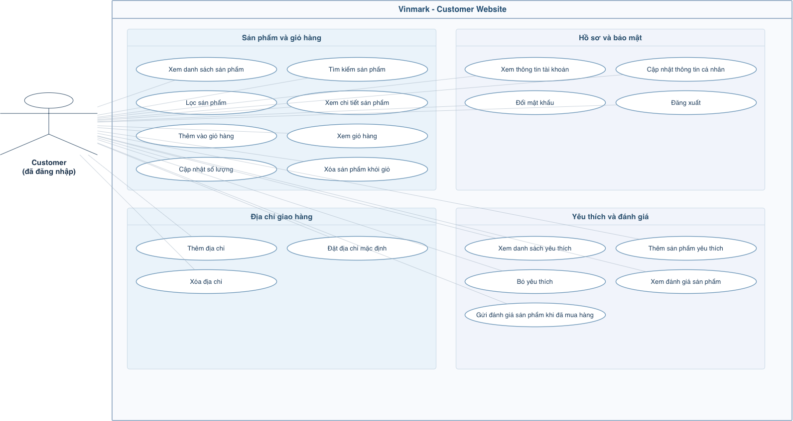
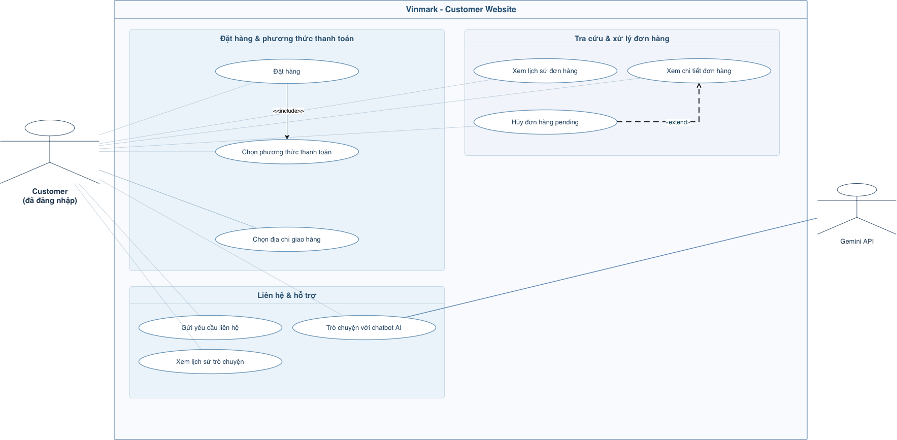
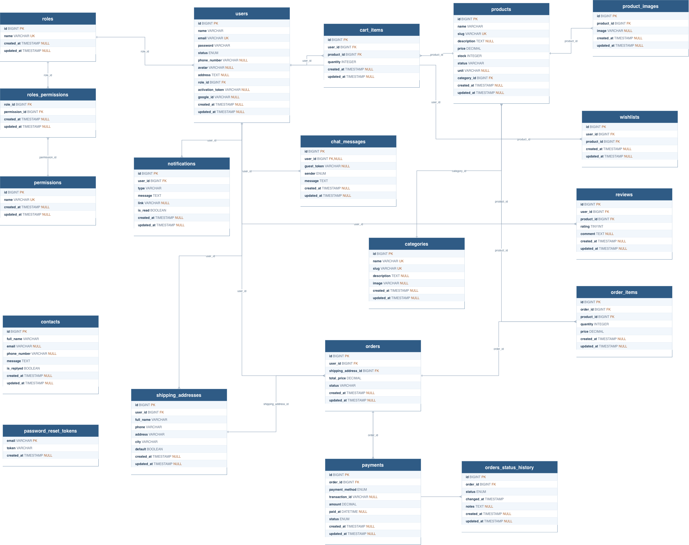
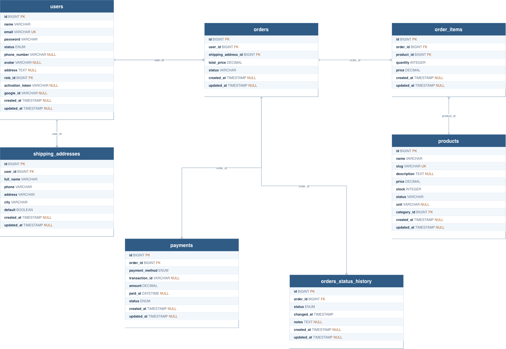

# ĐẶC TẢ USE CASE — WEBSITE BÁN HÀNG VINMARK

| Thông tin | Nội dung |
| --- | --- |
| Dự án | Website bán hàng Vinmark |
| Phiên bản | 1.0 — Dự thảo để nhóm rà soát |
| Ngày biên soạn | 17/11/2026 |
| Đầu vào | Bốn sơ đồ use case, hai sơ đồ ERD do nhóm cung cấp; BRD, SRS và mã nguồn dự án |
| Tài liệu liên quan | [BRD](BRD.md), [SRS](SRS.md), [User Story](USER_STORY.md) |
| Sơ đồ quy trình | [BPMN đặt hàng và thanh toán](../diagrams/bpmn/README.md) — bộ As-Is theo mã nguồn; đối chiếu riêng với luồng mục tiêu trong đặc tả |
| Phạm vi | 27 đặc tả cho nghiệp vụ mua hàng, tài khoản, vận hành và hỗ trợ quan trọng |

## Mục lục

1. [Phạm vi và quy ước](#1-phạm-vi-và-quy-ước)
2. [Tác nhân, phân quyền và quy tắc chung](#2-tác-nhân-phân-quyền-và-quy-tắc-chung)
3. [Danh mục và truy vết use case](#3-danh-mục-và-truy-vết-use-case)
4. [Đặc tả phía khách hàng](#4-đặc-tả-phía-khách-hàng)
5. [Đặc tả phía quản trị](#5-đặc-tả-phía-quản-trị)
6. [Đối chiếu ERD và những điểm cần thống nhất](#6-đối-chiếu-erd-và-những-điểm-cần-thống-nhất)
7. [Kịch bản rà soát nghiệp vụ](#7-kịch-bản-rà-soát-nghiệp-vụ)
8. [Sơ đồ và mã nguồn tham chiếu](#8-sơ-đồ-và-mã-nguồn-tham-chiếu)

## 1. Phạm vi và quy ước

### 1.1. Mục đích

Tài liệu mô tả tương tác giữa tác nhân và Vinmark để hoàn thành các mục tiêu nghiệp vụ quan trọng, làm cơ sở rà soát yêu cầu, triển khai và xây dựng ca kiểm thử. Phạm vi chức năng và tên thao tác được đối chiếu với các sơ đồ người dùng cung cấp. ERD được dùng để xác định dữ liệu liên quan; ERD không tự xác định điều kiện hủy đơn, quyền thao tác hoặc chính sách thanh toán.

Các luồng dưới đây mô tả **hành vi cần đạt**, phù hợp với cách trình bày trong SRS. Mục **Đối chiếu triển khai** ở cuối mỗi đặc tả chỉ ra những giới hạn đã quan sát từ mã nguồn. Việc có đặc tả không có nghĩa chức năng đã được kiểm thử hoặc triển khai đầy đủ. Tài liệu này không sửa mã nguồn nghiệp vụ và không chứa kết quả kiểm thử thực thi.

Ưu tiên đặc tả các nghiệp vụ ảnh hưởng đến quyền truy cập, tiền, tồn kho, lịch sử giao dịch và hỗ trợ khách hàng. Hồ sơ cá nhân/quản trị, đổi mật khẩu khi đang đăng nhập, đăng xuất, danh sách yêu thích và thông báo có trong sơ đồ nhưng chưa được đặc tả chi tiết tại phiên bản này; tham chiếu FR-05, FR-12, FR-31, FR-32 và các yêu cầu đăng xuất tại FR-03/FR-22 trong SRS.

### 1.2. Quy ước đọc

- Mã dùng tiền tố `UC-TK`, `UC-SP`, `UC-GH`, `UC-DC`, `UC-DH`, `UC-DG`, `UC-HT`, `UC-QT`. Các mã này độc lập với tám mã UC tóm tắt trong SRS phần 5; bảng ở phần 3 cung cấp liên kết tương ứng.
- **P0:** nghiệp vụ cốt lõi; **P1:** nghiệp vụ mở rộng hoặc cần tích hợp, theo SRS. Ưu tiên không biểu thị mức hoàn thiện.
- **Luồng chính:** kịch bản thành công điển hình. **A:** luồng thay thế hợp lệ. **E:** ngoại lệ; chỉ rõ bước phát sinh và điểm tiếp tục/kết thúc.
- Với một nhóm thao tác được trình bày chung, bảng truy vết liệt kê từng use case trên sơ đồ; các nhánh thêm/sửa/xóa/xem được mô tả riêng trong luồng thay thế. Đây là cách tổ chức đặc tả, không bổ sung một hình oval mới vào sơ đồ.
- **Tiền điều kiện** là trạng thái cần có để bắt đầu luồng chính. Máy chủ vẫn phải kiểm tra lại quyền, dữ liệu và trạng thái trước khi đọc/ghi; tiền điều kiện không thay thế kiểm tra này.
- **Hậu điều kiện thất bại** áp dụng khi không hoàn thành nghiệp vụ. Tác động đã phát sinh ở dịch vụ ngoài phải được ghi nhận để xử lý tiếp, không thể coi rollback cơ sở dữ liệu là rollback giao dịch ngoài.
- `BRD-TBD-xx` trong tài liệu này tương ứng `TBD-xx` tại BRD phần 11. Những chính sách đề xuất vẫn chờ nhóm thống nhất.

### 1.3. Quan hệ trên sơ đồ

| Sơ đồ | Quan hệ thể hiện | Cách áp dụng trong đặc tả |
| --- | --- | --- |
| `US_cus3` | Đặt hàng `<<include>>` Chọn phương thức thanh toán | UC-DH-01 luôn gọi UC-DH-02. COD, PayPal, MoMo là các nhánh thực hiện sau khi chọn phương thức. |
| `US_cus3` | Hủy đơn hàng pending `<<extend>>` Xem chi tiết đơn hàng | UC-DH-05 mở rộng UC-DH-04 tại điểm xem đơn của mình còn `pending`. |
| `US_Ad` | Hủy đơn hàng `<<extend>>` Xem chi tiết đơn hàng | UC-QT-06 mở rộng UC-QT-04 khi người có quyền chọn hủy và đơn đủ điều kiện. |
| `US_Ad` | Gửi hóa đơn qua email `<<extend>>` Xem chi tiết đơn hàng | UC-QT-07 mở rộng UC-QT-04 khi người có quyền chủ động chọn gửi email. |
| `US_Ad` | Phản hồi liên hệ `<<extend>>` Xem danh sách liên hệ | UC-QT-08 có luồng cơ sở xem danh sách và luồng mở rộng phản hồi một liên hệ được chọn. |

Chọn địa chỉ giao hàng là thao tác liên quan trong checkout, được mô tả tại UC-DH-03. Sơ đồ không vẽ `include` cho thao tác này nên tài liệu không gán thêm quan hệ UML. Kích hoạt email diễn ra sau đăng ký, không phải một bước bắt buộc hoàn tất ngay trong cùng lần đăng ký. Xác nhận đơn được giữ là thao tác độc lập như sơ đồ quản trị.

## 2. Tác nhân, phân quyền và quy tắc chung

### 2.1. Tác nhân

| Tác nhân | Vai trò trong đặc tả |
| --- | --- |
| Guest — Khách vãng lai | Tra cứu, dùng giỏ session, đăng ký/đăng nhập/khôi phục mật khẩu, gửi liên hệ và trò chuyện với chatbot. |
| Customer — Khách hàng | Tài khoản khách hàng đã đăng nhập; dùng dữ liệu giỏ, địa chỉ, đơn và đánh giá thuộc mình. |
| Admin — Quản trị viên | Tài khoản quản trị hoạt động; sử dụng chức năng theo permission. |
| Staff — Nhân viên | Tài khoản nhân viên hoạt động; mặc định quản lý sản phẩm, liên hệ và truy cập dashboard. |
| Dịch vụ email | Hỗ trợ gửi link kích hoạt, đặt lại mật khẩu, phản hồi liên hệ và thông tin đơn. Là tác nhân hỗ trợ được suy ra từ các thao tác email, dù sơ đồ không vẽ riêng. |
| PayPal, MoMo | Hỗ trợ thanh toán online; được xác định từ các phương thức trong mã nguồn/SRS. Sơ đồ khách hàng chưa vẽ riêng hai tác nhân này. |
| Google Gemini API / Gemini API | Hai tên trên các sơ đồ cùng chỉ dịch vụ AI hỗ trợ chatbot. |

### 2.2. Giới hạn tác nhân Admin / Staff

Ký hiệu gộp “Admin / Staff” trên sơ đồ không cấp mọi quyền cho cả hai vai trò. Quyền cụ thể theo SRS phần 3 và seed hiện tại:

| Nghiệp vụ | Permission | Admin | Staff |
| --- | --- | :---: | :---: |
| Danh mục | `manage_categories` | Có | Không |
| Sản phẩm | `manage_products` | Có | Có |
| Đơn hàng và email đơn | `manage_orders` | Có | Không |
| Liên hệ | `manage_contacts` | Có | Có |
| Người dùng | `manage_users` | Có | Không |
| Đăng nhập quản trị, dashboard | Guard quản trị; không có permission riêng cho dashboard | Có | Có |

### 2.3. Quy tắc dùng chung

| Mã | Quy tắc nghiệp vụ |
| --- | --- |
| QD-01 | Email tài khoản duy nhất. Đăng ký tạo vai trò `customer`, trạng thái `pending`; kích hoạt hợp lệ chuyển `active`. Mật khẩu lưu dạng băm. |
| QD-02 | Khách đăng nhập qua guard `web`; admin/staff qua guard `admin`. Chỉ tài khoản đúng vai trò và `active` được đăng nhập. Dữ liệu vãng lai chỉ hợp nhất vào tài khoản khách hàng phù hợp. |
| QD-03 | Dữ liệu riêng phải được lọc theo chủ sở hữu ở máy chủ. Người có vai trò quản trị vẫn phải có permission nghiệp vụ tương ứng. |
| QD-04 | Lượng mua là số nguyên dương; tồn kho là số nguyên không âm. Kiểm tra tổng lượng khi thêm trùng/hợp nhất và kiểm tra lại lúc chốt đơn. Giỏ hàng không giữ chỗ hay trừ tồn. |
| QD-05 | Tiền hàng = tổng(số lượng × đơn giá máy chủ tại lúc đặt). Tổng thanh toán = tiền hàng + phí giao hàng; phí đề xuất 25.000 VNĐ/đơn còn chờ BRD-TBD-01. Tỷ giá/làm tròn PayPal chờ BRD-TBD-02. Không tin tổng do trình duyệt gửi. |
| QD-06 | Tạo đơn, dòng hàng, thanh toán, trừ kho và xóa giỏ phải nhất quán; lỗi cơ sở dữ liệu rollback toàn bộ phần ghi liên quan. Kiểm soát mua đồng thời và gửi lặp để không âm kho hoặc tạo đơn trùng. |
| QD-07 | Tách trạng thái đơn và thanh toán. Đơn mới `pending`, xác nhận thành `processing`, hủy dùng `cancelled`. COD tạo thanh toán `cash/pending`, `paid_at = null`; tạo/xác nhận đơn không có nghĩa đã thu tiền. |
| QD-08 | Khách chỉ hủy đơn của mình còn `pending`; mặc định đề xuất cho quản trị cũng chỉ hủy `pending` cho đến khi chốt BRD-TBD-03. Hủy hợp lệ hoàn kho một lần và ghi lịch sử. Đơn đã trả online cần xử lý hoàn tiền riêng. |
| QD-09 | Chỉ ghi online `completed` sau xác minh kết quả, số tiền, tiền tệ, mã tham chiếu và giao dịch tại máy chủ. Callback/yêu cầu lặp không tạo thêm tác động. Lỗi chưa xác định kết quả phải cho tra soát, không vội coi là thất bại chắc chắn. |
| QD-10 | Không xóa danh mục, sản phẩm, địa chỉ hoặc tài khoản theo cách làm mất lịch sử đơn. Đề xuất chặn xóa dữ liệu đang được tham chiếu; phương án lưu bản chụp/ngừng bán cần triển khai phù hợp. |
| QD-11 | Đánh giá theo đề xuất BRD-TBD-05: đã có đơn `completed` chứa sản phẩm, tối đa một đánh giá/khách/sản phẩm; điểm nguyên 1–5, bình luận tùy chọn tối đa 1.000 ký tự. |
| QD-12 | Email phản hồi lấy người nhận từ liên hệ; email thông tin đơn lấy từ khách của đơn. Chỉ báo gửi thành công khi dịch vụ gửi chấp nhận; điều đó không bảo đảm người nhận đã đọc hoặc thư đã vào hộp thư đến. |
| QD-13 | Chat chỉ truy cập lịch sử theo tài khoản khách hoặc token khách vãng lai tương ứng. Bot tư vấn bằng tiếng Việt, không tự đặt/hủy đơn, thay đổi dữ liệu hoặc công nhận thanh toán. |

Mọi luồng ghi dữ liệu: phiên hết hạn hoặc thiếu quyền thì dừng trước khi ghi; dữ liệu không hợp lệ thì báo lỗi phù hợp; lỗi lưu thì không báo hoàn thành. Các ngoại lệ dùng chung này áp dụng cho tất cả đặc tả dưới đây.

## 3. Danh mục và truy vết use case

Ký hiệu nguồn: **CUS1**, **CUS2**, **CUS3**, **AD** tương ứng bốn sơ đồ `US_cus1`, `US_cus2`, `US_cus3`, `US_Ad`. “UC SRS” là mã luồng tóm tắt ở SRS phần 5; dấu “—” nghĩa là đối chiếu trực tiếp FR, chưa có UC tóm tắt riêng.

| Mã đặc tả | Use case trên sơ đồ / Phạm vi đặc tả | Nguồn | SRS / UC SRS | Ưu tiên |
| --- | --- | --- | --- | --- |
| [UC-TK-01](#uc-tk-01) | Đăng ký tài khoản | CUS1 | FR-01 / UC-01 | P0 |
| [UC-TK-02](#uc-tk-02) | Kích hoạt qua email | CUS1 | FR-02 / UC-01 | P0 |
| [UC-TK-03](#uc-tk-03) | Đăng nhập | CUS1 | FR-03, FR-11, FR-21 / UC-01 | P0 |
| [UC-TK-04](#uc-tk-04) | Yêu cầu đặt lại mật khẩu | CUS1 | FR-04 / UC-01 | P0 |
| [UC-TK-05](#uc-tk-05) | Đặt lại mật khẩu | CUS1 | FR-04 / UC-01 | P0 |
| [UC-SP-01](#uc-sp-01) | Xem danh sách, tìm kiếm, lọc, xem chi tiết sản phẩm | CUS1, CUS2 | FR-07–FR-09 / — | P0 |
| [UC-GH-01](#uc-gh-01) | Thêm vào giỏ, xem giỏ, cập nhật số lượng, xóa khỏi giỏ, xem mini-cart | CUS1, CUS2 | FR-10–FR-11 / UC-02 | P0 |
| [UC-DC-01](#uc-dc-01) | Thêm địa chỉ, đặt địa chỉ mặc định, xóa địa chỉ | CUS2 | FR-06 / UC-02 | P0 |
| [UC-DH-01](#uc-dh-01) | Đặt hàng; nhánh COD, PayPal, MoMo | CUS3 | FR-13–FR-16 / UC-02–UC-03 | P0: COD; P1: online |
| [UC-DH-02](#uc-dh-02) | Chọn phương thức thanh toán | CUS3 | FR-13–FR-16 / UC-02–UC-03 | P0/P1 theo phương thức |
| [UC-DH-03](#uc-dh-03) | Chọn địa chỉ giao hàng | CUS3 | FR-06, FR-13 / UC-02 | P0 |
| [UC-DH-04](#uc-dh-04) | Xem lịch sử đơn hàng, xem chi tiết đơn hàng | CUS3 | FR-17 / — | P0 |
| [UC-DH-05](#uc-dh-05) | Hủy đơn hàng pending | CUS3 | FR-18 / UC-04 | P0 |
| [UC-DG-01](#uc-dg-01) | Gửi đánh giá sản phẩm khi đã mua hàng; xem đánh giá sau gửi | CUS2 | FR-19 / UC-06 | P1 |
| [UC-HT-01](#uc-ht-01) | Xem trang liên hệ, gửi yêu cầu liên hệ | CUS1, CUS3 | FR-20 / UC-07 | P0 |
| [UC-HT-02](#uc-ht-02) | Trò chuyện với chatbot AI, xem lịch sử chat/trò chuyện | CUS1, CUS3 | FR-21 / UC-08 | P1 |
| [UC-QT-01](#uc-qt-01) | Đăng nhập quản trị | AD | FR-22–FR-23 / — | P0 |
| [UC-QT-02](#uc-qt-02) | Xem danh sách, thêm, cập nhật, xóa danh mục | AD | FR-24 / UC-05 | P0 |
| [UC-QT-03](#uc-qt-03) | Xem danh sách, thêm, cập nhật, xóa sản phẩm | AD | FR-25 / UC-05 | P0 |
| [UC-QT-04](#uc-qt-04) | Xem danh sách đơn hàng, xem chi tiết đơn hàng | AD | FR-26 / — | P0 |
| [UC-QT-05](#uc-qt-05) | Xác nhận đơn hàng | AD | FR-26 / — | P0 |
| [UC-QT-06](#uc-qt-06) | Hủy đơn hàng | AD | FR-26 / UC-04 | P0 |
| [UC-QT-07](#uc-qt-07) | Gửi hóa đơn qua email | AD | FR-28 / — | P1 |
| [UC-QT-08](#uc-qt-08) | Xem danh sách liên hệ, phản hồi liên hệ | AD | FR-20 / UC-07 | P0 |
| [UC-QT-09](#uc-qt-09) | Xem danh sách người dùng, nâng cấp người dùng thành nhân viên | AD | FR-29 / — | P0 |
| [UC-QT-10](#uc-qt-10) | Cập nhật trạng thái người dùng | AD | FR-29 / — | P0 |
| [UC-QT-11](#uc-qt-11) | Xem dashboard | AD | FR-30 / — | P0 |

## 4. Đặc tả phía khách hàng

### UC-TK-01 — Đăng ký tài khoản

| Thuộc tính | Đặc tả |
| --- | --- |
| Mục tiêu | Tạo tài khoản khách hàng và nhận hướng dẫn kích hoạt. |
| Tác nhân chính / Hỗ trợ | Guest / Dịch vụ email. |
| Kích hoạt | Guest chọn đăng ký. |
| Tiền điều kiện | Chưa đăng nhập khu vực khách hàng; email chưa được đăng ký. |
| Dữ liệu vào | Họ tên, email, mật khẩu. |
| Hậu điều kiện thành công | Một tài khoản `customer/pending`, mật khẩu băm, token kích hoạt; dịch vụ gửi chấp nhận email hướng dẫn. Chưa tạo phiên đăng nhập. |
| Hậu điều kiện thất bại | Dữ liệu sai không tạo tài khoản; nếu lỗi gửi sau khi đã tạo, tài khoản vẫn chờ kích hoạt và phải thông báo đúng tình trạng. |
| Quy tắc / Dữ liệu | QD-01, QD-12; `users`, `roles`. |

**Luồng chính**

| Bước | Tác nhân | Hệ thống |
| --- | --- | --- |
| 1 | Mở trang đăng ký. | Hiển thị biểu mẫu. |
| 2 | Nhập họ tên, email, mật khẩu và gửi. | Kiểm tra trường bắt buộc; tên/email tối đa 255 ký tự, email đúng định dạng và duy nhất, mật khẩu tối thiểu 6 ký tự. |
| 3 | — | Tạo tài khoản khách `pending`, băm mật khẩu và sinh token kích hoạt. |
| 4 | — | Gửi email chứa đường dẫn kích hoạt cho tài khoản vừa tạo. |
| 5 | Xem kết quả. | Thông báo đăng ký thành công, yêu cầu kiểm tra email; cung cấp lối tới đăng nhập. |

**Ngoại lệ:** E1 tại bước 2: dữ liệu thiếu/sai/email trùng → báo lỗi, quay lại biểu mẫu, không ghi thêm tài khoản. E2 tại bước 3: lỗi lưu → kết thúc thất bại. E3 tại bước 4: lỗi gửi → không thông báo đã gửi; giữ trạng thái `pending` nếu đã lưu, hướng dẫn liên hệ hỗ trợ; cơ chế gửi lại cần được nhóm chốt, chưa có use case riêng trên sơ đồ.

**Đối chiếu triển khai:** `Clients/AuthController::register` có tạo tài khoản và gửi email; xử lý phục hồi sau lỗi email chưa đầy đủ theo SRS FR-01. Không tự áp dụng thời hạn token reset cho token kích hoạt.

### UC-TK-02 — Kích hoạt qua email

| Thuộc tính | Đặc tả |
| --- | --- |
| Mục tiêu | Chuyển tài khoản đang chờ sang hoạt động. |
| Tác nhân chính | Guest đã đăng ký. |
| Kích hoạt | Mở đường dẫn kích hoạt nhận qua email. |
| Tiền điều kiện | Có tài khoản `pending` và token chưa dùng gắn với tài khoản. |
| Dữ liệu vào | Token trong đường dẫn. |
| Hậu điều kiện thành công | Tài khoản `active`, token bị vô hiệu hóa; khách có thể đăng nhập. |
| Hậu điều kiện thất bại | Không thay đổi trạng thái tài khoản; không tạo phiên đăng nhập. |
| Quy tắc / Dữ liệu | QD-01; `users.activation_token`, `users.status`. |

**Luồng chính**

| Bước | Tác nhân | Hệ thống |
| --- | --- | --- |
| 1 | Mở link kích hoạt. | Đọc token. |
| 2 | — | Tìm đúng tài khoản đang chờ; kiểm tra token chưa dùng và thời hạn nếu đã có chính sách được chốt. |
| 3 | — | Chuyển sang `active`, xóa/vô hiệu hóa token trong cùng thao tác lưu. |
| 4 | Xem kết quả. | Thông báo kích hoạt thành công và chuyển tới đăng nhập. |

**Ngoại lệ:** E1 tại bước 2: token không tồn tại/đã dùng hoặc tài khoản không còn đủ điều kiện → từ chối, kết thúc. Token hết hạn chỉ được kiểm tra khi chính sách và dữ liệu hết hạn đã được bổ sung. E2 tại bước 3: lưu thất bại → không báo đã kích hoạt.

**Đối chiếu triển khai:** `activateAccount` tìm token rồi cập nhật trạng thái; chưa có dữ liệu hết hạn token và chưa kiểm tra riêng trạng thái nguồn. Thời hạn còn mở tại BRD-TBD-06; hai ERD dùng tên token khác nhau, xem phần 6.

### UC-TK-03 — Đăng nhập khách hàng

| Thuộc tính | Đặc tả |
| --- | --- |
| Mục tiêu | Tạo phiên mua hàng và tiếp nối dữ liệu vãng lai của đúng khách. |
| Tác nhân chính | Guest có tài khoản khách hàng. |
| Kích hoạt | Chọn đăng nhập hoặc được yêu cầu đăng nhập trước khi mua hàng. |
| Tiền điều kiện | Chưa có phiên khách hàng; tài khoản `customer/active`. |
| Dữ liệu vào | Email, mật khẩu; giỏ session và token chat nếu có. |
| Hậu điều kiện thành công | Có phiên khách hàng được tái tạo; dữ liệu vãng lai hợp lệ được hợp nhất hoặc được bảo toàn để xử lý tiếp nếu có lỗi. |
| Hậu điều kiện thất bại | Sai thông tin/vai trò/trạng thái không tạo phiên khách hàng; không chuyển dữ liệu vãng lai sang sai tài khoản. |
| Quy tắc / Dữ liệu | QD-02–QD-04, QD-13; `users`, `cart_items`, `chat_messages`, session. |

**Luồng chính**

| Bước | Tác nhân | Hệ thống |
| --- | --- | --- |
| 1 | Mở đăng nhập. | Hiển thị form. |
| 2 | Nhập email, mật khẩu và gửi. | Kiểm tra dữ liệu, thông tin xác thực, vai trò `customer` và trạng thái `active`. |
| 3 | — | Thiết lập guard `web` và tái tạo phiên. |
| 4 | — | Nếu có giỏ tạm, gộp theo sản phẩm vào giỏ tài khoản, cộng lượng, kiểm tra tổng lượng và tồn kho trước khi ghi. Chỉ xóa giỏ tạm khi hợp nhất thành công. |
| 5 | — | Nếu có token chat hợp lệ của khách hiện tại, gắn lịch sử tương ứng vào tài khoản; chỉ bỏ token sau khi hợp nhất thành công. |
| 6 | Xem kết quả đăng nhập. | Hiển thị thành công và trạng thái giỏ/lịch sử tương ứng. |

**Luồng thay thế / Ngoại lệ**

| Mã / Bước | Điều kiện | Xử lý / Điểm tiếp tục |
| --- | --- | --- |
| A1 / 4–5 | Không có dữ liệu vãng lai. | Bỏ qua phần hợp nhất tương ứng, tới bước 6. |
| E1 / 2 | Sai mật khẩu, chưa kích hoạt, bị khóa/xóa hoặc sai vai trò. | Từ chối đăng nhập; không chạy hợp nhất. |
| E2 / 4 | Tổng lượng vượt tồn hoặc sản phẩm không còn bán. | Không âm thầm bỏ hàng hay ghi lượng vượt tồn; giữ dữ liệu cần điều chỉnh, thông báo khách mở giỏ xử lý. Phiên đăng nhập có thể tiếp tục. Cách hợp nhất từng phần/toàn bộ chờ thống nhất ở phần 6. |
| E3 / 4–5 | Lỗi lưu dữ liệu. | Không xóa nguồn dữ liệu vãng lai của phần chưa hợp nhất; thông báo chưa hoàn tất việc hợp nhất, không báo đăng nhập sai mật khẩu. |

**Đối chiếu triển khai:** `AuthController::login` và hai listener hợp nhất. Listener giỏ chưa kiểm soát tồn/guard; listener chat cần bảo đảm chỉ hợp nhất vào đúng khách. Tham chiếu GAP-03, GAP-15.

### UC-TK-04 — Yêu cầu đặt lại mật khẩu

| Thuộc tính | Đặc tả |
| --- | --- |
| Mục tiêu | Nhận đường dẫn đặt lại mật khẩu qua email. |
| Tác nhân chính / Hỗ trợ | Guest quên mật khẩu / Dịch vụ email. |
| Kích hoạt | Chọn quên mật khẩu. |
| Tiền điều kiện | Chưa đăng nhập; có tài khoản mang email cần khôi phục. |
| Dữ liệu vào | Email đã đăng ký. |
| Hậu điều kiện thành công | Token reset được tạo/cập nhật, email đặt lại được dịch vụ gửi chấp nhận; mật khẩu cũ chưa đổi. |
| Hậu điều kiện thất bại | Không đổi mật khẩu và không báo gửi thành công khi gửi lỗi. |
| Quy tắc / Dữ liệu | QD-12; `users`, `password_reset_tokens`. |

**Luồng chính**

| Bước | Tác nhân | Hệ thống |
| --- | --- | --- |
| 1 | Mở quên mật khẩu. | Hiển thị form email. |
| 2 | Nhập email và gửi. | Kiểm tra email hợp lệ và tồn tại. |
| 3 | — | Kiểm tra khoảng cách gửi lại, tạo/cập nhật token reset theo cơ chế khôi phục mật khẩu. |
| 4 | — | Gửi email chứa link đặt lại mật khẩu. |
| 5 | Xem hướng dẫn. | Thông báo kết quả gửi. |

**Ngoại lệ:** E1 tại bước 2: email sai/không tồn tại → báo lỗi, quay lại form. E2 tại bước 3: chưa đủ 60 giây từ lần gửi trước theo cấu hình hiện tại → yêu cầu chờ, không gửi dồn. E3 tại bước 4: dịch vụ email lỗi → báo chưa gửi được; mật khẩu không đổi.

**Đối chiếu triển khai:** `ForgotPasswordController`, `config/auth.php`: hạn reset 60 phút, throttle 60 giây. Sơ đồ chỉ mô tả khôi phục phía khách; mã nguồn dùng chung bảng `users`, chưa có quy trình khôi phục quản trị riêng.

### UC-TK-05 — Đặt lại mật khẩu

| Thuộc tính | Đặc tả |
| --- | --- |
| Mục tiêu | Thay mật khẩu bị quên bằng link reset hợp lệ. |
| Tác nhân chính | Guest đã yêu cầu khôi phục. |
| Kích hoạt | Mở link đặt lại mật khẩu. |
| Tiền điều kiện | Có token reset đúng email, chưa dùng và còn hạn. |
| Dữ liệu vào | Email, token, mật khẩu mới, xác nhận mật khẩu. |
| Hậu điều kiện thành công | Mật khẩu mới được băm và lưu; token không thể dùng lại; khách phải đăng nhập bằng mật khẩu mới. |
| Hậu điều kiện thất bại | Mật khẩu hiện tại không thay đổi. |
| Quy tắc / Dữ liệu | QD-01; `users`, `password_reset_tokens`. |

**Luồng chính**

| Bước | Tác nhân | Hệ thống |
| --- | --- | --- |
| 1 | Mở link reset. | Hiển thị form kèm token. |
| 2 | Nhập email, mật khẩu mới và xác nhận. | Kiểm tra mật khẩu ít nhất 6 ký tự, xác nhận khớp và email hợp lệ. |
| 3 | — | Kiểm tra token đúng email, chưa dùng, còn hạn 60 phút theo cấu hình. |
| 4 | — | Băm, lưu mật khẩu mới và vô hiệu hóa token đã sử dụng. |
| 5 | Xem kết quả. | Thông báo thành công và dẫn tới đăng nhập. |

**Ngoại lệ:** E1 tại bước 2: dữ liệu sai → quay lại form, không đổi mật khẩu. E2 tại bước 3: token sai/đã dùng/hết hạn hoặc sai email → từ chối và hướng dẫn yêu cầu link mới. E3 tại bước 4: lỗi lưu → không báo thành công. Đặt lại mật khẩu không tự chuyển `pending/banned/deleted` thành `active`.

**Đối chiếu triển khai:** `ResetPasswordController` sử dụng cơ chế reset và băm mật khẩu; thời hạn lấy từ `config/auth.php`.

### UC-SP-01 — Tra cứu sản phẩm

| Thuộc tính | Đặc tả |
| --- | --- |
| Mục tiêu | Tìm và xem thông tin sản phẩm phù hợp trước khi mua. |
| Tác nhân chính | Guest, Customer. |
| Kích hoạt | Mở danh sách hoặc sử dụng tìm kiếm/lọc. |
| Tiền điều kiện | Không yêu cầu đăng nhập. |
| Dữ liệu vào | Từ khóa; danh mục, khoảng giá, cách sắp xếp, trang; slug sản phẩm khi xem chi tiết. |
| Hậu điều kiện thành công | Hiển thị danh sách/kết quả hoặc chi tiết đúng điều kiện; dữ liệu mua hàng chưa thay đổi. |
| Hậu điều kiện thất bại | Không trả nhầm chi tiết sản phẩm hoặc thay đổi giỏ/đơn. |
| Quy tắc / Dữ liệu | QD-04; `products`, `categories`, `product_images`, `reviews`. |

**Luồng chính — tìm kiếm và xem chi tiết**

| Bước | Tác nhân | Hệ thống |
| --- | --- | --- |
| 1 | Mở danh sách sản phẩm. | Hiển thị hàng được phép bán gồm ảnh, tên, giá, đơn vị, danh mục; phân trang 9 sản phẩm/trang. |
| 2 | Nhập từ khóa và tìm. | Kiểm tra từ khóa không rỗng; tìm theo tên/mô tả và phân trang 12 kết quả/trang. |
| 3 | Chọn một kết quả. | Lấy chi tiết theo slug: mô tả, ảnh, giá, đơn vị, tồn, điểm trung bình/đánh giá và tối đa 6 sản phẩm khác cùng danh mục. |
| 4 | Xem thông tin. | Hiển thị khả năng mua theo tình trạng bán và tồn; cho phép chuyển sang thao tác giỏ nếu đủ điều kiện. |

**Luồng thay thế / Ngoại lệ**

| Mã / Bước | Điều kiện | Xử lý / Điểm tiếp tục |
| --- | --- | --- |
| A1 / 2 | Chọn lọc thay vì tìm từ khóa. | Áp dụng danh mục, giá, sắp xếp giá tăng/giảm hoặc mới nhất; hiển thị 9 sản phẩm/trang rồi có thể tới bước 3. Không mặc định khẳng định code hỗ trợ kết hợp từ khóa với mọi bộ lọc. |
| A2 / 1–2 | Chuyển trang. | Giữ tham số tra cứu của luồng tương ứng; hiển thị trang được chọn. |
| A3 / 1 | Mở trực tiếp link chi tiết hợp lệ. | Thực hiện bước 3–4. |
| A4 / 1–2 | Không có kết quả. | Hiển thị trạng thái rỗng, cho phép đổi tiêu chí. |
| E1 / 2 | Từ khóa rỗng/tham số không hợp lệ. | Báo lỗi hoặc yêu cầu nhập lại; không trả kết quả sai điều kiện. |
| E2 / 3 | Slug không tồn tại. | Thông báo không tìm thấy, kết thúc xem chi tiết. |
| E3 / 4 | Hết tồn hoặc không còn cho bán. | Không cho mua; áp dụng chính sách hiển thị hàng ngừng bán thống nhất sau khi chốt ở phần 6. |

**Đối chiếu triển khai:** `SearchController`, `Clients/ProductController`; cách lọc tình trạng bán và tên trạng thái chưa thống nhất, GAP-10, GAP-12. Trang chi tiết không thay thế kiểm tra lại lúc thêm giỏ/chốt đơn.

### UC-GH-01 — Quản lý giỏ hàng

| Thuộc tính | Đặc tả |
| --- | --- |
| Mục tiêu | Duy trì danh sách và số lượng sản phẩm dự định mua. |
| Tác nhân chính | Guest, Customer. |
| Kích hoạt | Chọn thêm hàng, mở giỏ/mini-cart, sửa lượng hoặc xóa hàng. |
| Tiền điều kiện | Sản phẩm tồn tại, đang được phép mua đối với thao tác thêm; có dòng giỏ tương ứng đối với sửa/xóa. |
| Dữ liệu vào | Mã sản phẩm, số lượng; giỏ hiện tại của phiên hoặc tài khoản. |
| Hậu điều kiện thành công | Giỏ của đúng chủ thể được cập nhật; giỏ/mini-cart/số lượng và tiền dự tính thống nhất. Tồn kho chưa bị trừ. |
| Hậu điều kiện thất bại | Thao tác sai không ghi lượng không hợp lệ hoặc làm mất giỏ cũ. |
| Quy tắc / Dữ liệu | QD-03–QD-05; Guest: session; Customer: `cart_items`, liên kết `products`. |

**Luồng chính — thêm sản phẩm**

| Bước | Tác nhân | Hệ thống |
| --- | --- | --- |
| 1 | Chọn sản phẩm và lượng cần thêm. | Tiếp nhận yêu cầu. |
| 2 | — | Kiểm tra sản phẩm, tình trạng bán và lượng nguyên dương. |
| 3 | — | Xác định giỏ session hoặc giỏ tài khoản; tính lượng mới = lượng đang có + lượng thêm, kiểm tra không vượt tồn hiện tại. |
| 4 | — | Tạo/cập nhật đúng một dòng cho sản phẩm trong giỏ của chủ thể hiện tại. |
| 5 | Mở giỏ hoặc mini-cart. | Hiển thị ảnh, tên, đơn giá, lượng, thành tiền và tiền dự tính theo QD-05. |

**Luồng thay thế / Ngoại lệ**

| Mã / Bước | Điều kiện | Xử lý / Điểm tiếp tục |
| --- | --- | --- |
| A1 / 1 | Cập nhật số lượng. | Tìm dòng của giỏ hiện tại; kiểm tra lượng mới nguyên, ít nhất 1, không vượt tồn **trước khi ghi**; thay thế lượng cũ rồi tới bước 5. |
| A2 / 1 | Xóa sản phẩm. | Chỉ xóa dòng thuộc giỏ hiện tại; tính lại tiền và số dòng rồi tới bước 5. Xóa không làm tăng tồn kho. |
| A3 / 1 | Chỉ xem giỏ/mini-cart. | Tải giỏ hiện tại, thực hiện bước 5; giỏ rỗng hiển thị lời nhắc chọn hàng. |
| A4 / 1 | Khách đăng nhập. | Hợp nhất theo UC-TK-03; không coi hợp nhất là use case `include` mới trên sơ đồ. |
| E1 / 2–3 hoặc A1 | Mã sai, hàng không bán, lượng phân số/âm/0/vượt tồn. | Từ chối, giữ dữ liệu cũ; thông báo để điều chỉnh. Không tự ép lượng phân số thành số nguyên hợp lệ. |
| E2 / A1–A2 | Dòng không thuộc giỏ hoặc không còn tồn tại. | Báo không tìm thấy, không đổi giỏ người khác. |
| E3 / 5 | Giá/tồn đã thay đổi từ lần thêm trước. | Hiển thị tình trạng mới, yêu cầu điều chỉnh nếu cần; đơn chỉ dùng giá/tồn được máy chủ kiểm tra ở bước chốt. |

**Đối chiếu triển khai:** `CartController` và `MergeCartAfterLogin`. `updateCart` đang ghi trước kiểm tra tồn; nhánh thêm ép kiểu lượng trước validate, cần bảo đảm yêu cầu số nguyên thực sự. GAP-03, GAP-13; chưa khẳng định DB có unique cặp khách–sản phẩm.

### UC-DC-01 — Quản lý địa chỉ giao hàng

| Thuộc tính | Đặc tả |
| --- | --- |
| Mục tiêu | Chuẩn bị địa chỉ nhận hàng và xác định địa chỉ mặc định cho checkout. |
| Tác nhân chính | Customer. |
| Kích hoạt | Chọn thêm, đặt mặc định hoặc xóa địa chỉ trong tài khoản. |
| Tiền điều kiện | Đã đăng nhập khách hàng; địa chỉ mục tiêu thuộc mình với thao tác mặc định/xóa. |
| Dữ liệu vào | Người nhận, điện thoại, địa chỉ, thành phố, cờ mặc định; mã địa chỉ khi thao tác trên địa chỉ có sẵn. |
| Hậu điều kiện thành công | Địa chỉ được thêm/đổi mặc định/xóa hợp lệ; mỗi khách có tối đa một địa chỉ mặc định; lịch sử đơn được bảo toàn. |
| Hậu điều kiện thất bại | Không thay đổi địa chỉ người khác, không mất đơn hoặc mất địa chỉ mặc định cũ vì lưu dở dang. |
| Quy tắc / Dữ liệu | QD-03, QD-10; `shipping_addresses`, `orders`. |

**Luồng chính — thêm địa chỉ**

| Bước | Tác nhân | Hệ thống |
| --- | --- | --- |
| 1 | Mở quản lý địa chỉ, chọn thêm. | Hiển thị form. |
| 2 | Nhập người nhận, điện thoại, địa chỉ, thành phố; tùy chọn mặc định. | Kiểm tra: tên 3–100 ký tự, điện thoại 10 chữ số, địa chỉ 5–255 ký tự, thành phố 2–100 ký tự. |
| 3 | Xác nhận lưu. | Lấy `user_id` từ phiên; tạo địa chỉ. Nếu chọn mặc định, bỏ mặc định ở địa chỉ khác của cùng khách trong cùng giao dịch lưu. |
| 4 | Xem danh sách. | Hiển thị địa chỉ và cờ mặc định sau cập nhật. |

**Luồng thay thế / Ngoại lệ**

| Mã / Bước | Điều kiện | Xử lý / Điểm tiếp tục |
| --- | --- | --- |
| A1 / 1 | Đặt địa chỉ có sẵn làm mặc định. | Kiểm tra sở hữu; đổi các cờ của cùng khách một cách nhất quán; tới bước 4. |
| A2 / 1 | Xóa địa chỉ. | Kiểm tra sở hữu và tham chiếu đơn; chỉ xóa nếu không phá lịch sử. Nếu xóa địa chỉ mặc định không được tham chiếu, không tự chọn địa chỉ thay thế khi chưa có chính sách; yêu cầu chọn mặc định trước lần checkout tiếp. |
| E1 / 2 | Thông tin không hợp lệ. | Báo lỗi trường dữ liệu, quay lại form. |
| E2 / A1–A2 | Địa chỉ không tồn tại/không thuộc mình. | Từ chối, không đổi dữ liệu. |
| E3 / A2 | Địa chỉ đã gắn đơn. | Theo phương án đề xuất hiện tại: chặn xóa và giải thích cần giữ thông tin giao dịch. |
| E4 / 3 hoặc A1 | Lỗi lưu hoặc thao tác đồng thời. | Rollback, giữ tối đa một mặc định; không để mất cờ cũ do thao tác lưu thất bại. |

**Đối chiếu triển khai:** `Clients/AccountController` có thêm/xóa/đổi mặc định, không có sửa toàn bộ nội dung địa chỉ. Chưa bảo vệ tham chiếu lịch sử và giao dịch đổi mặc định đầy đủ: GAP-02, GAP-09.

### UC-DH-01 — Đặt hàng

| Thuộc tính | Đặc tả |
| --- | --- |
| Mục tiêu | Chuyển giỏ hợp lệ thành một đơn có thông tin giao nhận và thanh toán nhất quán. |
| Tác nhân chính / Hỗ trợ | Customer / PayPal hoặc MoMo đối với nhánh online. |
| Kích hoạt | Khách chọn thanh toán từ giỏ và xác nhận đặt hàng. |
| Tiền điều kiện | Đăng nhập khách hàng; giỏ không rỗng; có địa chỉ mặc định để mở checkout theo luồng hiện tại; địa chỉ chọn thuộc mình; hàng đủ điều kiện mua. |
| Dữ liệu vào | Giỏ của tài khoản, địa chỉ chọn, phương thức thanh toán; mã yêu cầu mua ổn định để nhận diện gửi lặp theo yêu cầu mục tiêu. |
| Quan hệ | `<<include>>` UC-DH-02; sử dụng kết quả chọn địa chỉ từ UC-DH-03. |
| Hậu điều kiện thành công | Đúng một đơn `pending`, các dòng hàng lưu giá lúc đặt, thanh toán đúng nhánh; kho giảm đúng lượng và giỏ đã chốt được xóa. |
| Hậu điều kiện thất bại | Không để đơn/dòng hàng/thanh toán/tồn dở dang; giỏ chưa chốt vẫn còn. Nếu dịch vụ đã thu tiền nhưng chưa chốt được đơn, phải giữ dấu vết giao dịch và đưa vào xử lý đối soát. |
| Quy tắc / Dữ liệu | QD-03–QD-09; `cart_items`, `products`, `shipping_addresses`, `orders`, `order_items`, `payments`; lịch sử trạng thái là yêu cầu cần bổ sung. |

**Luồng chính — COD**

| Bước | Tác nhân | Hệ thống |
| --- | --- | --- |
| 1 | Mở checkout từ giỏ. | Kiểm tra đăng nhập, tải giỏ tài khoản và địa chỉ của khách; hiển thị tiền hàng, phí, tổng dự tính và địa chỉ mặc định. |
| 2 | Giữ địa chỉ mặc định hoặc chọn địa chỉ khác. | Xử lý theo UC-DH-03 và hiển thị người nhận. |
| 3 | Chọn phương thức thanh toán. | Thực hiện UC-DH-02; luồng chính chọn `cash` — COD. |
| 4 | Kiểm tra thông tin và xác nhận đặt hàng. | Nhận yêu cầu gắn với lần mua; kiểm tra yêu cầu lặp trước khi tạo mới. |
| 5 | — | Mở giao dịch dữ liệu; lấy lại giỏ hiện tại, kiểm tra sở hữu địa chỉ, sản phẩm được phép bán, lượng nguyên dương và tồn. Khóa/cập nhật tồn có điều kiện để kiểm soát mua đồng thời. |
| 6 | — | Tính tiền bằng giá máy chủ theo QD-05. Nếu giá/phí/tổng thay đổi so với nội dung khách vừa xác nhận, dừng chốt và yêu cầu khách duyệt lại trước khi tiếp tục. |
| 7 | — | Tạo `orders` với `pending`; tạo `order_items` gồm sản phẩm, lượng, đơn giá lúc đặt; trừ tồn và ghi `payments` có `cash`, `pending`, số tiền bằng tổng đơn, `paid_at = null`. |
| 8 | — | Xóa các dòng giỏ đã chốt và commit toàn bộ giao dịch; yêu cầu mục tiêu ghi lịch sử khởi tạo `pending`. |
| 9 | Xem kết quả. | Thông báo đặt thành công, cung cấp mã đơn/đường dẫn tra cứu; không báo đã thanh toán và không mặc định tự gửi email hóa đơn. |

**A1 — Thanh toán qua PayPal, thay thế sau bước 3**

| Bước | Tác nhân / Dịch vụ | Hệ thống |
| --- | --- | --- |
| A1.1 | Khách chọn PayPal. | Kiểm tra giỏ/địa chỉ/tồn, tính tổng VNĐ và quy đổi theo chính sách đã chốt; gắn số tiền, tiền tệ, hàng và địa chỉ với mã tham chiếu ổn định của lần mua. |
| A1.2 | Khách thao tác trên PayPal để thanh toán. | Khởi tạo yêu cầu thanh toán tương ứng; không dùng số tiền do trình duyệt khai báo làm căn cứ quyết toán. |
| A1.3 | PayPal trả kết quả giao dịch. | Máy chủ xác minh kết quả với dịch vụ, người nhận, mã giao dịch, mã tham chiếu, tiền tệ và số tiền; kiểm tra chưa xử lý giao dịch này. |
| A1.4 | — | Chốt đơn theo giao dịch dữ liệu như bước 5–8, đối chiếu đúng nội dung lần mua đã thanh toán; payment `paypal/completed`, lưu `transaction_id`, `paid_at`. Không lấy một giỏ đã bị thay đổi làm nội dung đơn đã trả tiền. |
| A1.5 | Khách xem kết quả. | Trả mã đơn và trạng thái thanh toán đã xác minh; kết thúc thành công. |

**A2 — Thanh toán qua MoMo, thay thế sau bước 3**

| Bước | Tác nhân / Dịch vụ | Hệ thống |
| --- | --- | --- |
| A2.1 | Khách chọn MoMo. | Kiểm tra giỏ/địa chỉ/tồn, tính tổng tại máy chủ và tạo tham chiếu ổn định gắn với lần mua, không chỉ lưu tạm qua session. |
| A2.2 | — | Gửi yêu cầu tạo thanh toán, nhận liên kết và chuyển khách sang MoMo. |
| A2.3 | Khách hoàn thành hoặc hủy ở MoMo. | Chờ thông báo kết quả; trang return có thể hiển thị đang xác minh. Không chốt chỉ từ tham số `resultCode` trên URL. |
| A2.4 | MoMo gửi IPN/thông báo kết quả. | Xác minh chữ ký, mã tham chiếu, giao dịch, số tiền và kết quả; kiểm tra chống lặp. Việc nhận callback không phụ thuộc khách còn phiên đăng nhập/mở trình duyệt. |
| A2.5 | — | Chốt đúng lần mua theo giao dịch như bước 5–8; payment `momo/completed`, lưu mã giao dịch và thời điểm trả tiền. |
| A2.6 | Khách quay lại trang kết quả hoặc tra cứu sau. | Đọc kết quả đã xác minh từ hệ thống; trả cùng một mã đơn cho cùng giao dịch đã xử lý. |

**Luồng thay thế / Ngoại lệ chung**

| Mã / Bước | Điều kiện | Xử lý / Điểm tiếp tục |
| --- | --- | --- |
| A3 / 4, A1.3, A2.4 | Gửi lại yêu cầu/callback đã xử lý thành công. | Trả kết quả của lần xử lý trước; không tạo đơn, trừ kho hay xóa giỏ mới thêm lần nữa. |
| E1 / 1 | Chưa đăng nhập hoặc chưa có địa chỉ mặc định. | Yêu cầu đăng nhập hoặc thêm/chọn mặc định tại UC-DC-01; sau đó khách mở lại checkout. |
| E2 / 1 hoặc 5 | Giỏ rỗng. | Không tạo đơn; dẫn về giỏ/chọn hàng. |
| E3 / 5, A1.1, A2.1 | Địa chỉ không thuộc khách, hàng bị xóa/ngừng bán hoặc lượng sai. | Từ chối chốt; giữ giỏ, yêu cầu điều chỉnh thông tin. |
| E4 / 5–7 hoặc A1.4/A2.5 | Thiếu tồn, kể cả khách khác vừa mua lượng cuối. | Rollback phần ghi, không âm kho. Nếu chưa trả tiền thì yêu cầu chỉnh giỏ; nếu đã thu online thì xử lý E8. |
| E5 / 7–8 hoặc A1.4/A2.5 | Lỗi ghi đơn, dòng hàng, payment hoặc xóa giỏ. | Rollback giao dịch dữ liệu. Nếu dịch vụ đã thu tiền, giữ dấu vết ngoài giao dịch rollback để đối soát theo E8. |
| E6 / A1.2–A1.3, A2.2–A2.4 | Khách hủy, dịch vụ xác nhận thất bại hoặc xác minh sai. | Không ghi `completed`, không tạo đơn thành công hoặc xóa giỏ. Chỉ ghi `failed` khi đã có căn cứ thất bại; chưa rõ kết quả thì xử lý E7. |
| E7 / A1.3, A2.3–A2.4 | Timeout, mất kết nối, đóng trình duyệt hoặc kết quả chưa xác định. | Hiển thị chưa xác minh/đang xử lý; giữ tham chiếu để tra soát. Không đề nghị trả lại ngay khi có thể đã bị trừ tiền, không đánh dấu thất bại chỉ vì không quay về trang return. |
| E8 / A1.4, A2.5 | Đã được xác nhận thu tiền nhưng không thể chốt đơn. | Không báo đặt thành công; lưu mã giao dịch, số tiền và nội dung mua cần đối soát, hướng dẫn liên hệ hỗ trợ. Không tự công bố đã hoàn tiền; cách lưu/trạng thái đối soát cần bổ sung theo phần 6. |
| E9 / 6, A1.1 hoặc A2.1 | Chưa chốt phí giao hàng/tỷ giá hoặc dịch vụ thanh toán không sẵn sàng. | Không tự giả định tỷ giá/phí được phê duyệt; thông báo và cho khách chọn lại phương thức phù hợp trước khi trả tiền. |

**Dữ liệu ghi khi chốt thành công:** `orders.user_id` từ phiên; `shipping_address_id` đã kiểm tra sở hữu; `total_price` do máy chủ tính; các `order_items.price` giữ nguyên sau khi sửa giá sản phẩm. Payment lưu đúng phương thức và tiền thực tế theo chính sách quy đổi; cùng một giao dịch thành công không được gắn cho nhiều đơn. ERD hiện chưa có bản ghi lần mua/bản chụp giỏ trước thanh toán, xem phần 6.

**Đối chiếu triển khai:** `CheckoutController` có cả ba nhánh nhưng chưa đáp ứng đầy đủ luồng mục tiêu: lệch tổng tiền/phí, thiếu kiểm tra sở hữu địa chỉ, khóa tồn/chống lặp, xác minh PayPal; MoMo return đang chốt theo tham số, IPN chỉ ghi log và không trừ tồn trong luồng return. GAP-01–GAP-07, GAP-13. Không coi các nhánh online là đã nghiệm thu.

### UC-DH-02 — Chọn phương thức thanh toán

| Thuộc tính | Đặc tả |
| --- | --- |
| Mục tiêu | Xác định cách thanh toán cho lần đặt hàng. |
| Tác nhân chính | Customer. |
| Kích hoạt | Được gọi tại bước 3 UC-DH-01. |
| Tiền điều kiện | Đang checkout với giỏ và địa chỉ hợp lệ; tổng tiền được hiển thị. |
| Dữ liệu vào | Lựa chọn `cash`, `paypal` hoặc `momo`. |
| Quan hệ | Được UC-DH-01 `<<include>>`. |
| Hậu điều kiện thành công | Đúng một phương thức hợp lệ được chuyển về UC-DH-01; chưa công nhận đã trả tiền chỉ vì chọn phương thức. |
| Hậu điều kiện thất bại | Chưa chốt đơn/thu tiền; giữ checkout để khách lựa chọn lại. |
| Quy tắc / Dữ liệu | QD-05, QD-07, QD-09; lựa chọn checkout, `payments.payment_method` khi chốt sau đó. |

**Luồng chính**

| Bước | Tác nhân | Hệ thống |
| --- | --- | --- |
| 1 | Xem các phương thức. | Hiển thị COD và các phương thức online sẵn sàng theo cấu hình, cùng tổng thanh toán. |
| 2 | Chọn một phương thức. | Kiểm tra thuộc tập hỗ trợ; với online kiểm tra điều kiện cấu hình/phí/quy đổi đã được thống nhất. |
| 3 | Xác nhận lựa chọn. | Trả phương thức cho UC-DH-01: COD về bước 4; PayPal sang A1; MoMo sang A2. |

**Ngoại lệ:** E1 tại bước 2: giá trị không hỗ trợ hoặc chưa chọn → báo lỗi, ở lại bước 1. E2 tại bước 2: phương thức online chưa sẵn sàng → thông báo, cho chọn lại; không âm thầm chuyển COD. Khách rời checkout trước xác nhận thì kết thúc mà không tạo đơn.

**Đối chiếu triển khai:** có các endpoint cash/PayPal/MoMo, nhưng validate phương thức giữa các nhánh chưa thống nhất. Các điều kiện xác minh/độ sẵn sàng trên đây là yêu cầu mục tiêu của FR-13–FR-16.

### UC-DH-03 — Chọn địa chỉ giao hàng

| Thuộc tính | Đặc tả |
| --- | --- |
| Mục tiêu | Gắn đúng thông tin người nhận cho lần mua hiện tại. |
| Tác nhân chính | Customer. |
| Kích hoạt | Mở checkout hoặc chọn một địa chỉ khác trong checkout. |
| Tiền điều kiện | Đã đăng nhập; có địa chỉ giao hàng của mình và địa chỉ mặc định để mở checkout. |
| Dữ liệu vào | Mã địa chỉ được chọn. |
| Hậu điều kiện thành công | Checkout hiển thị địa chỉ hợp lệ thuộc khách để UC-DH-01 kiểm tra lại khi chốt. Chọn trong checkout không tự đổi địa chỉ mặc định. |
| Hậu điều kiện thất bại | Không sử dụng hay tiết lộ địa chỉ người khác; chưa chốt đơn. |
| Quy tắc / Dữ liệu | QD-03, QD-10; `shipping_addresses`; `orders.shipping_address_id` được ghi ở UC-DH-01. |

**Luồng chính**

| Bước | Tác nhân | Hệ thống |
| --- | --- | --- |
| 1 | Xem checkout. | Nạp các địa chỉ của khách; chọn sẵn địa chỉ mặc định. |
| 2 | Giữ mặc định hoặc chọn địa chỉ khác. | Lấy địa chỉ theo cả mã và `user_id` từ phiên. |
| 3 | Kiểm tra người nhận, điện thoại và nơi giao. | Hiển thị đúng dữ liệu địa chỉ; chuyển lựa chọn về bước 2 UC-DH-01. |

**Ngoại lệ:** E1 tại bước 1: chưa có mặc định → yêu cầu thêm/đặt mặc định qua UC-DC-01 rồi mở lại checkout. E2 tại bước 2: mã không tồn tại/không thuộc khách → từ chối và yêu cầu chọn lại, không trả thông tin địa chỉ đó. E3 sau bước 3: địa chỉ bị xóa/không còn hợp lệ trước chốt → UC-DH-01 dừng và yêu cầu chọn lại.

**Đối chiếu triển khai:** `getAddress` đã lọc sở hữu; thao tác tạo đơn cũng phải kiểm tra lại, hiện còn thiếu theo GAP-02. Chưa có bản chụp địa chỉ trong đơn; xem QD-10 và phần 6.

### UC-DH-04 — Xem lịch sử và chi tiết đơn hàng

| Thuộc tính | Đặc tả |
| --- | --- |
| Mục tiêu | Theo dõi nội dung mua, tiến độ xử lý và tình trạng thanh toán. |
| Tác nhân chính | Customer. |
| Kích hoạt | Mở lịch sử đơn trong tài khoản hoặc link chi tiết đơn. |
| Tiền điều kiện | Đăng nhập khách hàng; đơn mục tiêu thuộc mình khi mở chi tiết. |
| Dữ liệu vào | Tài khoản hiện tại, mã đơn khi xem chi tiết. |
| Hậu điều kiện thành công | Hiển thị đúng các đơn/chi tiết được phép; bản thân thao tác xem không đổi dữ liệu đơn. |
| Hậu điều kiện thất bại | Không tiết lộ đơn không thuộc khách. |
| Quy tắc / Dữ liệu | QD-03, QD-05, QD-07; `orders`, `order_items`, `products`, `shipping_addresses`, `payments`; lịch sử nếu đã triển khai. |

**Luồng chính**

| Bước | Tác nhân | Hệ thống |
| --- | --- | --- |
| 1 | Mở lịch sử mua hàng. | Lọc đơn theo khách hiện tại, mới nhất trước; hiển thị mã, ngày, tổng tiền, trạng thái. |
| 2 | Chọn đơn cần xem. | Tra theo mã và chủ sở hữu; lấy dòng hàng, đơn giá lúc đặt, địa chỉ và thanh toán. |
| 3 | Xem chi tiết. | Hiển thị tiền hàng/phí/tổng theo dữ liệu đơn, phương thức/trạng thái thanh toán tách khỏi trạng thái đơn; không dùng giá sản phẩm hiện tại để tính lại giá đơn cũ. |
| 4 | Xem hành động khả dụng. | Tại **điểm mở rộng “Đơn của mình còn pending”**, cho phép chọn UC-DH-05. Nếu không chọn thì kết thúc xem. |

**Luồng thay thế / Ngoại lệ:** A1 tại bước 1: chưa có đơn → hiển thị danh sách rỗng, kết thúc. A2: mở link trực tiếp → bắt đầu kiểm tra tại bước 2. E1 tại bước 2: không tồn tại/không thuộc khách → từ chối theo cách không tiết lộ dữ liệu người khác. E2 tại bước 3: thiếu dữ liệu tham chiếu → báo thông tin không đầy đủ, không dựng tổng/địa chỉ giả; cần xử lý lỗi bảo toàn dữ liệu.

**Đối chiếu triển khai:** danh sách trong `AccountController::index` có lọc chủ; `Clients/OrderController::showOrder` chưa lọc sở hữu, GAP-02. ERD chưa lưu phí riêng/bản chụp địa chỉ, hạn chế khả năng tái dựng đơn cũ, xem phần 6.

### UC-DH-05 — Hủy đơn hàng pending

| Thuộc tính | Đặc tả |
| --- | --- |
| Mục tiêu | Hủy đơn chưa xử lý của mình và trả lại lượng hàng đã trừ. |
| Tác nhân chính | Customer. |
| Kích hoạt | Chọn hủy tại chi tiết đơn. |
| Tiền điều kiện | Đã đăng nhập; là chủ đơn; trạng thái hiện tại `pending`. |
| Quan hệ | `<<extend>>` UC-DH-04 tại điểm “Đơn của mình còn pending”. |
| Dữ liệu vào | Mã đơn; quyết định xác nhận hủy. |
| Hậu điều kiện thành công | Đơn `cancelled`; hoàn kho mỗi dòng đúng một lần; ghi lịch sử hủy theo yêu cầu mục tiêu. |
| Hậu điều kiện thất bại | Không đổi trạng thái/kho; không công bố đã hoàn tiền. |
| Quy tắc / Dữ liệu | QD-03, QD-06–QD-10; `orders`, `order_items`, `products`, `orders_status_history`; đọc `payments` để xác định tình trạng tiền. |

**Luồng chính**

| Bước | Tác nhân | Hệ thống |
| --- | --- | --- |
| 1 | Chọn hủy đơn. | Hiển thị yêu cầu xác nhận. |
| 2 | Xác nhận hủy. | Mở giao dịch, lấy và khóa đơn; kiểm tra lại chủ sở hữu và trạng thái `pending`. |
| 3 | — | Chuyển `cancelled`, hoàn kho đúng lượng đã trừ từng dòng và ghi lịch sử hủy. |
| 4 | — | Commit; giữ thông tin thanh toán đúng sự thật. Với online đã trả, ghi nhận nhu cầu xử lý hoàn tiền riêng, không đặt `failed` để biểu thị đã hoàn. |
| 5 | Xem kết quả. | Hiển thị hủy thành công và trạng thái mới trên lịch sử/chi tiết. |

**Luồng thay thế / Ngoại lệ:** A1 tại bước 1: bỏ xác nhận → quay về chi tiết, không đổi dữ liệu. E1 tại bước 2: đơn không tồn tại/không thuộc khách → từ chối. E2 tại bước 2: đơn đã `processing`, đã hủy hoặc kết thúc → không thực hiện hủy/hoàn kho. Yêu cầu hủy lặp hoặc đồng thời không gây hoàn kho lần hai. E3 tại bước 3–4: thiếu sản phẩm tham chiếu hoặc lỗi lưu → rollback, báo không hoàn tất.

**Đối chiếu triển khai:** khách hủy đã lọc chủ và `pending`, nhưng đang ghi `canceled`, chưa có transaction/khóa chống hủy đồng thời/lịch sử. Mục tiêu thống nhất `cancelled`; GAP-04, GAP-07, GAP-09.

### UC-DG-01 — Gửi đánh giá sản phẩm khi đã mua hàng

| Thuộc tính | Đặc tả |
| --- | --- |
| Mục tiêu | Ghi nhận nhận xét của khách có trải nghiệm mua sản phẩm. |
| Tác nhân chính | Customer. |
| Kích hoạt | Chọn đánh giá trên trang chi tiết sản phẩm. |
| Tiền điều kiện | Đăng nhập; có đơn `completed` chứa sản phẩm; chưa đánh giá sản phẩm đó theo chính sách đề xuất. |
| Dữ liệu vào | Mã sản phẩm, điểm 1–5, bình luận tùy chọn tối đa 1.000 ký tự. |
| Hậu điều kiện thành công | Có một đánh giá hợp lệ gắn khách–sản phẩm; hiển thị trong danh sách đánh giá và cập nhật điểm trung bình. |
| Hậu điều kiện thất bại | Không tạo đánh giá trái điều kiện hoặc trùng. |
| Quy tắc / Dữ liệu | QD-03, QD-11; `reviews`, `orders`, `order_items`, `products`. |

**Luồng chính**

| Bước | Tác nhân | Hệ thống |
| --- | --- | --- |
| 1 | Mở chi tiết sản phẩm và chọn đánh giá. | Hiển thị form khi đủ điều kiện. |
| 2 | Chọn điểm, nhập bình luận và gửi. | Kiểm tra sản phẩm tồn tại, điểm nguyên 1–5, giới hạn bình luận. |
| 3 | — | Kiểm tra ở máy chủ: đúng khách có đơn hoàn tất chứa sản phẩm và chưa có đánh giá; kiểm soát gửi đồng thời. |
| 4 | — | Lưu đánh giá theo `user_id` từ phiên, tính lại điểm trung bình và trả kết quả. |
| 5 | Xem đánh giá vừa gửi. | Hiển thị danh sách đánh giá và điểm trung bình mới. |

**Ngoại lệ:** E1 tại bước 2: dữ liệu sai → báo lỗi, giữ nội dung để sửa. E2 tại bước 3: chưa mua, đơn chưa hoàn tất, đơn hủy hoặc đã đánh giá → từ chối kể cả POST trực tiếp. E3 tại bước 3–4: gửi lặp/đồng thời → không tạo đánh giá thứ hai. Guest muốn gửi phải đăng nhập; việc xem đánh giá công khai theo trang chi tiết nằm trong UC-SP-01.

**Đối chiếu triển khai:** `ReviewController` mới validate dữ liệu, chưa kiểm tra đầy đủ điều kiện mua/chống trùng tại máy chủ. GAP-08, GAP-13. Điều kiện một lần sau đơn hoàn tất chờ BRD-TBD-05; luồng hoàn tất đơn chưa đầy đủ trong source, không được suy ra mọi đơn đã xác nhận đều đủ điều kiện.

### UC-HT-01 — Gửi yêu cầu liên hệ

| Thuộc tính | Đặc tả |
| --- | --- |
| Mục tiêu | Chuyển câu hỏi/yêu cầu hỗ trợ đến cửa hàng. |
| Tác nhân chính | Guest, Customer. |
| Kích hoạt | Mở trang liên hệ và chọn gửi. |
| Tiền điều kiện | Không yêu cầu đăng nhập. |
| Dữ liệu vào | Họ tên, email, điện thoại, nội dung yêu cầu. |
| Hậu điều kiện thành công | Lưu liên hệ chưa trả lời để người có quyền xử lý. |
| Hậu điều kiện thất bại | Không lưu liên hệ thiếu nội dung hoặc thông tin bắt buộc sai. |
| Quy tắc / Dữ liệu | QD-12; `contacts`. Liên hệ không bắt buộc gắn `user_id`. |

**Luồng chính**

| Bước | Tác nhân | Hệ thống |
| --- | --- | --- |
| 1 | Mở trang liên hệ. | Hiển thị form và thông tin cửa hàng. |
| 2 | Nhập thông tin và gửi. | Kiểm tra tên/email tối đa 255 ký tự, email hợp lệ, điện thoại 10–15 chữ số, nội dung không rỗng. |
| 3 | — | Tạo bản ghi liên hệ, cờ chưa trả lời. |
| 4 | Xem kết quả. | Thông báo đã tiếp nhận; yêu cầu xuất hiện tại danh sách quản trị. |

**Ngoại lệ:** E1 tại bước 2: thiếu/sai dữ liệu → trả lỗi theo trường, giữ form để sửa. E2 tại bước 3: lỗi lưu → báo chưa tiếp nhận, không báo gửi thành công. Việc gửi yêu cầu không đồng nghĩa đã có phản hồi email; phản hồi do UC-QT-08 thực hiện.

**Đối chiếu triển khai:** `Clients/ContactController` chưa validate nội dung và ghi cờ khác tên trường migration; GAP-11. Tên cờ trong ERD/migration là `is_replyed`.

### UC-HT-02 — Trò chuyện với chatbot AI và xem lịch sử

| Thuộc tính | Đặc tả |
| --- | --- |
| Mục tiêu | Nhận tư vấn sản phẩm và xem lại cuộc trò chuyện của mình. |
| Tác nhân chính / Hỗ trợ | Guest, Customer / Google Gemini API. |
| Kích hoạt | Mở khung chat hoặc gửi tin nhắn. |
| Tiền điều kiện | Không yêu cầu đăng nhập; dịch vụ AI cần cấu hình để có phản hồi sinh từ mô hình. |
| Dữ liệu vào | Tin nhắn tối đa 2.000 ký tự; danh tính từ phiên khách hàng hoặc cookie token khách. |
| Hậu điều kiện thành công | Tin người dùng/phản hồi được lưu đúng chủ thể và hiển thị theo thứ tự. |
| Hậu điều kiện thất bại | Không lộ lịch sử người khác; nếu AI lỗi thì thông báo đúng tình trạng, tin đã lưu vẫn thuộc đúng khách. |
| Quy tắc / Dữ liệu | QD-03, QD-13; `chat_messages`, đọc `products`; không sửa giỏ/đơn/thanh toán. |

**Luồng chính**

| Bước | Tác nhân | Hệ thống |
| --- | --- | --- |
| 1 | Mở chat. | Nhận diện khách bằng phiên hoặc token khách vãng lai; tải lịch sử tương ứng theo thời gian. |
| 2 | Nhập và gửi tin. | Kiểm tra nội dung không rỗng, tối đa 2.000 ký tự; tạo token khách nếu chưa có. |
| 3 | — | Lưu tin `sender = user`; lấy tối đa 10 bản ghi gần nhất làm ngữ cảnh và tên/giá/đơn vị sản phẩm còn tồn. |
| 4 | — | Gọi Gemini với yêu cầu trả lời tiếng Việt và dữ liệu ngữ cảnh tương ứng. |
| 5 | Xem phản hồi. | Lưu tin `sender = bot` và hiển thị; không thực hiện hành động giao dịch theo nội dung trò chuyện. |

**Luồng thay thế / Ngoại lệ:** A1 tại bước 1: chỉ xem lịch sử → trả danh sách tương ứng và kết thúc, không cần gọi Gemini. A2: khách đăng nhập → hợp nhất theo UC-TK-03. E1 tại bước 2: nội dung sai → báo lỗi, không gọi AI. E2 tại bước 4: thiếu cấu hình, timeout, lỗi mạng hoặc phản hồi không dùng được → hiển thị/lưu thông báo dịch vụ không sẵn sàng phù hợp; không giả là câu trả lời AI thành công. E3 tại bước 1: token không có lịch sử → trả lịch sử rỗng; không đọc lịch sử tài khoản khác từ ID do client gửi.

**Đối chiếu triển khai:** `ChatController`, `MergeGuestChatAfterLogin`; còn cần kiểm thử cô lập dữ liệu, hợp nhất guard và lỗi dịch vụ, GAP-15. Cách chọn sản phẩm hiện dựa trên tồn, chính sách tình trạng bán cần thống nhất cùng UC-SP-01. Chưa khẳng định đã có thời hạn lưu chat được phê duyệt, BRD-TBD-06.

## 5. Đặc tả phía quản trị

### UC-QT-01 — Đăng nhập quản trị

| Thuộc tính | Đặc tả |
| --- | --- |
| Mục tiêu | Cho người vận hành truy cập khu vực quản trị theo đúng quyền. |
| Tác nhân chính | Admin, Staff. |
| Kích hoạt | Mở trang đăng nhập quản trị và gửi thông tin. |
| Tiền điều kiện | Chưa có phiên quản trị; tài khoản `admin` hoặc `staff` ở trạng thái `active`. |
| Dữ liệu vào | Email, mật khẩu. |
| Hậu điều kiện thành công | Có phiên guard `admin` được tái tạo; truy cập dashboard và chức năng theo permission. |
| Hậu điều kiện thất bại | Không tạo phiên quản trị; không hợp nhất giỏ/chat khách vãng lai vào tài khoản vận hành. |
| Quy tắc / Dữ liệu | QD-02–QD-03; `users`, `roles`, `permissions`, `roles_permissions`. |

**Luồng chính**

| Bước | Tác nhân | Hệ thống |
| --- | --- | --- |
| 1 | Mở đăng nhập quản trị. | Hiển thị form. |
| 2 | Nhập email, mật khẩu và gửi. | Kiểm tra dữ liệu, xác thực mật khẩu, vai trò và trạng thái hoạt động. |
| 3 | — | Thiết lập guard `admin`, tái tạo phiên; không chạy hợp nhất dữ liệu dành cho khách mua hàng. |
| 4 | Truy cập dashboard/chức năng quản lý. | Hiển thị nội dung theo quyền; mỗi yêu cầu nghiệp vụ tiếp tục được kiểm tra permission tại máy chủ. |

**Ngoại lệ:** E1 tại bước 2: sai mật khẩu, vai trò khách hàng hoặc tài khoản `pending/banned/deleted` → từ chối. E2 tại bước 4: đã đăng nhập nhưng thiếu permission → trả lỗi không đủ quyền, không ghi dữ liệu. Không coi việc ẩn menu là kiểm soát quyền đầy đủ.

**Đối chiếu triển khai:** `AdminAuthController` có kiểm tra vai trò nhưng chưa kiểm tra `status`, GAP-14. Cần kiểm thử listener để không hợp nhất nhầm dữ liệu khách, GAP-03/GAP-15.

### UC-QT-02 — Quản lý danh mục

| Thuộc tính | Đặc tả |
| --- | --- |
| Mục tiêu | Duy trì danh mục để phân loại sản phẩm mà vẫn bảo toàn lịch sử mua hàng. |
| Tác nhân chính | Người có `manage_categories`; mặc định Admin. |
| Kích hoạt | Mở danh mục, chọn thêm/cập nhật/xóa. |
| Tiền điều kiện | Phiên quản trị hợp lệ, có permission; danh mục tồn tại khi sửa/xóa. |
| Dữ liệu vào | Tên, mô tả, ảnh tùy chọn; mã danh mục khi sửa/xóa. Slug được sinh từ tên và phải duy nhất. |
| Hậu điều kiện thành công | Danh sách hoặc dữ liệu danh mục phản ánh thao tác hợp lệ; không mất đơn/dòng hàng do xóa dây chuyền. |
| Hậu điều kiện thất bại | Không lưu dở danh mục/ảnh hoặc xóa dữ liệu đang cần giữ. |
| Quy tắc / Dữ liệu | QD-03, QD-10; `categories`, `products`, `product_images`, `order_items` khi kiểm tra tham chiếu. |

**Luồng chính — thêm danh mục**

| Bước | Tác nhân | Hệ thống |
| --- | --- | --- |
| 1 | Mở danh sách danh mục. | Kiểm tra quyền, tải danh sách; không có dữ liệu thì hiển thị rỗng. |
| 2 | Chọn thêm, nhập tên, mô tả và ảnh nếu có. | Hiển thị form, nhận dữ liệu. |
| 3 | Xác nhận lưu. | Kiểm tra tên bắt buộc tối đa 255 ký tự, tên/slug duy nhất; ảnh đúng định dạng được hỗ trợ và tối đa 2 MB. |
| 4 | — | Lưu danh mục và ảnh nhất quán, tránh để bản ghi thành công giả khi lưu ảnh thất bại. |
| 5 | Xem kết quả. | Báo thành công, hiển thị danh mục mới. |

**Luồng thay thế / Ngoại lệ**

| Mã / Bước | Điều kiện | Xử lý / Điểm tiếp tục |
| --- | --- | --- |
| A1 / 2 | Cập nhật danh mục. | Nạp dữ liệu theo mã; kiểm tra như bước 3 nhưng loại trừ chính bản ghi khi xét trùng; không tải ảnh mới thì giữ ảnh cũ. Lưu và tới bước 5. |
| A2 / 2 | Xóa danh mục. | Yêu cầu xác nhận, kiểm tra tham chiếu. Theo phương án đề xuất: chặn khi còn sản phẩm; danh mục rỗng mới được xóa kèm ảnh thuộc nó, rồi tới bước 5. |
| A3 / 1 | Chỉ xem danh sách. | Kết thúc sau khi hiển thị, không đổi dữ liệu. |
| E1 / 3 hoặc A1 | Trùng tên/slug, ảnh sai/quá lớn, dữ liệu thiếu. | Báo lỗi rõ, cho sửa; không xóa ảnh cũ trước khi bảo đảm thay thế thành công. |
| E2 / A1–A2 | Không tồn tại hoặc có tham chiếu không được phép xóa. | Từ chối thao tác và tải lại danh sách. |
| E3 / 4 hoặc A1–A2 | Lỗi lưu/xóa ảnh hoặc cơ sở dữ liệu. | Không báo thành công; bảo toàn dữ liệu hợp lệ trước thao tác, xử lý file tạm nếu có. |

**Đối chiếu triển khai:** `Admin/CategoryController`; DB có unique nhưng validation trùng chưa đầy đủ; xóa trực tiếp có thể cascade tới dữ liệu liên quan. Chặn xóa khi còn sản phẩm là phương án đề xuất để đáp ứng FR-24 và QD-10, GAP-09.

### UC-QT-03 — Quản lý sản phẩm

| Thuộc tính | Đặc tả |
| --- | --- |
| Mục tiêu | Cập nhật hàng hóa, giá bán, tồn, tình trạng bán và ảnh phục vụ mua hàng. |
| Tác nhân chính | Người có `manage_products`; mặc định Admin, Staff. |
| Kích hoạt | Mở sản phẩm, chọn thêm/cập nhật/xóa. |
| Tiền điều kiện | Phiên quản trị có quyền; danh mục tham chiếu tồn tại; sản phẩm tồn tại khi sửa/xóa. |
| Dữ liệu vào | Tên, danh mục, mô tả, giá, tồn, đơn vị, trạng thái, ảnh; mã sản phẩm khi sửa/xóa. |
| Hậu điều kiện thành công | Sản phẩm/ảnh hiển thị đúng; giá dòng đơn cũ không đổi; lịch sử mua hàng được giữ. |
| Hậu điều kiện thất bại | Không lưu dở dữ liệu/ảnh, không làm tồn âm hoặc mất lịch sử đơn. |
| Quy tắc / Dữ liệu | QD-03–QD-05, QD-10; `products`, `categories`, `product_images`, `order_items`. |

**Luồng chính — thêm sản phẩm**

| Bước | Tác nhân | Hệ thống |
| --- | --- | --- |
| 1 | Mở danh sách và chọn thêm. | Kiểm tra quyền, tải danh sách/form và danh mục. |
| 2 | Nhập dữ liệu, chọn ảnh và lưu. | Kiểm tra tên bắt buộc tối đa 255 ký tự, danh mục tồn tại, giá không âm, tồn nguyên không âm, đơn vị/trạng thái hợp lệ, slug duy nhất; mỗi ảnh tối đa 2 MB, đúng định dạng hỗ trợ. |
| 3 | — | Lưu sản phẩm và ảnh nhất quán. |
| 4 | Xem kết quả. | Hiển thị sản phẩm mới; việc được phép bán phụ thuộc trạng thái và tồn hợp lệ. |

**Luồng thay thế / Ngoại lệ**

| Mã / Bước | Điều kiện | Xử lý / Điểm tiếp tục |
| --- | --- | --- |
| A1 / 1 | Chỉ xem danh sách. | Hiển thị tên, danh mục, giá, tồn, đơn vị, ảnh, trạng thái và thao tác theo quyền; kết thúc. |
| A2 / 1 | Cập nhật sản phẩm. | Nạp dữ liệu theo mã; kiểm tra như bước 2. Không chọn ảnh mới thì giữ ảnh; chọn ảnh mới thì thay thế theo chức năng hiện có và bảo đảm lưu thành công trước khi bỏ ảnh cũ. Sửa giá không sửa `order_items.price`; tới bước 4. |
| A3 / 1 | Xóa sản phẩm. | Yêu cầu xác nhận và kiểm tra tham chiếu. Đề xuất chặn xóa nếu đã có dòng đơn; hướng dẫn dùng tình trạng ngừng bán đã thống nhất. Sản phẩm không có lịch sử đơn mới được xóa với dữ liệu phụ phù hợp. |
| E1 / 2 hoặc A2 | Giá/tồn âm, tồn lẻ, slug trùng, danh mục sai, ảnh lỗi. | Báo lỗi theo dữ liệu, không lưu dở; cho sửa. |
| E2 / A2–A3 | Sản phẩm không còn tồn tại hoặc đã phát sinh tham chiếu cần giữ. | Từ chối thao tác không hợp lệ, tải lại dữ liệu. |
| E3 / 3 | Lỗi ảnh/cơ sở dữ liệu hoặc xung đột cập nhật tồn. | Không báo hoàn thành; tránh ghi đè tồn vừa thay đổi do đặt/hủy đơn. Phương án kiểm soát cập nhật đồng thời cần bổ sung khi triển khai. |

**Đối chiếu triển khai:** `Admin/ProductController`; validation thêm/sửa, slug, đường dẫn ảnh và giá trị trạng thái chưa thống nhất. Source dùng `in_stock`, `out_stock`, có nơi `out_of_stock`; không tự coi đây là tập trạng thái đã chốt. Xóa đang trực tiếp/cascade, GAP-09, GAP-10, GAP-12. Kiểm soát tồn khi sửa đồng thời là yêu cầu toàn vẹn, chưa được chứng minh từ source.

### UC-QT-04 — Xem danh sách và chi tiết đơn hàng

| Thuộc tính | Đặc tả |
| --- | --- |
| Mục tiêu | Cung cấp thông tin để người vận hành quyết định xử lý đơn. |
| Tác nhân chính | Người có `manage_orders`; mặc định Admin. |
| Kích hoạt | Mở quản lý đơn hoặc link chi tiết đơn. |
| Tiền điều kiện | Phiên quản trị có quyền. |
| Dữ liệu vào | Mã đơn khi xem chi tiết. |
| Hậu điều kiện thành công | Xem được dữ liệu đơn và các thao tác hợp lệ; bản thân việc xem không cập nhật đơn/thanh toán. |
| Hậu điều kiện thất bại | Không trả dữ liệu cho người thiếu quyền. |
| Quy tắc / Dữ liệu | QD-03, QD-05, QD-07; `orders`, `order_items`, `users`, `shipping_addresses`, `payments`; lịch sử nếu đã triển khai. |

**Luồng chính**

| Bước | Tác nhân | Hệ thống |
| --- | --- | --- |
| 1 | Mở danh sách đơn. | Kiểm tra quyền; hiển thị mới nhất trước với mã, khách, ngày, tổng, trạng thái đơn và thanh toán. |
| 2 | Chọn xem chi tiết một đơn. | Tìm đơn và tải khách, địa chỉ, các dòng hàng, giá lúc đặt, thanh toán. |
| 3 | Xem nội dung và tình trạng đơn. | Hiển thị dữ liệu nhất quán; phân biệt chờ xử lý/chờ thu tiền/đã trả tiền. |
| 4 | Chọn thao tác hoặc kết thúc xem. | Tại **điểm mở rộng “Hủy đơn đủ điều kiện”**, có thể chạy UC-QT-06; tại **“Gửi email thông tin đơn”**, có thể chạy UC-QT-07. UC-QT-05 xác nhận được đặc tả riêng và có thể gọi từ màn hình cung cấp thao tác. |

**Luồng thay thế / Ngoại lệ:** A1 tại bước 1: chưa có đơn → danh sách rỗng. A2: mở link chi tiết trực tiếp → kiểm tra quyền rồi thực hiện từ bước 2. E1 tại bước 2: mã không tồn tại → báo không tìm thấy, không dựng trang dữ liệu rỗng gây hiểu nhầm. E2 tại bước 3: thiếu địa chỉ/khách/sản phẩm liên quan → thông báo thiếu dữ liệu và chặn thao tác cần dữ liệu đó.

**Đối chiếu triển khai:** `Admin/OrderController::index/showOrderDetail`; xử lý đơn không tồn tại và bảo toàn dữ liệu cần hoàn thiện theo FR-26, GAP-09. Staff mặc định không được xem đơn dù sơ đồ gộp tác nhân Admin / Staff.

### UC-QT-05 — Xác nhận đơn hàng

| Thuộc tính | Đặc tả |
| --- | --- |
| Mục tiêu | Tiếp nhận đơn chờ để cửa hàng bắt đầu xử lý. |
| Tác nhân chính | Người có `manage_orders`; mặc định Admin. |
| Kích hoạt | Chọn xác nhận một đơn đang chờ. |
| Tiền điều kiện | Phiên quản trị có quyền; đơn tồn tại và hiện `pending`. |
| Dữ liệu vào | Mã đơn, xác nhận thao tác. |
| Hậu điều kiện thành công | Đơn chuyển `pending → processing`, ghi lịch sử; tồn và thanh toán không tự thay đổi. |
| Hậu điều kiện thất bại | Không chuyển sai trạng thái hoặc ghi lịch sử lặp. |
| Quy tắc / Dữ liệu | QD-03, QD-06–QD-08; `orders`, `orders_status_history`. |

**Luồng chính**

| Bước | Tác nhân | Hệ thống |
| --- | --- | --- |
| 1 | Chọn xác nhận và đồng ý thực hiện. | Kiểm tra quyền và mã đơn. |
| 2 | — | Mở giao dịch, khóa/kiểm soát cập nhật đơn; kiểm tra trạng thái hiện tại vẫn `pending`. |
| 3 | — | Chuyển `processing`, ghi lịch sử trạng thái và thời điểm. |
| 4 | Xem kết quả. | Commit và tải lại trạng thái; không trừ kho lần nữa, không tự chuyển COD thành đã thu tiền. |

**Ngoại lệ:** E1 tại bước 1–2: không tồn tại/thiếu quyền → từ chối. E2 tại bước 2: đã xác nhận, đã hủy hoặc kết thúc → không cập nhật; trả trạng thái hiện tại. Khi xác nhận và hủy đồng thời, chỉ một chuyển đổi từ `pending` được chấp nhận. E3 tại bước 3: lỗi cập nhật/lịch sử → rollback.

**Đối chiếu triển khai:** `confirm` đang đặt `processing` nếu tìm được ID, chưa kiểm tra trạng thái nguồn/chống lặp/lịch sử, GAP-04, GAP-07. Không mở rộng use case này thành `shipped/completed`: sơ đồ chưa có thao tác đó và FR-27 mới là đề xuất.

### UC-QT-06 — Hủy đơn hàng phía quản trị

| Thuộc tính | Đặc tả |
| --- | --- |
| Mục tiêu | Hủy đơn đủ điều kiện và hoàn lượng hàng đã trừ. |
| Tác nhân chính | Người có `manage_orders`; mặc định Admin. |
| Kích hoạt | Chọn hủy tại chi tiết đơn hàng. |
| Tiền điều kiện | Phiên quản trị có quyền; đơn tồn tại, còn `pending` theo giới hạn đề xuất chờ BRD-TBD-03. |
| Quan hệ | `<<extend>>` UC-QT-04 tại điểm “Hủy đơn đủ điều kiện”. |
| Dữ liệu vào | Mã đơn và xác nhận hủy. |
| Hậu điều kiện thành công | Đơn `cancelled`, kho tăng đúng một lần theo lượng đã trừ, lịch sử được ghi; thông tin tiền không bị diễn giải thành đã hoàn. |
| Hậu điều kiện thất bại | Không tăng kho hay đổi đơn khi hủy không hợp lệ/lặp. |
| Quy tắc / Dữ liệu | QD-03, QD-06–QD-10; `orders`, `order_items`, `products`, `payments`, `orders_status_history`. |

**Luồng chính**

| Bước | Tác nhân | Hệ thống |
| --- | --- | --- |
| 1 | Chọn hủy. | Hiển thị đơn và yêu cầu xác nhận. |
| 2 | Đồng ý hủy. | Kiểm tra quyền, mở giao dịch và khóa đơn; kiểm tra lại trạng thái đủ điều kiện. |
| 3 | — | Chuyển `cancelled`, hoàn kho từng dòng một lần và ghi lịch sử. |
| 4 | — | Kiểm tra tình trạng thanh toán: COD chưa thu không trở thành đã trả; online đã trả giữ bằng chứng thu và thông báo cần xử lý hoàn tiền riêng. |
| 5 | Xem kết quả. | Commit, báo hủy thành công và hiển thị cùng trạng thái với giao diện khách. |

**Luồng thay thế / Ngoại lệ:** A1 tại bước 1: bỏ xác nhận → kết thúc, không ghi. E1 tại bước 2: thiếu quyền/không tồn tại → từ chối. E2 tại bước 2: đơn đã hủy, đang xử lý hoặc đã kết thúc → từ chối theo giới hạn hiện tại; không hoàn kho thêm. E3 tại bước 3–4: thiếu dữ liệu hàng hóa hoặc lỗi ghi → rollback. Nếu sau này cho hủy ngoài `pending`, phải chốt điều kiện, quy tắc tồn và cập nhật đặc tả trước khi mở thao tác.

**Đối chiếu triển khai:** `Admin/OrderController::cancelOrder` chưa kiểm tra trạng thái, transaction hay chống lặp; có thể hoàn kho nhiều lần. GAP-04, GAP-07. Không áp dụng hành vi hủy mọi trạng thái trong code làm chính sách nghiệp vụ.

### UC-QT-07 — Gửi hóa đơn qua email

| Thuộc tính | Đặc tả |
| --- | --- |
| Mục tiêu | Gửi bản thông tin đơn cho khách theo yêu cầu chủ động của cửa hàng. |
| Tác nhân chính / Hỗ trợ | Người có `manage_orders`, mặc định Admin / Dịch vụ email. |
| Kích hoạt | Chọn gửi hóa đơn tại chi tiết đơn. |
| Tiền điều kiện | Phiên quản trị có quyền; đơn, khách, email và địa chỉ liên quan hợp lệ. |
| Quan hệ | `<<extend>>` UC-QT-04 tại điểm “Gửi email thông tin đơn”. |
| Dữ liệu vào | Mã đơn; người nhận lấy từ khách của đơn, không lấy tùy ý từ trình duyệt. |
| Hậu điều kiện thành công | Dịch vụ gửi chấp nhận email chứa thông tin đúng đơn. |
| Hậu điều kiện thất bại | Báo gửi không thành công hoặc chưa rõ kết quả; không đổi đơn, tồn hoặc thanh toán. |
| Quy tắc / Dữ liệu | QD-03, QD-05, QD-07, QD-12; đọc `orders`, `order_items`, `users`, `shipping_addresses`, `payments`. |

**Luồng chính**

| Bước | Tác nhân | Hệ thống |
| --- | --- | --- |
| 1 | Chọn gửi email đơn. | Kiểm tra quyền và tải đầy đủ đơn cùng quan hệ. |
| 2 | — | Kiểm tra khách, email, địa chỉ và dòng hàng; lấy email từ bản ghi khách của đơn. |
| 3 | — | Dựng nội dung từ mã/ngày đơn, hàng, lượng, đơn giá lúc đặt, tổng và thông tin giao nhận/thanh toán. |
| 4 | — | Gửi qua dịch vụ email. |
| 5 | Xem kết quả gửi. | Thông báo được dịch vụ gửi chấp nhận; giữ nguyên trạng thái xử lý và thanh toán. |

**Ngoại lệ:** E1 tại bước 1–2: thiếu đơn/khách/email/địa chỉ hợp lệ → dừng và báo nguyên nhân. E2 tại bước 4: dịch vụ từ chối/lỗi → không báo thành công. Nếu timeout khiến kết quả gửi chưa rõ, thông báo tình trạng đó; gửi lại có thể tạo thêm email. Chủ động gửi lại được hiểu là gửi bản sao thông tin đơn, không tạo thêm đơn.

**Đối chiếu triển khai:** `sendInvoice` và template `admin/emails/invoice` có kiểm tra đơn/email/địa chỉ và gửi chủ động. ERD chưa có lịch sử gửi email; không tự khẳng định có bằng chứng lưu việc gửi/đọc. Tên use case giữ theo sơ đồ; nội dung này không phải quy trình hóa đơn điện tử kế toán hay tự gửi ngay sau đặt hàng.

### UC-QT-08 — Xem và phản hồi liên hệ

| Thuộc tính | Đặc tả |
| --- | --- |
| Mục tiêu | Theo dõi yêu cầu hỗ trợ và gửi phản hồi đúng người liên hệ. |
| Tác nhân chính / Hỗ trợ | Người có `manage_contacts`, mặc định Admin, Staff / Dịch vụ email. |
| Kích hoạt | Mở danh sách liên hệ; tùy chọn phản hồi một liên hệ. |
| Tiền điều kiện | Phiên quản trị có quyền; liên hệ mục tiêu tồn tại khi phản hồi. |
| Dữ liệu vào | Mã liên hệ, nội dung phản hồi; email nhận được lấy từ bản ghi liên hệ. |
| Quan hệ | Luồng phản hồi `<<extend>>` luồng xem danh sách tại điểm “Chọn liên hệ để phản hồi”. |
| Hậu điều kiện thành công | Xem danh sách; nếu thực hiện phản hồi thì dịch vụ gửi chấp nhận email và cờ đã trả lời được lưu. |
| Hậu điều kiện thất bại | Chưa gửi thành công thì không đổi chưa trả lời thành đã trả lời; không gửi lệch người nhận. |
| Quy tắc / Dữ liệu | QD-03, QD-12; `contacts`. |

**Luồng cơ sở — xem danh sách**

| Bước | Tác nhân | Hệ thống |
| --- | --- | --- |
| 1 | Mở liên hệ. | Kiểm tra quyền, tải danh sách mới nhất trước. |
| 2 | Xem nội dung một yêu cầu. | Hiển thị họ tên, email, điện thoại, nội dung và cờ đã/chưa trả lời. |
| 3 | Chọn kết thúc xem hoặc phản hồi. | Nếu chọn phản hồi, thực hiện luồng mở rộng A1; nếu không thì kết thúc. |

**A1 — Phản hồi liên hệ, mở rộng tại bước 3**

1. Người vận hành chọn liên hệ, nhập nội dung phản hồi và xác nhận gửi.
2. Hệ thống kiểm tra lại quyền, sự tồn tại của liên hệ, email trong bản ghi và nội dung không rỗng.
3. Hệ thống gửi email tới email của liên hệ; không sử dụng email thay thế do request tự khai báo.
4. Khi dịch vụ gửi chấp nhận, hệ thống lưu cờ đã trả lời và trả kết quả; quay lại danh sách được cập nhật.

**Luồng thay thế / Ngoại lệ:** A2 tại bước 1: không có liên hệ → hiển thị rỗng. E1 tại A1.2: liên hệ mất/thiếu email/nội dung rỗng → không gửi, cho sửa hoặc tải lại. E2 tại A1.3: lỗi gửi → giữ cờ trước thao tác, báo thất bại/chưa rõ kết quả phù hợp. E3 tại A1.4: đã gửi nhưng cập nhật cờ lỗi → báo rõ email đã được chấp nhận nhưng trạng thái chưa lưu; không coi email đã được rollback. ERD chỉ có cờ phản hồi, không đủ chứng minh lịch sử nhiều lần trả lời; chính sách gửi lại cần được nhóm thống nhất.

**Đối chiếu triển khai:** `Admin/ContactController`; code phản hồi hiện lấy email request và tên cờ giữa model/controller chưa thống nhất. Dùng tên cột thực `is_replyed` khi đối chiếu schema; GAP-11.

### UC-QT-09 — Nâng cấp người dùng thành nhân viên

| Thuộc tính | Đặc tả |
| --- | --- |
| Mục tiêu | Cấp vai trò nhân viên cho tài khoản khách hàng được chọn. |
| Tác nhân chính | Người có `manage_users`; mặc định Admin. |
| Kích hoạt | Chọn nâng cấp từ danh sách người dùng. |
| Tiền điều kiện | Phiên quản trị có quyền; tài khoản đích tồn tại và hiện là khách hàng. |
| Dữ liệu vào | Mã người dùng và xác nhận nâng cấp. |
| Hậu điều kiện thành công | Người dùng đích mang vai trò `staff`, được quyền theo vai trò nhân viên; trạng thái tài khoản không tự thay đổi. |
| Hậu điều kiện thất bại | Không đổi sai vai trò, không hạ admin thành staff hay nâng lặp. |
| Quy tắc / Dữ liệu | QD-02–QD-03; `users`, `roles`, `roles_permissions`, `permissions`. |

**Luồng chính**

| Bước | Tác nhân | Hệ thống |
| --- | --- | --- |
| 1 | Mở danh sách người dùng. | Kiểm tra quyền, hiển thị thông tin vai trò/trạng thái; phân trang 9 người/trang. |
| 2 | Chọn khách hàng và nâng cấp. | Hiển thị tài khoản đích và yêu cầu xác nhận. |
| 3 | Đồng ý thực hiện. | Kiểm tra lại đích tồn tại và vai trò hiện tại là `customer`; cập nhật sang `staff` một cách có kiểm soát. |
| 4 | Xem kết quả. | Hiển thị vai trò mới và quyền theo seed: quản lý sản phẩm, liên hệ; không tự cấp quản lý đơn/danh mục/người dùng. |

**Luồng thay thế / Ngoại lệ:** A1 tại bước 1: chỉ xem danh sách → kết thúc. A2 tại bước 2: bỏ xác nhận → không đổi dữ liệu. E1 tại bước 3: không tồn tại, đã staff hoặc là admin → từ chối thay đổi không phù hợp, không ghi tác động lặp. E2 tại bước 3: lỗi lưu → giữ vai trò cũ. Tài khoản bị khóa không tự hoạt động lại vì được nâng vai trò.

**Đối chiếu triển khai:** `UsersController::upgrade` đang ghi staff theo ID mà chưa giới hạn vai trò nguồn, GAP-14. Quy tắc chỉ nâng khách hàng là đề xuất FR-29; tác động lên các phiên khách hàng đang mở cần chốt ở phần 6. Không có chức năng tùy biến permission trong sơ đồ/source hiện tại.

### UC-QT-10 — Cập nhật trạng thái người dùng

| Thuộc tính | Đặc tả |
| --- | --- |
| Mục tiêu | Kiểm soát khả năng sử dụng tài khoản theo trạng thái được phép. |
| Tác nhân chính | Người có `manage_users`; mặc định Admin. |
| Kích hoạt | Chọn cập nhật trạng thái tại danh sách người dùng. |
| Tiền điều kiện | Phiên quản trị có quyền; tài khoản đích tồn tại; chuyển đổi được phép theo chính sách. |
| Dữ liệu vào | Mã người dùng, trạng thái mới thuộc `pending/active/banned/deleted`. |
| Hậu điều kiện thành công | Trạng thái mới được lưu; vai trò và dữ liệu đơn giữ nguyên; đăng nhập tiếp theo tuân thủ trạng thái mới. |
| Hậu điều kiện thất bại | Không ghi trạng thái ngoài tập hợp hoặc thao tác làm mất quản trị viên hoạt động cuối cùng. |
| Quy tắc / Dữ liệu | QD-02–QD-03, QD-10; `users`; kiểm tra `roles` khi bảo vệ tài khoản quản trị. |

**Luồng chính — khóa tài khoản**

| Bước | Tác nhân | Hệ thống |
| --- | --- | --- |
| 1 | Chọn người dùng và đổi `active → banned`. | Hiển thị tài khoản/trạng thái để xác nhận. |
| 2 | Xác nhận. | Kiểm tra quyền, đích, trạng thái nguồn và đích; áp dụng quy tắc bảo vệ quản trị viên hoạt động cuối cùng theo đề xuất FR-29. |
| 3 | — | Lưu `banned`, không xóa đơn hoặc đổi vai trò. |
| 4 | Xem kết quả. | Hiển thị trạng thái mới; tài khoản bị từ chối ở lần đăng nhập tiếp theo. |

**Luồng thay thế / Ngoại lệ**

| Mã / Bước | Điều kiện | Xử lý / Điểm tiếp tục |
| --- | --- | --- |
| A1 / 1–2 | Mở khóa `banned → active`. | Kiểm tra quyền và chính sách, lưu nếu hợp lệ; tới bước 4. |
| A2 / 1–2 | Chuyển đổi khác liên quan `pending/deleted`. | Chỉ thực hiện sau khi nhóm chốt ma trận chuyển trạng thái; không coi việc thuộc enum là đủ điều kiện. `deleted` là trạng thái nghiệp vụ, không mặc định xóa vật lý. |
| E1 / 2 | Trạng thái không hợp lệ, đích không tồn tại hoặc trạng thái nguồn đã đổi. | Từ chối, tải lại thông tin. |
| E2 / 2 | Tự khóa quản trị viên hoạt động cuối cùng hoặc làm không còn admin hoạt động. | Chặn theo chính sách bảo vệ đề xuất; không ghi dữ liệu. |
| E3 / 3 | Lỗi lưu. | Không báo cập nhật thành công. |

**Đối chiếu triển khai:** `UsersController::updateStatus` chưa validate đầy đủ tập giá trị/chính sách, `AdminAuthController` chưa chặn tài khoản khóa. GAP-14. Việc buộc kết thúc ngay các phiên đã mở chưa được xác định; cần quyết định riêng, không khẳng định code đã thu hồi phiên.

### UC-QT-11 — Xem dashboard

| Thuộc tính | Đặc tả |
| --- | --- |
| Mục tiêu | Theo dõi chỉ số bán hàng và cơ cấu hàng hóa trong một kỳ xác định. |
| Tác nhân chính | Admin, Staff đã đăng nhập quản trị. |
| Kích hoạt | Mở dashboard. |
| Tiền điều kiện | Phiên quản trị hợp lệ; kỳ báo cáo được xác định theo cấu hình hoặc lựa chọn được thống nhất. |
| Dữ liệu vào | Dữ liệu người dùng, sản phẩm, đơn, dòng hàng; năm/kỳ báo cáo theo yêu cầu mục tiêu. |
| Hậu điều kiện thành công | Số liệu đúng định nghĩa và kỳ, không thay đổi dữ liệu nghiệp vụ. |
| Hậu điều kiện thất bại | Không trình bày dữ liệu thiếu/lỗi truy vấn như báo cáo đầy đủ. |
| Quy tắc / Dữ liệu | QD-03, QD-05, QD-07; `users`, `products`, `categories`, `orders`, `order_items`. |

**Luồng chính**

| Bước | Tác nhân | Hệ thống |
| --- | --- | --- |
| 1 | Mở dashboard. | Kiểm tra phiên quản trị; xác định kỳ/năm cần thống kê. |
| 2 | — | Tính số tài khoản khách hàng, tổng sản phẩm, tổng đơn và số đơn hoàn tất theo SRS phần 6.4. |
| 3 | — | Tính tổng `orders.total_price` của đơn `completed` trong kỳ; biểu đồ tháng chỉ lấy năm tương ứng, đủ 12 tháng, tháng không phát sinh là 0. |
| 4 | — | Tính cơ cấu sản phẩm theo danh mục; sản phẩm bán nhiều theo tổng lượng dòng hàng của đơn hoàn tất, theo định nghĩa mục tiêu. |
| 5 | Xem chỉ số/biểu đồ. | Hiển thị kỳ báo cáo và dữ liệu, phân biệt doanh thu đơn hoàn tất với tiền thực thu. |

**Luồng thay thế / Ngoại lệ:** A1 tại bước 2–4: không phát sinh → hiển thị 0 hoặc trạng thái rỗng phù hợp. E1 tại bước 1: kỳ không hợp lệ → yêu cầu điều chỉnh nếu giao diện có chọn kỳ; không tự gộp nhiều năm. E2 tại bước 2–4: lỗi truy vấn → thông báo không tải được, không coi 0 là kết quả thống kê đã xác minh.

**Đối chiếu triển khai:** `DashboardController` chưa lọc năm khi nhóm tháng; top sản phẩm chưa lọc đơn hoàn tất. GAP-16. Chưa thấy bộ chọn năm, nên đầu vào năm/kỳ là yêu cầu hoàn thiện chứ không khẳng định có sẵn. Cả Admin và Staff hiện có thể vào dashboard theo nhóm route.

## 6. Đối chiếu ERD và những điểm cần thống nhất

### 6.1. Dữ liệu và quan hệ phục vụ use case

| Nhóm dữ liệu | Diễn giải theo ERD / Migrations | Use case sử dụng |
| --- | --- | --- |
| `roles` — `users`; `roles_permissions` — `permissions` | Một người dùng tham chiếu một vai trò; vai trò có nhiều permission qua bảng nối. Gán vai trò staff không có nghĩa cấp mọi quyền quản trị. | UC-TK-01–UC-TK-03, UC-QT-01, UC-QT-09–UC-QT-10. |
| `users` — `cart_items` — `products` | Khách có nhiều dòng giỏ, mỗi dòng tham chiếu sản phẩm. Guest sử dụng session, không bắt buộc có dòng `cart_items` khi chưa đăng nhập. | UC-GH-01, UC-TK-03, UC-DH-01. |
| `categories` — `products` — `product_images` | Danh mục chứa nhiều sản phẩm; sản phẩm có nhiều ảnh. | UC-SP-01, UC-QT-02–UC-QT-03. |
| `users` — `shipping_addresses` | Khách có nhiều địa chỉ, mỗi địa chỉ thuộc một khách. `default` là cờ, ERD không tự bảo đảm tối đa một mặc định. | UC-DC-01, UC-DH-03, UC-DH-01. |
| `users` — `orders` — `order_items` — `products` | Khách có nhiều đơn, đơn có nhiều dòng; dòng lưu số lượng và giá lúc đặt. `orders.shipping_address_id` tham chiếu địa chỉ giao hàng. | UC-DH-01, UC-DH-04–UC-DH-05, UC-QT-04–UC-QT-07. |
| `orders` — `payments` | Payment có `order_id`. ERD thể hiện phía nhiều; DB chưa unique `order_id`, trong khi model `Order::payment` dùng `hasOne`. Đặc tả yêu cầu một kết quả thanh toán nhất quán cho lần chốt đơn, chưa quyết định mô hình nhiều lần thử thanh toán. | UC-DH-01–UC-DH-02, UC-DH-04–UC-DH-05, UC-QT-04, UC-QT-06–UC-QT-07. |
| `orders` — `orders_status_history` | Lịch sử phải tham chiếu đơn qua `order_id`; một đơn có thể có nhiều lần đổi trạng thái. | UC-DH-01, UC-DH-05, UC-QT-05–UC-QT-06 theo yêu cầu mục tiêu. |
| `users` — `reviews` — `products` | Đánh giá gắn khách–sản phẩm; điều kiện đã mua phải tra thêm đơn/dòng hàng, không có khóa trực tiếp `reviews.order_id`. | UC-DG-01, UC-SP-01. |
| `contacts` | Yêu cầu hỗ trợ lưu độc lập với tài khoản; có nội dung, email, điện thoại và cờ phản hồi. | UC-HT-01, UC-QT-08. |
| `users` — `chat_messages` | Tin chat gắn tài khoản hoặc `guest_token`; sender `user/bot`. | UC-HT-02, UC-TK-03. |
| `password_reset_tokens` | Khóa chính là email; token và thời điểm tạo phục vụ reset, khác token kích hoạt. | UC-TK-04–UC-TK-05. |

### 6.2. Chênh lệch cần đọc đúng

| Nội dung | Kết luận dùng trong đặc tả |
| --- | --- |
| Token kích hoạt | `erd_order_payment.png` ghi `action_token`, ERD tổng thể/migration/controller dùng `activation_token`. Đặc tả dùng `activation_token` theo schema hiện có; cần thống nhất lại nhãn sơ đồ rút gọn. |
| Liên kết lịch sử trạng thái | ERD tổng thể có đường nối dễ gây hiểu nhầm giữa `payments` và lịch sử. ERD đơn–thanh toán và khóa `orders_status_history.order_id` cho thấy lịch sử thuộc `orders`; migration xác nhận FK này, không có `payment_id` trong bảng lịch sử. |
| Thông tin người thay đổi trạng thái | ERD chỉ có `order_id`, `status`, `changed_at`, `notes`; chưa có trường người thực hiện. FR-27 có yêu cầu bổ sung người thực hiện. Không tự coi lịch sử hiện tại đã lưu đầy đủ tác nhân. Model lịch sử còn dùng `note` thay cho `notes` và chưa chỉ rõ tên bảng, cần chỉnh khi triển khai. |
| Chống trùng | ERD/migration chưa bảo đảm unique các cặp giỏ/đánh giá/yêu thích hoặc mã giao dịch/payment của đơn. Ràng buộc nghiệp vụ trong đặc tả là mục tiêu cần kiểm soát ở ứng dụng và dữ liệu, không phải khẳng định DB đã cưỡng chế. |
| Bản chụp thông tin đơn | Có giá lúc đặt trong `order_items.price`; chưa có bản chụp tên/đơn vị sản phẩm hoặc người nhận/địa chỉ. Xóa/sửa dữ liệu tham chiếu có thể ảnh hưởng việc đọc đơn cũ. Đề xuất trước mắt chặn xóa có tham chiếu; thiết kế lưu bản chụp cần bổ sung nếu muốn bảo toàn cả khi sửa thông tin. |
| Phí giao hàng | `orders` chỉ có tổng, chưa có trường phí riêng. Khi cần hiển thị lại tiền hàng/phí của đơn cũ, không được lấy phí cấu hình hiện tại áp ngược; cần lưu hoặc truy xuất được phí đã áp dụng. |
| Lần mua và đối soát online | Chưa có bảng/trường mô tả đầy đủ tham chiếu lần mua, bản chụp giỏ và tình trạng “đã thu tiền nhưng chưa chốt đơn”. UC-DH-01 yêu cầu cơ chế lưu bền vững để callback không lệ thuộc session và không mất giao dịch. Đây là phần cần thiết kế bổ sung, chưa có trong ERD hiện tại. |
| Cờ phản hồi liên hệ | ERD/migration dùng `is_replyed`; code có thêm `is_replied` và `isReply`. Tài liệu dùng tên schema để đối chiếu, cần chuẩn hóa khi triển khai. |
| Trạng thái đơn hủy | Đặc tả dùng `cancelled` theo enum lịch sử; code khách đang ghi `canceled`. Cần thống nhất cả dữ liệu và hiển thị, không coi đây là hai trạng thái nghiệp vụ riêng. |

### 6.3. Bảng chuyển trạng thái trong phạm vi đặc tả

| Thao tác | Trạng thái trước | Trạng thái sau | Tác động tồn | Tác động thanh toán |
| --- | --- | --- | --- | --- |
| Chốt đơn COD | Chưa có đơn chốt | `pending` | Trừ một lần | Tạo `cash/pending`, chưa thu tiền. |
| Chốt đơn online hợp lệ | Lần mua chưa chốt; giao dịch được xác minh | `pending` | Trừ một lần | Ghi `paypal` hoặc `momo`, `completed`; lưu giao dịch/thời điểm. |
| Xác nhận đơn | `pending` | `processing` | Không trừ lại | Không tự đổi trạng thái thanh toán. |
| Khách hủy đơn của mình | `pending` | `cancelled` | Hoàn đúng lượng đã trừ, một lần | Không tự ghi hoàn tiền hoặc chuyển `completed` sang `failed`. |
| Quản trị hủy theo giới hạn đề xuất | `pending` | `cancelled` | Như trên | Như trên. |
| Gửi email/xem đơn | Bất kỳ trạng thái được phép xem | Giữ nguyên | Không đổi | Không đổi. |

`processing → shipped → completed` là hướng hoàn thiện tại FR-27, ngoài các thao tác đã vẽ trên sơ đồ được cung cấp. Điều kiện đánh giá và doanh thu vẫn dùng `completed` theo SRS; cần có cách tạo/cập nhật trạng thái này hợp lệ khi triển khai hoặc chuẩn bị dữ liệu kiểm thử. Không dùng “xác nhận đơn” thay cho “hoàn tất đơn”.

### 6.4. Quyết định còn mở

| Căn cứ | Nội dung cần thống nhất | Cách thể hiện trong bản dự thảo |
| --- | --- | --- |
| BRD-TBD-01 | Phí giao hàng và phụ phí. | Đề xuất 25.000 VNĐ/đơn; yêu cầu mọi nhánh dùng cùng công thức, chưa coi là quyết định phê duyệt. |
| BRD-TBD-02 | Tiền tệ, tỷ giá, cách làm tròn PayPal. | Không dùng hằng số trong code làm tỷ giá được phê duyệt. |
| BRD-TBD-03 | Hủy ngoài `pending`; xử lý đơn đã trả tiền. | Khách chỉ tự hủy `pending`; quản trị tạm giới hạn `pending`; hoàn tiền là xử lý riêng chưa tự động hóa. |
| BRD-TBD-04 | Người có quyền chuyển giao/hoàn tất và bằng chứng hoàn tất/thu COD. | Không thêm use case ngoài sơ đồ; ghi phụ thuộc của đánh giá/dashboard và FR-27. |
| BRD-TBD-05 | Số lần và điều kiện đánh giá. | Dùng đề xuất một lần/khách/sản phẩm sau đơn `completed`. |
| BRD-TBD-06 | Hết hạn token kích hoạt, thời hạn lưu chat/đơn, sao lưu. | Không tự áp dụng hạn 60 phút của reset vào kích hoạt. |
| BRD-TBD-07 | Phạm vi người nhận thông báo. | Thông báo chưa được đặc tả chi tiết trong tài liệu này. |
| BRD-TBD-08 | Phạm vi nghiệm thu dịch vụ ngoài. | PayPal/MoMo/Gemini/email phải có bằng chứng kiểm thử riêng nếu đưa vào nghiệm thu. |
| Bổ sung từ UC-TK-03 | Hợp nhất giỏ khi một số dòng vượt tồn; cách phục hồi lỗi hợp nhất. | Không mất dữ liệu vãng lai hay ghi lượng sai; chưa mặc định cắt lượng hoặc loại hàng im lặng. Nhóm chọn hợp nhất toàn bộ hay từng phần. |
| Bổ sung từ UC-DH-01 và ERD | Cách lưu lần mua, thử lại thanh toán, giao dịch đối soát; chọn một hay nhiều payment/đơn. | Yêu cầu ánh xạ giao dịch ổn định và chống lặp; thiết kế lưu trữ/trạng thái bổ sung cần được chốt. |
| Bổ sung từ UC-QT-03 | Bộ trạng thái bán hàng và kiểm soát sửa tồn đồng thời với mua/hủy. | Không coi `out_stock`/`out_of_stock` là đã thống nhất; không để sửa tồn ghi đè cập nhật mua hàng. |
| Bổ sung từ UC-QT-08 | Cho phép phản hồi lại và lưu lịch sử gửi. | Bản hiện tại chỉ có cờ, chưa đủ quản lý nhiều lần gửi hoặc bảo đảm không gửi email trùng khi thử lại. |
| Bổ sung từ UC-QT-09–UC-QT-10 | Điều kiện tài khoản được nâng staff; ma trận đổi trạng thái; bảo vệ admin cuối cùng và thu hồi phiên. | Chỉ nâng `customer → staff`, giữ nguyên trạng thái; chặn chuyển tùy ý vào admin. Các quy tắc chi tiết còn chờ nhóm rà soát. |

## 7. Kịch bản rà soát nghiệp vụ

Các kịch bản dưới đây là đầu vào kiểm thử, chưa được thực thi trong phiên biên soạn tài liệu. Có thể dùng để phát triển các AT đã nêu trong SRS.

| Mã | Use case / SRS AT | Tình huống và kết quả cần quan sát |
| --- | --- | --- |
| KS-01 | UC-TK-01–UC-TK-03 / AT-01 | Đăng ký hợp lệ tạo một khách `pending`; chưa kích hoạt không đăng nhập được; kích hoạt đúng một lần rồi đăng nhập thành công; mật khẩu được băm. |
| KS-02 | UC-TK-04–UC-TK-05 / AT-01 | Reset đúng email/token còn hạn đổi được mật khẩu; token sai/đã dùng/hết hạn và xác nhận không khớp bị từ chối; không đổi trạng thái khóa. |
| KS-03 | UC-TK-03, UC-GH-01 / AT-05 | Giỏ khách và giỏ tài khoản có cùng sản phẩm: cộng lượng nếu hợp lệ; vượt tồn phải thông báo, bảo toàn dữ liệu cần xử lý. Admin login không nhận giỏ/chat của khách. |
| KS-04 | UC-SP-01 / AT-04 | Tìm đúng từ khóa, lọc/sắp xếp và phân trang đúng; không có kết quả hiển thị rỗng; link slug sai trả không tìm thấy; chính sách ngừng bán nhất quán. |
| KS-05 | UC-GH-01 / AT-05 | Thêm trùng, sửa lượng, xóa ở giỏ/mini-cart cho cả Guest và Customer; lượng 0, âm, lẻ, vượt tồn không được ghi; không trừ kho ở giỏ. |
| KS-06 | UC-DC-01, UC-DH-03 / AT-03, AT-06, AT-15 | Không chọn/xóa địa chỉ người khác bằng đổi ID; đặt mặc định đồng thời không tạo hai mặc định; xóa địa chỉ có đơn bị chặn theo phương án đề xuất. |
| KS-07 | UC-DH-01–UC-DH-02 / AT-07 | Giả sử phí đề xuất được chốt: 2 × 30.000đ + 1 × 40.000đ = 100.000đ tiền hàng, cộng 25.000đ phí thành 125.000đ; tổng hiển thị/đơn/payment COD khớp, COD vẫn `pending`. |
| KS-08 | UC-DH-01 / AT-08 | Hai khách mua lượng tồn cuối đồng thời: chỉ chấp nhận trong giới hạn tồn, không âm kho; lỗi giữa các bước ghi rollback đơn/dòng hàng/payment/kho/giỏ. |
| KS-09 | UC-DH-01 / AT-08–AT-10 | Gửi lại cùng yêu cầu đặt/callback không tạo đơn, trừ kho hoặc xóa giỏ mới thêm lần nữa. |
| KS-10 | UC-DH-01 nhánh PayPal / AT-09 | Sửa amount/mã giao dịch ở trình duyệt, sai người nhận/tiền tệ/tham chiếu: không ghi thanh toán thành công; giao dịch hợp lệ được xác minh và gắn đúng đơn. |
| KS-11 | UC-DH-01 nhánh MoMo / AT-10 | Giả tham số return, chữ ký sai, callback lặp, callback trước/sau return, khách đóng trình duyệt: chỉ kết quả xác minh mới được chốt, cùng giao dịch có cùng kết quả. |
| KS-12 | UC-DH-01 / AT-09–AT-10 | Đã thu online nhưng thiếu tồn/lỗi chốt: còn dấu vết giao dịch để đối soát; không báo đã có đơn hoặc đã hoàn tiền khi chưa thực hiện. |
| KS-13 | UC-DH-04–UC-DH-05 / AT-06, AT-11 | Không xem/hủy đơn người khác; khách chỉ hủy `pending`; hủy lặp/đồng thời chỉ hoàn kho một lần; giá dòng đơn cũ giữ nguyên sau sửa giá sản phẩm. |
| KS-14 | UC-DG-01 / AT-12 | POST đánh giá trực tiếp khi chưa mua/đơn chưa hoàn tất/đã đánh giá đều bị từ chối; điểm ngoài 1–5 và bình luận quá dài không lưu. |
| KS-15 | UC-QT-01–UC-QT-03 / AT-02, AT-06, AT-15 | Staff có sản phẩm/liên hệ, không có danh mục/đơn/người dùng; gọi thẳng endpoint cũng bị chặn. Giá/tồn âm, slug trùng, ảnh lỗi không lưu dở; không xóa mất lịch sử đơn. |
| KS-16 | UC-QT-05–UC-QT-06 / AT-11, AT-17 | Xác nhận và hủy tranh chấp cùng đơn `pending`: chỉ một kết quả hợp lệ; không xác nhận lại đơn hủy; lịch sử đúng số lần đổi, COD không tự thành đã thu. |
| KS-17 | UC-QT-07 / AT-17 | Email đơn gửi đúng email khách của đơn; dữ liệu thiếu hoặc gửi lỗi phải báo đúng; gửi email không đổi trạng thái đơn/payment. |
| KS-18 | UC-HT-01, UC-QT-08 / AT-13 | Liên hệ thiếu nội dung không lưu; sửa email người nhận trong request không làm gửi lệch; lỗi email không đổi cờ; đã gửi nhưng lưu cờ lỗi phải thông báo riêng. |
| KS-19 | UC-QT-09–UC-QT-10 / AT-16 | Nâng đúng khách thành staff; không hạ admin thành staff, không tự kích hoạt tài khoản khóa qua nâng vai trò; chặn trạng thái sai và bảo vệ admin hoạt động cuối cùng theo chính sách đề xuất. |
| KS-20 | UC-HT-02 / AT-14 | Lịch sử Guest/A/B tách biệt; hợp nhất đúng khách; thiếu key/timeout có thông báo phù hợp và không ảnh hưởng đặt hàng. |
| KS-21 | UC-QT-11 / AT-18 | Dữ liệu nhiều năm không gộp nhầm tháng; đơn hủy/chưa hoàn tất không vào doanh thu hoàn tất; tháng rỗng bằng 0, top bán tính đúng đơn hợp lệ. |

## 8. Sơ đồ và mã nguồn tham chiếu

### 8.1. Sơ đồ đầu vào

Sáu ảnh dưới đây là bản sao nguyên trạng từ tệp người dùng cung cấp, lưu kèm tài liệu để không phụ thuộc đường dẫn máy cá nhân. Các ghi chú ở phần 6 là đối chiếu, không chỉnh sửa nội dung ảnh gốc.

| Mã nguồn | Tệp trong tài liệu | Phạm vi |
| --- | --- | --- |
| AD | [use_case_admin_staff.png](../diagrams/use-case/use_case_admin_staff.png) | Quản trị và nhân viên. |
| CUS1 | [use_case_guest.png](../diagrams/use-case/use_case_guest.png) | Khách vãng lai. |
| CUS2 | [use_case_customer_account.png](../diagrams/use-case/use_case_customer_account.png) | Khách hàng: sản phẩm, giỏ, địa chỉ, hồ sơ, yêu thích và đánh giá. |
| CUS3 | [use_case_customer_order.png](../diagrams/use-case/use_case_customer_order.png) | Khách hàng: đặt hàng, đơn hàng và hỗ trợ. |
| ERD-01 | [erd.png](../diagrams/erd/erd.png) | Mô hình dữ liệu tổng thể. |
| ERD-02 | [erd_order_payment.png](../diagrams/erd/erd_order_payment.png) | Mô hình dữ liệu đơn hàng và thanh toán. |

Xem sơ đồ quản trị — AD

Xem sơ đồ khách vãng lai — CUS1

Xem sơ đồ khách hàng — CUS2

Xem sơ đồ đặt hàng và hỗ trợ — CUS3

Xem ERD tổng thể — ERD-01

Xem ERD đơn hàng và thanh toán — ERD-02

### 8.2. Nguồn đối chiếu trong dự án

- [SRS](SRS.md): yêu cầu FR, luồng tóm tắt, quy tắc dữ liệu, kịch bản AT và chênh lệch GAP.
- [BRD](BRD.md): mục tiêu, phạm vi, quy tắc nghiệp vụ và các quyết định TBD.
- [User Story](USER_STORY.md): nhu cầu người dùng và tiêu chí chấp nhận liên quan.
- [routes/web.php](../../routes/web.php), [routes/admin.php](../../routes/admin.php): thao tác và nhóm bảo vệ truy cập.
- [Controllers/Clients](../../app/Http/Controllers/Clients), [Controllers/Admin](../../app/Http/Controllers/Admin): hành vi hiện tại.
- [Listeners](../../app/Listeners): hợp nhất giỏ và lịch sử chat.
- [Models](../../app/Models), [Migrations](../../database/migrations): quan hệ, tên trường, khóa và trạng thái hiện có.
- [RolePermissionTableSeeder](../../database/seeders/RolePermissionTableSeeder.php): permission theo vai trò mặc định.
- [config/auth.php](../../config/auth.php): guard và cấu hình khôi phục mật khẩu.

### 8.3. Lịch sử và cập nhật tài liệu

| Phiên bản | Ngày | Nội dung |
| --- | --- | --- |
| 1.0 | 17/11/2026 | Đặc tả 27 nghiệp vụ/nhóm thao tác quan trọng từ bốn sơ đồ use case và hai ERD; đối chiếu SRS/mã nguồn, ghi quan hệ UML, ngoại lệ, dữ liệu và quyết định còn mở. |

Khi nhóm chốt chính sách hoặc sửa sơ đồ, cập nhật đồng thời quy tắc, luồng, bảng truy vết và kịch bản rà soát liên quan. Chỉ ghi một chênh lệch đã xử lý khi có bằng chứng triển khai/kiểm thử; bản dự thảo này chưa thể hiện xác nhận phê duyệt của nhóm hoặc giảng viên.
